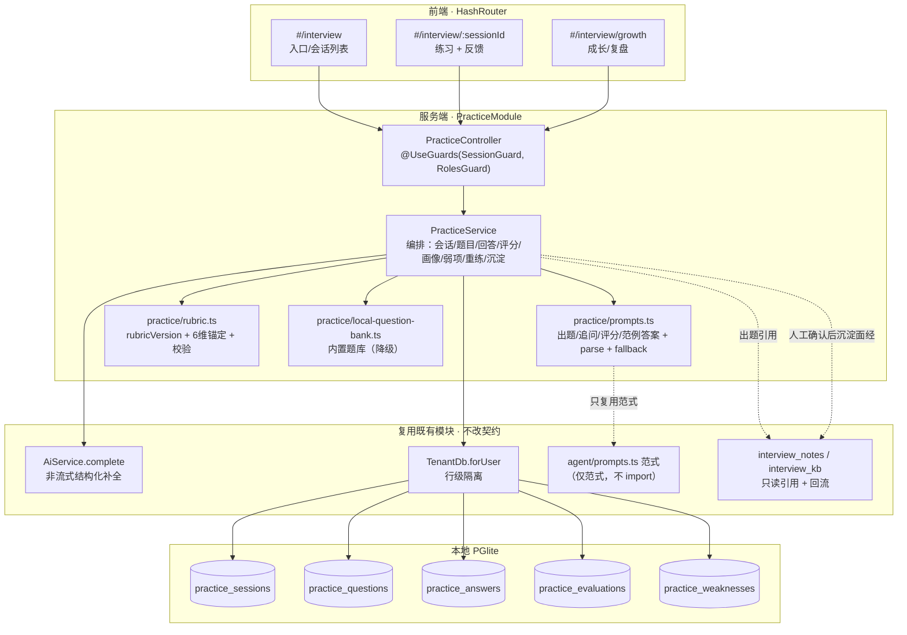
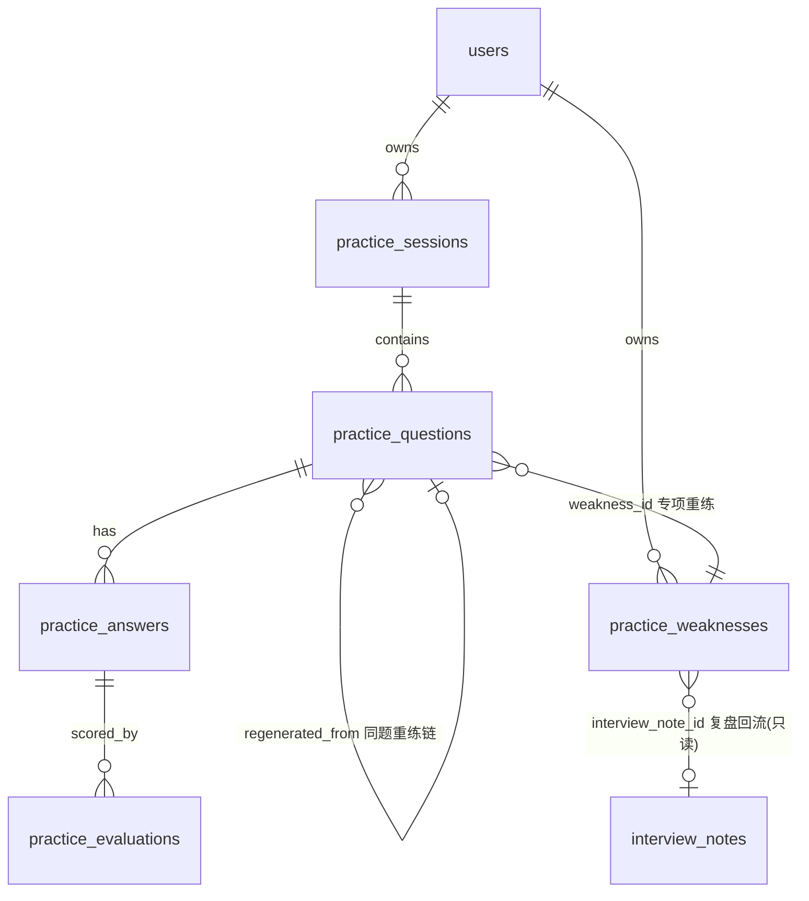
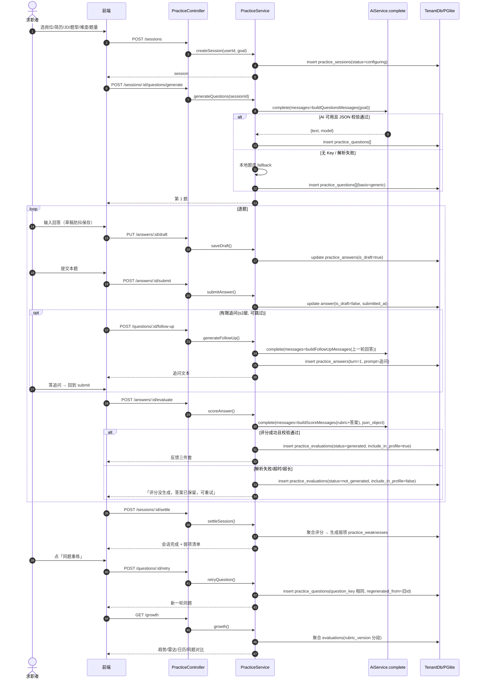
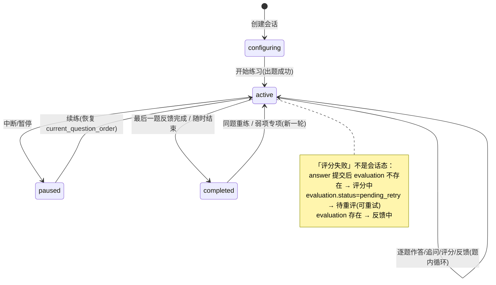
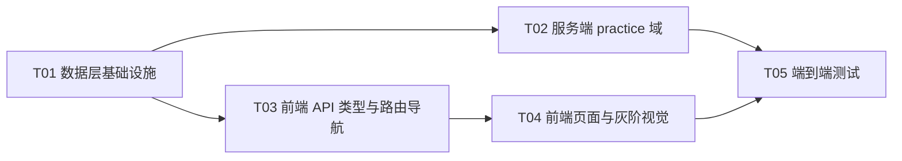

# AI 面试练习 · 增量技术设计方案

> **建议编号**：N14（接续 N13，与 PRD 一致）　**状态**：设计评审稿　**类型**：纯增量（不改既有 4 个 agent action、不改 review-interview / kb-ask）
> **上游输入**：`docs/需求文档/AI面试练习-完整PRD.md`（§6 闭环 / §8 状态流转 / §10.1 P0 验收 / §11 视觉口径 / §12 数据实体草案 / §15 工程护栏 / §16 Q1–Q14）
> **设计原则**：简单、纯增量、零新增依赖、少表 jsonb、可验收可测试。

---

## 0. 执行摘要（给工程师的一页速读）

1. **纯增量、零新增 npm 依赖**。全部 AI 能力复用 `AiService.complete`（非流式结构化补全），图表用纯 SVG/CSS，灰阶视觉用现有 token。
2. **新建独立 `PracticeModule`**（不改 `InterviewModule`，不改 `AgentModule` / 4 个 action）。Prompt 独立成 `src/server/practice/prompts.ts`，不污染 `agent/prompts.ts`。
3. **5 张新表**（`practice_sessions` / `practice_questions` / `practice_answers` / `practice_evaluations` / `practice_weaknesses`），迁移 `drizzle/0016_practice.sql`，**本期全量接入云同步**（change_log 增量 + HLC + 软删除，用户已拍板）。能力画像（⑥ 弱项之外）**不落表**，由服务层从评分实时聚合。
4. **全部 AI 操作非流式**（出题/追问/评分/范例答案都是结构化 JSON，服务端校验后才落库）；**无新增 SSE 端点**（SSE 仅保留现有 `/api/ai/chat` 试用台）。
5. **前端**：HashRouter 新增 `#/interview` / `#/interview/:sessionId` / `#/interview/growth`，3 个页面 + 灰阶 SVG 图表组件 + 一个纯函数文本 diff。
6. **落地顺序**：T01 数据层 → T02 服务端 practice 域 → T03 前端类型与路由 → T04 前端页面与灰阶视觉 → T05 端到端测试。

---

## 1. 实现方案与框架选型

### 1.1 核心结论

本需求是**纯增量**：现状「场景化 AI 动作 + 面试事实沉淀已就绪」，缺的是「练习过程」与「反馈闭环」。因此：

- **复用**：`AiModule`（注入 `AiService`）、agent 的「服务端拼 prompt → `complete` → `parseJsonLoose` → 白名单归一化 → fallback 降级」范式、interview 的「TenantDb.forUser 行级隔离 + 复合主键 + 跨用户 404」血缘、前端 SSE 消费范式（仅作参考，本期不新增 SSE）。
- **新增**：`PracticeModule` + 5 张表 + 3 个前端页面。
- **不动**：`src/server/agent/` 4 个 action 契约、`review-interview` / `kb-ask`、`interview_notes` / `interview_kb` 现状、`styles.css` 全局 token。

### 1.2 复用清单（精确到模块）

| 现有资产 | 复用方式 |
|---|---|
| `AiService.complete(userId, {messages, model, temperature, max_tokens, response_format})` → `{text, model}` | 出题/追问/评分/范例答案**全部走它**；未配置 Key 抛 `AiProxyError(400)`，据此走降级 |
| `AiModule`（`exports: [AiService]`） | `PracticeModule` import `AiModule` 即可注入 `AiService` |
| `agent/prompts.ts` 的 `buildXxxMessages` + `parseJsonLoose` + `normalize*` 白名单范式 | **只复用范式，不 import**；practice 域另写 `practice/prompts.ts` |
| `TenantDb.forUser(userId)` | 所有新表查询唯一入口，禁止 controller 手写 where |
| `interview.service.ts` 的 `newId(prefix)`、`optStr/optId/strArr`、`requireXxx`→404 范式 | 照抄到 `PracticeService` |
| `ai.controller.ts` 的 `rethrow(e)`（`AiProxyError`→`HttpException`） | 照抄到 `PracticeController` |
| `ApiPlayground.tsx:41-108` 的 SSE 消费 | **仅作前端心智参考**；本期 practice 不新增 SSE |
| `drizzle/0015_referrals.sql` | 作为新迁移的「建表 + 索引」格式模板（**但不复制触发器**，见 §2.5） |

### 1.3 新增模块划分

```
src/server/practice/
├── practice.module.ts        # 声明 controllers + providers，imports: [AuthModule, AiModule]
├── practice.service.ts       # 编排：会话/题目/回答/评分/画像聚合/弱项/重练/沉淀
├── practice.controller.ts    # REST 端点，@UseGuards(SessionGuard, RolesGuard)
├── prompts.ts                # 出题/追问/评分/范例答案的 messages 组装 + parse + fallback（纯函数）
├── rubric.ts                 # RUBRIC_VERSION / PROMPT_VERSION / 6 维锚定 / 评分 JSON TS 类型 + 校验
└── local-question-bank.ts    # 内置本地题库（无 Key / 断云降级用）
```

**为什么这样划分（裁决结论）**：

1. **独立 `PracticeModule`，不扩展 `InterviewModule`**：`InterviewModule` 是「复盘记录 + 面经库」的**事实沉淀**（CRUD + 本地检索），`PracticeModule` 是「练习过程 + 反馈闭环」的**编排 + 多轮会话 + AI 评分**。两者生命周期、状态机、数据模型完全不同，混在一起会让 `interview.service.ts` 变成一个「既要 CRUD 又要管 AI 多轮」的上帝对象。独立模块也让回归测试边界清晰（不碰 `interview.e2e.test.ts` 的既有断言）。

2. **不拆成 4 个 agent action**：出题/追问/评分/范例答案强耦合练习会话的「上下文状态」（session/question/answer 的多轮血缘），不是 4 个独立、可复用的场景动作。若塞进 `agent/` 会破坏「AgentModule 不导出、4 action 契约稳定」的现状，且会污染 `agent/prompts.ts`。因此**新建 `practice` 域**，4 个能力作为 `PracticeService` 的私有方法，共用 `practice/prompts.ts` 一个文件内的 4 组 `buildXxxMessages`。

### 1.4 关键裁决总表

| 裁决点 | 结论 | 一句话理由 |
|---|---|---|
| 表数量 | **5 张**（会话/题目/回答/评分/弱项），画像不落表 | 少表 + jsonb 承载可变结构；画像可随时从评分重算，落表反而引入一致性问题 |
| 模块 | **新建 `PracticeModule`** | 与 InterviewModule（事实沉淀）生命周期/状态机完全不同 |
| 动作归属 | **新建 practice 域 + 独立 prompt 文件** | 不污染 agent 契约；4 能力强耦合会话上下文，不进 agent |
| 出题/追问/评分/范例答案是否流式 | **全部非流式**（`AiService.complete`） | 结构化 JSON 需服务端校验后才落库，流式无 UX 收益、徒增复杂度；SSE 仅保留现有试用台 |
| 草稿持久化 | 存 `practice_answers`（`is_draft=true`），前端 800ms 防抖 + blur + beforeunload 触发 | 复用「草稿/正式」二态，草稿不计入画像，续练恢复原文本 |
| 无 Key/断云降级 | 内置题库（代码常量）+ 自评（`source='self'`）与 AI 评分（`source='ai'`）**分列存储、不混算** | 自评 `include_in_profile=false`，趋势只算 `source='ai'` |
| 成长页图表 | **纯 SVG/CSS 零依赖** | 折线/雷达/日历/徽章均手绘；同题 diff 用前端纯函数 LCS 单词级 diff |

### 1.5 整体架构图



---

## 2. 数据模型

### 2.1 表数量裁决：6 类实体 → 5 张表

PRD §12 给了 6 类实体（①会话 ②题目 ③回答 ④评分 ⑤能力画像 ⑥弱项清单）。落地为 **5 张表**：

| PRD 实体 | 落地 | 理由 |
|---|---|---|
| ① 练习会话 | `practice_sessions` | 一表 |
| ② 题目 | `practice_questions` | 一表；同题重练链（`question_key` + `regenerated_from`）落这里 |
| ③ 回答（含追问轮次） | `practice_answers` | 一表；`turn` 0=首答 / 1..n=追问轮，追问文本存 `prompt` 字段，与回答同表 |
| ④ 评分 | `practice_evaluations` | 一表；**与回答分表**（评分只增不改 + 需要「同一答案重评不覆盖」，独立表更干净，且自评/AI 评分同表不同 source 列） |
| ⑤ 能力画像 | **不落表**（读模型，实时聚合） | 画像 = 评分按维度的聚合投影，可从 `practice_evaluations` 重算；落表需维护一致性、还要处理跨版本分段，得不偿失 |
| ⑥ 弱项清单 | `practice_weaknesses` | 一表；有生命周期状态（待复习/已重练/已收敛）+ 人工确认，需持久化 |

**倾向说明**：遵循「少表、jsonb 承载可变结构、避免过度建模」。可变结构（出题依据、目标快照、评分维度数组、改进动作数组、校准标注）一律 jsonb；只有「需要被 WHERE / ORDER BY / 索引命中」的列才开独立列。

### 2.2 表结构

> 通用约定：`id` 均为 `text`（前缀 + 18 hex，复用 `newId('ps')` 范式）；`user_id` 均为 `uuid REFERENCES users(id) ON DELETE CASCADE`；**主键一律复合键 `(user_id, id)`**（与项目铁律一致）。时间戳：`created_at` / `updated_at` 为本机墙钟，仅展示排序用。
>
> **同步三元组（本期全量接入云同步，用户已拍板）**：5 张表**均**带 `hlc text NOT NULL DEFAULT ''` + `device_id text NOT NULL DEFAULT 'local'` + `deleted_at timestamptz null` 三列，由 0010/0011 的 `ca_business_row_guard`（BEFORE）与 `ca_record_business_change`（AFTER）触发器统一授时与记账，**应用层绝不手写时钟**。读走 `active()`（自动过滤 `deleted_at IS NULL`）、删走 `softDelete()`、建走 `revive()`。各表下方不再逐列重复三元组，仅标注 `syncCols()`。

#### 表 1：`practice_sessions`（练习会话）

| 字段 | 类型 | 说明 |
|---|---|---|
| `id` | text | `ps_<hex>` |
| `user_id` | uuid | 行级隔离 |
| `status` | text enum | `configuring` / `active` / `paused` / `completed`（无「失败」，见 §4） |
| `application_id` | text null | 关联投递记录（只读引用，可空；复合键原因不加 FK） |
| `resume_id` | text null | 关联简历（只读引用，可空） |
| `goal` | jsonb | 目标快照：`{jdText, jdId, questionType, difficulty, questionCount, sourceTags[], rubricVersion, promptVersion, modelId, questionSource}` |
| `current_question_order` | int | 续练定位：当前题序（0-based） |
| `usage` | jsonb | 本次 AI 调用摘要 `{calls, tokensEstimate, models[]}` |
| `started_at` | timestamptz null | 开始练习时间 |
| `completed_at` | timestamptz null | 完成时间 |
| `created_at` / `updated_at` | timestamptz | 墙钟 |
| `hlc` / `device_id` / `deleted_at` | `syncCols()` | 同步三元组（触发器授时，应用层不写） |

索引：`(user_id)`、`practice_sessions_user_status_idx (user_id, status)`、`practice_sessions_active_idx (user_id) WHERE deleted_at IS NULL`。

#### 表 2：`practice_questions`（题目）

| 字段 | 类型 | 说明 |
|---|---|---|
| `id` | text | `pq_<hex>` |
| `user_id` | uuid | 隔离 |
| `session_id` | text | 所属会话 |
| `order` | int | 题序（0-based） |
| `question_key` | text | **稳定题标识**（同题重练跨会话共享），首答生成一次 |
| `question` | text | 题干 |
| `type` | text | 题型：`behavioral` / `project` / `hr` / `system_design` |
| `dimension` | text null | 关联能力维度 `D1..D6`（专项题绑定弱项维度） |
| `difficulty` | text | `standard` / `easy` / `hard` |
| `basis` | jsonb | 出题依据：`{source: 'resume'|'jd'|'kb'|'interview_note'|'generic', refId?, excerpt?}` |
| `max_follow_ups` | int | 追问层数上限（默认 2） |
| `skipped` | boolean | 是否被跳过 |
| `regenerated_from` | text null | 同题重练链：指向上一次 `practice_questions.id`（首答为 null） |
| `weakness_id` | text null | 弱项专项重练：关联 `practice_weaknesses.id` |
| `created_at` / `updated_at` | timestamptz | 墙钟 |
| `hlc` / `device_id` / `deleted_at` | `syncCols()` | 同步三元组（触发器授时，应用层不写） |

索引：`(user_id, session_id, order)`、`(user_id, question_key)`（同题对比查询）、`practice_questions_active_idx (user_id) WHERE deleted_at IS NULL`。

#### 表 3：`practice_answers`（回答轮次，含追问）

| 字段 | 类型 | 说明 |
|---|---|---|
| `id` | text | `pa_<hex>` |
| `user_id` | uuid | 隔离 |
| `session_id` | text | 冗余便于按会话取全部 |
| `question_id` | text | 所属题目 |
| `turn` | int | **0 = 首答，1..n = 追问轮** |
| `prompt` | text | 本轮的面试官提问/追问文本（turn 0 时 = 题干快照） |
| `answer` | text | 用户回答正文（草稿/正式共用此列） |
| `is_draft` | boolean | 草稿标志（`true` = 未提交，不计入画像、不触发评分） |
| `word_count` | int | 篇幅代理指标 |
| `para_count` | int | 篇幅代理指标 |
| `submitted_at` | timestamptz null | 提交时间（草稿为 null） |
| `created_at` / `updated_at` | timestamptz | 墙钟（草稿更新会刷新 updated_at） |
| `hlc` / `device_id` / `deleted_at` | `syncCols()` | 同步三元组（触发器授时，应用层不写） |

索引：`(user_id, question_id, turn)`、`(user_id, session_id, question_id)`、`practice_answers_active_idx (user_id) WHERE deleted_at IS NULL`。

#### 表 4：`practice_evaluations`（评分）

| 字段 | 类型 | 说明 |
|---|---|---|
| `id` | text | `pe_<hex>` |
| `user_id` | uuid | 隔离 |
| `answer_id` | text | 被评分的回答 |
| `question_id` | text | 冗余便于按题/维度聚合 |
| `source` | text enum | **`ai` / `self`**（自评与 AI 评分分列，不混算） |
| `status` | text enum | `generated` / `pending_retry` / `not_generated`（仅 `source='ai'` 有意义；self 恒 `generated`） |
| `rubric_version` | text | 冻结的 `rubricVersion`（跨版本不混算） |
| `prompt_version` | text | 评分 prompt 版本 |
| `model_id` | text null | 上游模型标识（`source='self'` 为 null） |
| `dimensions` | jsonb | 6 维评分数组（schema 见 §2.3） |
| `strengths` | jsonb | 「做得好」字符串数组（置顶） |
| `actions` | jsonb | 可执行改进动作数组（动词句 + 可替换片段） |
| `sample_answer` | text null | 参考范例答案（标注「示范非标准」） |
| `summary` | text null | 一句话总评 |
| `include_in_profile` | boolean | 是否计入画像（仅 `source='ai' && status='generated'` 为 true；自评/失败恒 false） |
| `calibration` | jsonb null | 用户校准标注：`{dimension, reason, at}`（「这档不准」，不自动改分） |
| `created_at` / `updated_at` | timestamptz | 墙钟 |
| `hlc` / `device_id` / `deleted_at` | `syncCols()` | 同步三元组（触发器授时，应用层不写） |

索引：`(user_id, answer_id)`、`(user_id, question_id)`、`(user_id, rubric_version, created_at)`（趋势聚合）、`practice_evaluations_active_idx (user_id) WHERE deleted_at IS NULL`。

#### 表 5：`practice_weaknesses`（弱项清单/待复习项）

| 字段 | 类型 | 说明 |
|---|---|---|
| `id` | text | `pw_<hex>` |
| `user_id` | uuid | 隔离 |
| `source` | text | 来源：`dimension` / `question` / `interview_note` |
| `dimension` | text null | 维度 `D1..D6`（来源为维度时） |
| `question_id` | text null | 关联题目（来源为题时） |
| `interview_note_id` | text null | 关联真实面试复盘（来源为复盘时） |
| `reason` | text | 判定理由（可解释） |
| `status` | text enum | `pending`（待复习）/ `practiced`（已重练）/ `resolved`（已收敛） |
| `last_practice_at` | timestamptz null | 最近一次练习时间 |
| `last_level` | int null | 最近一次档位 |
| `created_at` / `updated_at` | timestamptz | 墙钟 |
| `hlc` / `device_id` / `deleted_at` | `syncCols()` | 同步三元组（触发器授时，应用层不写） |

索引：`(user_id, status)`、`(user_id, dimension, status)`、`practice_weaknesses_active_idx (user_id) WHERE deleted_at IS NULL`。

### 2.3 评分 JSON 精确 Schema（TS 类型 + 示例）

**位置**：`src/server/practice/rubric.ts`。字段顺序上 `reason` 排在 `level` 之前（降打分漂移），服务端按契约校验，字段顺序不依赖 LLM 输出顺序（校验后归一化）。

```ts
export const RUBRIC_VERSION = 'v1';     // 维度定义/锚定样例打包版本，升级即换新常量
export const PROMPT_VERSION = 'v1';     // 评分 prompt 模板版本，改动即 +1 并留存历史

export type DimensionCode = 'D1' | 'D2' | 'D3' | 'D4' | 'D5' | 'D6';

export interface RubricDimension {
  code: DimensionCode;
  name: string;
  // 每档文字锚（1~4）
  anchors: Record<'1' | '2' | '3' | '4', string>;
  // 每档一条 worked example（可虚构，禁止用用户真实数据）
  workedExamples: Record<'1' | '2' | '3' | '4', string>;
}

export const RUBRIC_DIMENSIONS: RubricDimension[] = [
  { code: 'D1', name: '结构与完整性', anchors: { /* ... */ }, workedExamples: { /* ... */ } },
  // D2 相关性与岗位匹配 / D3 证据具体性 / D4 表达清晰与简洁 / D5 逻辑自洽与抗压 / D6 篇幅与时间控制
];

// LLM 输出的评分契约（reason 先于 level）
export interface DimensionScore {
  dimension: DimensionCode;
  level: 1 | 2 | 3 | 4;
  reason: string;   // 为什么这档（排在 level 之前）
  evidence: string; // 引用答案原文片段
}

export interface PracticeScore {
  dimensions: DimensionScore[]; // 恰好 6 条，每维一条
  strengths: string[];          // ≥1 条「做得好」（置顶）
  actions: string[];            // ≥1 条可执行改进动作
  sampleAnswer: string;         // 参考范例（标注「示范，非标准答案」）
  summary: string;              // 一句话总评
}
```

**示例 JSON**（落库 `practice_evaluations.dimensions/strengths/actions` 的原始形态）：

```json
{
  "dimensions": [
    { "dimension": "D1", "reason": "有 Situation 与 Action，但缺 Result 与反思，Action 未占主体", "evidence": "「我们最终把功能上线了」", "level": 2 },
    { "dimension": "D2", "reason": "例子难度与目标岗位相当，直击问题", "evidence": "「针对高并发写入我重写了缓存层」", "level": 3 },
    { "dimension": "D3", "reason": "有具体场景但缺少可核验数字与个人动作区分", "evidence": "「我们上线了」", "level": 2 },
    { "dimension": "D4", "reason": "主线清晰，20 秒内成立，无冗余", "evidence": "开场即点明时间与背景", "level": 3 },
    { "dimension": "D5", "reason": "因果成立，被追问后能补充", "evidence": "「回滚从 40 分钟压到 5 分钟」", "level": 3 },
    { "dimension": "D6", "reason": "篇幅适中，要点密度合理", "evidence": "全文约 180 字，3 段", "level": 3 }
  ],
  "strengths": ["开场直接给出了具体时间与背景", "对技术方案的选择给了理由"],
  "actions": ["把第 2 段的「我们最终上线」改成「我主导灰度方案，把回滚时间从 40 分钟压到 5 分钟」——补上你个人的动作和一个数字"],
  "sampleAnswer": "（AI 生成的示范，基于你的简历与 JD，不是标准答案，请用自己的话重说）……",
  "summary": "结构完整，但 Action 与 Result 缺失，需补充个人动作与量化结果。"
}
```

**服务端校验规则**（`rubric.ts` 导出 `normalizeScore(raw): PracticeScore | null`）：
- `dimensions` 必须恰好 6 条，`dimension` 覆盖 `D1..D6` 且不重复；
- `level` 必须是 1..4 整数；
- `reason` / `evidence` 非空字符串；
- `actions` 至少 1 条非空；
- 任一不满足 → 返回 `null` → 判「未生成」（`status='not_generated'`），不落画像。

### 2.4 ER 关系图



> 注：所有业务表均含 `user_id`，真实主键为 `(user_id, id)` 复合键；ER 图仅为血缘示意。`application_id` / `resume_id` 为只读引用（不加 FK，与 `companies` 复合键现状一致）。

### 2.5 云同步决策（Q7 —— 已定：本期全量接入）

**用户已拍板：5 张新表本期全量接入现有云同步**（change_log 增量 + HLC + 软删除），**不再**走 `ai_usage` 的「纯本地」定位。理由：练习记录/评分是「用户成长资产」，需跨设备保留、重装可恢复（PRD Q7 从默认「不纳入」翻转为「纳入」）。

**表归类裁决：每张都是「可变实体表」，全量接入，不设「只同步不恢复」的新类别**：

| 表 | 归类 | 是否软删 | 是否进 RESTORABLE | 原因（可变业务列 → 需 LWW + 冲突留底） |
|---|---|---|---|---|
| `practice_sessions` | 实体表 | ✅ softDelete | ✅ | `status` / `current_question_order` / `goal` / `usage`（暂停/续练/完成、删会话级联） |
| `practice_questions` | 实体表 | ✅ softDelete | ✅ | `skipped`（同题链 anchor；随会话级联软删，重练是新建行+复用 `question_key`，与软删无关） |
| `practice_answers` | 实体表 | ✅ softDelete | ✅ | `is_draft` / `answer` / `submitted_at` / `word_count` / `para_count`（草稿反复 UPDATE；追问 turn 是 INSERT 新行） |
| `practice_evaluations` | 实体表 | ✅ softDelete | ✅ | `calibration`（「这档不准」标注）/ `status`（pending_retry→generated/not_generated） |
| `practice_weaknesses` | 实体表 | ✅ softDelete | ✅ | `status`（pending→practiced→resolved）/ `last_practice_at` / `last_level` |

**为什么全部进 `RESTORABLE_TABLES`（不拆「只同步不恢复」）**：
1. 现有 `restore.ts:22-25` 注释明确：只有「有 `(user_id,id)` 复合主键、支持软删除」的可变实体表才可恢复；`versions`/`application_events`/`settings`/`ai_configs` 是流水/单例、「没有可安全覆盖的行身份」，**根本不进任何白名单**（它们的 change_log 被游标跳过，属有意行为）。
2. 这 5 张表每张都有至少一个可变业务列（草稿、校准、状态迁移、跳过标记），跨设备编辑需要 LWW 冲突解决 + `conflict_snapshots` 留底，因此必须可人工恢复。
3. 「历史回答与评分只增不改」是**产品语义**（不提供编辑入口），不是 DB 层不可变——草稿提交、评分重试、校准标注都是合法 UPDATE。
4. 引入「进 `SYNCED_TABLES` 但不进 `RESTORABLE_TABLES`」的新类别无既有先例、徒增工程师心智负担；全量实体表与现有 9 张实体表模式完全一致，最不易出错。

**触发器下「只增不改但带 UPDATE」的表如何表现（工程师重点）**：

`ca_business_row_guard`（BEFORE）与 `ca_record_business_change`（AFTER）对 INSERT 与 UPDATE **一视同仁**，不存在「只增」与「可变」的分支：
- 本地写（草稿 UPDATE、状态流转 UPDATE、追问 INSERT）→ 一律 `NEW.hlc := ca_hlc_next()` 领新号 + `device_id`；
- AFTER 记账 → INSERT/UPDATE 都写 `op='upsert'` 增量；软删除（`deleted_at` null→非null）写 `op='delete'`；
- 跨设备并发 UPDATE → 回灌时仅当 `OLD.device_id IS DISTINCT FROM NEW.device_id` 才做 LWW（`NEW.hlc > OLD.hlc`），胜者生效、败者整行落 `conflict_snapshots`（可人工恢复）；同设备多次写（device_id 相同）直接 `RETURN NEW`，不会误判冲突。

因此：answers 的草稿每次保存 = 一条 upsert 增量、正常同步；weaknesses 状态流转 = 一条 upsert、正常同步；追问 turn 是 INSERT 新行、正常同步。**没有任何表需要特殊处理**——挂上 syncCols + 两个触发器 + 进白名单后，行为与现有 9 张实体表完全一致。「只增不改」只是产品语义（不提供编辑入口），不是 DB 层不可变。

⚠️ 澄清给工程师：现有真正的「流水表」（`versions`/`application_events`/`settings`/`ai_configs`）之所以「只增不删 / 不同步」，是它们**故意不进白名单**（change_log 增量被同步游标跳过，属有意行为）。用户已拍板 5 张练习表「全量同步」，所以它们**必须按实体表处理（进 3 白名单）**；若按「流水」处理（不进白名单）= 不同步，与用户拍板矛盾。

**本期必做的 7 处接入**（与 context-scout 摸底结论一致）：
1. `src/server/db/schema.ts`：5 个 `pgTable` 展开 `...syncCols()`，并登记 `schema` 对象（`primaryKey({columns:[userId,id]})` 已具备）；
2. `drizzle/0016_practice.sql`：5 表加 `hlc` / `device_id` / `deleted_at` 三列 + `*_active_idx`（`WHERE deleted_at IS NULL`）部分索引 + 复用既有函数挂两个触发器（`ca_business_row_guard` BEFORE INSERT/UPDATE、`ca_record_business_change` AFTER INSERT/UPDATE/DELETE，照 `0015_referrals.sql` 模板，不重定义函数体）；
3. `src/server/tenant/tenant-db.ts`：5 组方法改走 `active()` 读过滤 + `softDelete()` 删 + `revive()` 建（不再是无软删除语义）；
4. `src/server/sync/engine.ts:55` `SYNCED_TABLES` 加 5 行；
5. `src/server/sync/sync-import.ts:32` `SYNC_TABLES` 加 5 行；
6. `src/server/sync/restore.ts:26` `RESTORABLE_TABLES` 加 5 行；
7. `src/server/sync/engine.ts:69` `TIMESTAMP_KEYS` 补 4 个新 timestamptz 列：`startedAt` / `completedAt`（sessions）、`submittedAt`（answers）、`lastPracticeAt`（weaknesses）；敏感列复核——5 表**不含** `api_key`/`password_hash`/`token_hash`/`ip`/`user_agent`，无需改 `ca_safe_row_json`/`restore.ts` 剔除集。

> 🔴 **强制约束（禁止「半接入」）**：触发器 + 三处白名单（`SYNCED_TABLES`/`SYNC_TABLES`/`RESTORABLE_TABLES`）+ `TIMESTAMP_KEYS` 必须**在同一次改动全部落地**。原因：`engine.ts:281` `changeToEvent` 对不在 `SYNCED_TABLES` 的实体返回 `null`，但 `incrementalPush`（`engine.ts:249-274`）仍会 `lastCursor = change.hlc` 推进游标——若只挂触发器却漏加白名单，这些增量会被**静默吞掉且游标越过，永不补传、不报错**（`0013_sync_state.sql:6-9` 注释已说明此为已知行为）。

---

## 3. API 契约

### 3.1 通用约定

- **前缀**：全部 `@Controller('api/practice')`（与 `/api/ai`、`/api/agent` 平级）。
- **返回格式**：沿用现有「直接返回对象/数组」，**不引入** `{code,data,message}` 信封（与全项目一致）。
- **错误码**：Nest 标准异常 → Fastify 序列化 `{statusCode, message, error}`；`AiProxyError` 用 `rethrow()` 转 `HttpException`（保留 `e.status` 与 `e.code`）。语义：404 = 资源不存在或跨用户；400 = 入参非法/未配置 AI；504/502 = 上游超时/失败（`AiProxyError`）。
- **幂等**：`POST` 创建资源每次生成新 `id`（非幂等，正常语义）；`PUT /sessions/:id/status`（暂停/续练/完成）与 `PUT /answers/:id/draft` 幂等（重复提交同状态无害）；「重新评分」=`POST /evaluations` 产生**新评分行**，不覆盖（历史只增不改）。
- **行级隔离**：所有端点经 `TenantDb.forUser(user.id)`，跨用户返回 404（P0-1 AC4 / P0-12 AC4）。

### 3.2 端点清单

| Method | 路径 | 入参（body/query） | 出参 | 说明 / 走 AI 方式 |
|---|---|---|---|---|
| GET | `/api/practice/sessions` | — | `Session[]` | 会话列表（按 updated_at desc） |
| POST | `/api/practice/sessions` | `{applicationId?, resumeId?, jdText?, questionType, difficulty, questionCount}` | `Session` | 创建会话（`status='configuring'`），落目标快照 |
| GET | `/api/practice/sessions/:id` | — | `Session` + 题目/回答树 | 会话详情（续练恢复用） |
| PUT | `/api/practice/sessions/:id/status` | `{status: 'active'\|'paused'\|'completed'}` | `Session` | 状态转移（幂等） |
| POST | `/api/practice/sessions/:id/questions/generate` | `{count?}` | `Question[]` | **出题**：非流式 `AiService.complete`（`response_format:{type:'json_object'}`）；无 Key/解析失败 → 本地题库 fallback |
| POST | `/api/practice/questions/:id/follow-up` | `{answerId}` | `Answer`（追问 prompt 落库） | **追问**：非流式，引用上一轮回答，STAR 缺项补齐，≤2 层 |
| POST | `/api/practice/questions/:id/answers` | `{answer}` | `Answer` | 提交首答（`turn=0, is_draft=false`），触发评分 |
| PUT | `/api/practice/answers/:id/draft` | `{answer}` | `Answer` | **草稿保存**（防抖），`is_draft=true`，不评分 |
| POST | `/api/practice/answers/:id/submit` | `{answer}` | `Answer` | 草稿转正式（或提交追问答案），置 `submitted_at` |
| POST | `/api/practice/answers/:id/evaluate` | — | `Evaluation` | **评分**：非流式，6 维 JSON + 校验；失败返回 `{status:'not_generated'}` 不写画像 |
| POST | `/api/practice/answers/:id/self-evaluate` | `{dimensions}` | `Evaluation` | **自评**：`source='self'`，`include_in_profile=false` |
| POST | `/api/practice/answers/:id/sample-answer` | — | `{sampleAnswer}` | **范例答案**：非流式，基于简历+JD，事实护栏 |
| POST | `/api/practice/questions/:id/retry` | — | `Question` | **同题重练**：复制 `question_key`，设 `regenerated_from` |
| GET | `/api/practice/growth` | `query: rubricVersion?, from?, to?` | 聚合结果 | 画像/趋势/雷达/日历/里程碑数据（服务端聚合） |
| GET | `/api/practice/weaknesses` | — | `Weakness[]` | 弱项清单 |
| POST | `/api/practice/weaknesses` | `{source, dimension?, questionId?, interviewNoteId?, reason}` | `Weakness` | 生成弱项（会话结束/人工确认） |
| PUT | `/api/practice/weaknesses/:id/status` | `{status}` | `Weakness` | 待复习→已重练→已收敛 |
| POST | `/api/practice/sessions/:id/settle` | — | `{weaknesses, profile}` | **沉淀**：会话结束写弱项 + 返回画像摘要 |
| POST | `/api/practice/sessions/:id/export-kb` | `{title, category, tags}` | `KbItem` | **人工确认后**沉淀面经（调 `InterviewService.createKb`，带来源会话引用） |

### 3.3 关键时序图（创建会话 → 出题 → 作答 → 追问 → 评分 → 写画像 → 重练对比）



### 3.4 流式决策

- **出题 / 追问 / 评分 / 范例答案：全部非流式**（`AiService.complete`）。原因：四者都是「提交 → 服务端组装 prompt → 完整 JSON → 校验 → 落库 → 一次性返回」的结构化动作，流式对「等待看结果」的练习场景没有 UX 收益，却要引入「边流边解析 JSON、半截输出如何落库、如何断点续传」的复杂度。
- **不新增 SSE 端点**。现有 `/api/ai/chat`（SSE 透传试用台）保持不变，与 practice 无关。

---

## 4. 状态机落地（PRD §8 → DB 字段 + 转移规则）

PRD §8 的 7 个状态（配置中/作答中/追问中/评分中/反馈中/已完成/已暂停 + 评分失败→待重评）拆成**两层**落库：

### 4.1 会话级（持久化粗粒度）：`practice_sessions.status`

| 状态值 | 语义 | 覆盖的 PRD 细粒度 |
|---|---|---|
| `configuring` | 配置中（已建会话，未出题/未开始） | 配置中 |
| `active` | 进行中（作答中/追问中/评分中/反馈中） | 作答中 + 追问中 + 评分中 + 反馈中 |
| `paused` | 已暂停（可续练） | 已暂停 |
| `completed` | 已完成 | 已完成 |

> 作答中/追问中/评分中/反馈中**不持久化**，由前端 UI 态 + 数据可推导：`(answer 已提交 && 无 evaluation) → 评分中`；`(evaluation.status='pending_retry') → 待重评`；`(evaluation 存在) → 反馈中`。这样避免把瞬态写进 DB 造成一致性问题。

### 4.2 评分级（append-only）：`practice_evaluations.status` + `source`

| 字段组合 | 语义 |
|---|---|
| `source='ai', status='generated'` | AI 评分成功，`include_in_profile=true` |
| `source='ai', status='pending_retry'` | 评分失败待重评（可重试，不产低分不写画像） |
| `source='ai', status='not_generated'` | 放弃评分（标注未生成，答案保留） |
| `source='self', status='generated'` | 用户自评，`include_in_profile=false` |

### 4.3 转移规则 + 状态图



转移规则要点（对照 PRD AC）：
- `active → paused`：**不触发评分、不写画像**（P0-4 AC3）；`current_question_order` 与草稿 `practice_answers` 保留。
- `active → completed`：允许「随时结束并查看已有反馈」（P0-3 / N4）。
- `completed → active`：同题重练/弱项专项开启新一轮，**继承原题/JD/简历/rubricVersion**（P0-8 AC1）。
- **刻意没有「失败/未通过」态**（N5）。

---

## 5. Prompt 设计要点（只写结构约定，不写完整 prompt）

### 5.1 与现有 `prompts.ts` 的关系

**新增文件** `src/server/practice/prompts.ts`，**不复用、不修改** `agent/prompts.ts`。理由：agent 的 4 action 契约需保持字节级稳定（`review-interview` / `kb-ask` 有既有 e2e 断言按 prompt 关键词 mock），practice 的 4 组 prompt 语义、字段、护栏完全不同。但**复用同一套范式**：`buildXxxMessages` 纯函数 + `parseJsonLoose`（从 `agent/prompts.ts` 复制该函数或抽公共，建议本期直接复制一份到 practice 保持解耦）+ 白名单归一化 + fallback。

### 5.2 四个 prompt 的结构约定

| Prompt | system 核心指令 | user 注入内容 | 输出 JSON 契约 | 护栏 |
|---|---|---|---|---|
| **出题** `buildQuestionsMessages` | 「面试官，只基于材料出题，一次只出 1~N 道，不编造经历/公司/数字」 | 目标快照（简历片段 + JD + 投递阶段 + 面经片段 + 复盘弱项） | `{questions: [{question, type, dimension, basis, difficulty}]}` | 事实护栏：题干不得出现材料外的事实；`basis` 标明来源片段 |
| **追问** `buildFollowUpMessages` | 「必须引用上一轮回答的具体内容，按 STAR 缺项（S/T/A/R/Reflection）补齐，≤2 层，证据够了就停」 | 题干 + 上一轮回答全文 + 已追问层数 | `{followUp, target, enough}` | `enough=true` 时停止追问；不因答得短而无限追问 |
| **评分** `buildScoreMessages` | 「你是 rubric 执行器；固定 6 维 1–4 锚；每维先写 reason 再写 level；evidence 必须引用原文；**不因答案更长/格式更漂亮/语气更自信而加分**；不奖励空洞自信」 | rubric（6 维锚 + 每档 worked example）+ 题干 + 用户答案 | `PracticeScore`（§2.3） | 反冗长/反格式/反自信偏差；reason 先于 level；锚定样例随请求注入 |
| **范例答案** `buildSampleAnswerMessages` | 「基于简历 + JD 生成示范，只引用简历中真实存在的经历，不编造；标注『示范非标准答案』」 | 简历片段 + JD + 题干 | `{sampleAnswer, basedOn: 'resume'|'generic'}` | 事实护栏：不编造数字/公司/时间段 |

### 5.3 版本冻结

- `RUBRIC_VERSION`（`'v1'`）与 `PROMPT_VERSION`（`'v1'`）**常量化在 `rubric.ts`**，随每次评分写入 `practice_evaluations`。
- 维度定义/每档文字锚/锚定样例的改动 = **升级 `RUBRIC_VERSION` 为新常量 + 新增维度数组**，绝不原地改 `v1`（否则历史评分口径漂移）。
- prompt 模板措辞的改动 = 升级 `PROMPT_VERSION`，旧评分保留旧值，成长页跨版本分段、不连线（P0-5 AC5 / P0-10 AC3）。

---

## 6. 文件清单（新增 / 修改 + 一句话职责）

### 6.1 服务端（新增）

| 文件 | 职责 |
|---|---|
| `drizzle/0016_practice.sql` | 建 5 张新表 + 索引 + `hlc/device_id/deleted_at` 三列 + `*_active_idx` 部分索引 + 挂 `ca_business_row_guard`/`ca_record_business_change` 两个触发器（复用 0010/0011 既有函数） |
| `src/server/practice/rubric.ts` | `RUBRIC_VERSION`/`PROMPT_VERSION`/6 维锚定 + 评分 JSON TS 类型 + `normalizeScore` 校验 |
| `src/server/practice/prompts.ts` | 出题/追问/评分/范例答案的 `buildXxxMessages` + `parseJsonLoose` + fallback（纯函数，可单测） |
| `src/server/practice/local-question-bank.ts` | 内置本地题库（题型×难度），无 Key/断云降级出题 |
| `src/server/practice/practice.service.ts` | 编排层：会话/题目/回答/评分/画像聚合/弱项/重练/沉淀面经 |
| `src/server/practice/practice.controller.ts` | REST 端点，`@UseGuards(SessionGuard, RolesGuard)` + `@CurrentUser()` + `rethrow()` |
| `src/server/practice/practice.module.ts` | 声明 controller/service/providers，`imports: [AuthModule, AiModule]` |

### 6.2 服务端（修改）

| 文件 | 修改点 |
|---|---|
| `src/server/db/schema.ts` | 新增 5 个 `pgTable`（含 `...syncCols()`）+ `$inferSelect` 行类型 + 加入 `schema` 导出 |
| `src/server/tenant/tenant-db.ts` | 新增 5 组方法（list/get/create/update/delete）与 `*Input/*Patch` 类型；读走 `active()`、删走 `softDelete()`、建走 `revive()` |
| `src/server/sync/engine.ts` | `SYNCED_TABLES` 加 5 行；`TIMESTAMP_KEYS` 补 `startedAt`/`completedAt`/`submittedAt`/`lastPracticeAt` |
| `src/server/sync/sync-import.ts` | `SYNC_TABLES` 加 5 行 |
| `src/server/sync/restore.ts` | `RESTORABLE_TABLES` 加 5 行 |
| `src/server/app.module.ts` | `imports` 追加 `PracticeModule` |

### 6.3 前端（新增）

| 文件 | 职责 |
|---|---|
| `src/web/pages/Interview.tsx` | `#/interview`：快速开始卡 + 待复习清单 + 最近会话列表 |
| `src/web/pages/InterviewSession.tsx` | `#/interview/:sessionId`：左对话/作答 + 右反馈三件套 + 草稿防抖 + 追问/评分/重练 |
| `src/web/pages/InterviewGrowth.tsx` | `#/interview/growth`：趋势/雷达/里程碑/日历/同题对比 |
| `src/web/pages/interview/charts.tsx` | 纯 SVG 折线/雷达/日历组件（6 级灰 + 线型 + 加粗） |
| `src/web/pages/interview/diff.ts` | 纯函数单词级 diff（LCS），灰底加粗标差异，只读 |
| `src/web/pages/interview/styles.css` | **新增黑白灰样式**（不引彩色 token、不引 `--accent/--success/--danger/--brand-text`） |

### 6.4 前端（修改）

| 文件 | 修改点 |
|---|---|
| `src/web/api.ts` | 新增 practice 相关 TS 类型 + `api/post/put` 便捷函数 |
| `src/web/App.tsx` | 新增 3 条路由（`/interview`、`/interview/:sessionId`、`/interview/growth`） |
| `src/web/Layout.tsx` | `GROUPS` 的「智能工具」组追加 `{ to: '/interview', label: 'AI 面试练习', icon: '▣' }` |

### 6.5 测试（新增）

| 文件 | 职责 |
|---|---|
| `test/practice.e2e.test.ts` | 端到端：会话/出题/作答/追问/评分/画像/重练闭环 + 行级隔离 + 无 Key 降级 + 评分解析失败兜底 + 跨 rubric 版本不混算 |
| `test/practice-prompts.test.ts` | `rubric.ts` 校验 + `prompts.ts` 纯函数 + 本地题库 fallback 单测 |

### 6.6 文档（移交）

| 文件 | 说明 |
|---|---|
| `docs/技术设计方案/AI面试练习-技术设计方案.md` | **本设计文档**（本次唯一落盘交付） |
| 索引登记 | `docs/需求文档/00-需求总览.md` / `README.md` / N7 §七 范围扩张留痕 —— **本次不改**，移交文档维护者（PRD Q12/Q14） |

---

## 7. 有序任务列表（≤5 个，按依赖排序）

> 粒度遵守「每任务 ≥3 文件、按功能分层、首个任务为基础设施、最小化线性链」。T03 与 T02 可并行（API 契约已在 §3 冻结）。

| Task ID | 任务名 | 源文件（创建/修改） | 依赖 | 优先级 |
|---|---|---|---|---|
| **T01** | 数据层基础设施（迁移 + schema + tenant-db + 同步白名单接入 + 评分类型） | 新增 `drizzle/0016_practice.sql`、`src/server/practice/rubric.ts`；修改 `src/server/db/schema.ts`、`src/server/tenant/tenant-db.ts`、`src/server/sync/engine.ts`、`src/server/sync/sync-import.ts`、`src/server/sync/restore.ts` | — | P0 |
| **T02** | 服务端 practice 域（prompt + 题库 + service + controller + module 注册） | 新增 `src/server/practice/prompts.ts`、`local-question-bank.ts`、`practice.service.ts`、`practice.controller.ts`、`practice.module.ts`；修改 `src/server/app.module.ts` | T01 | P0 |
| **T03** | 前端 API 类型与路由导航 | 修改 `src/web/api.ts`、`src/web/App.tsx`、`src/web/Layout.tsx` | T01（契约已冻结，可与 T02 并行） | P0 |
| **T04** | 前端页面与灰阶视觉（练习页/反馈页/成长页 + SVG 图表 + diff + 样式） | 新增 `src/web/pages/Interview.tsx`、`InterviewSession.tsx`、`InterviewGrowth.tsx`、`src/web/pages/interview/charts.tsx`、`diff.ts`、`styles.css` | T03 | P0 |
| **T05** | 端到端测试与回归 | 新增 `test/practice.e2e.test.ts`（含：闭环/行级隔离/无 Key 降级/评分解析失败兜底/跨 rubric 版本不混算/**软删除 + change_log + 跨设备冲突恢复**）、`test/practice-prompts.test.ts`；运行 `npm test` 全量回归并修复 | T02、T04 | P0 |

### 任务依赖图



---

## 8. 依赖包列表

**结论：零新增 npm 依赖。** 验证如下：

| 能力 | 实现 | 是否需新依赖 |
|---|---|---|
| 出题/追问/评分/范例答案 | 复用 `AiService.complete`（OpenAI 兼容转发） | 否（`undici` 已有，`fetch` 原生） |
| 评分 JSON 校验 | 手写白名单归一化（与 agent 范式一致），**不用 zod**（虽已依赖，保持范式统一） | 否 |
| 趋势图/雷达图 | 纯 SVG `polyline`/`polygon` + 6 级灰 + 线型 | 否（不引 recharts/d3） |
| 里程碑/日历 | 纯 CSS 灰阶徽章 + grid | 否 |
| 同题 diff | 前端纯函数 LCS（~50-80 行） | 否 |
| 灰阶视觉 | 现有 `styles.css` 灰阶 token + 新增局部 CSS | 否 |

---

## 9. 共享知识 / 跨文件约定（给工程师）

1. **新表命名与 ID 前缀**：`practice_sessions`(`ps_`)、`practice_questions`(`pq_`)、`practice_answers`(`pa_`)、`practice_evaluations`(`pe_`)、`practice_weaknesses`(`pw_`)；`newId(prefix)` = `prefix + '_' + randomBytes(9).toString('hex')`。
2. **复合主键 + 行级隔离**：所有新表主键 `(user_id, id)`；查询一律 `TenantDb.forUser(userId)`，controller 禁止手写 where；跨用户 404。
3. **同步三元组（全量接入）**：新表挂 `hlc/device_id/deleted_at`（DB 触发器授时，应用层绝不手写时钟）；读一律套 `active()`、删走 `softDelete()`、建走 `revive()`；5 表已进 `SYNCED_TABLES`/`SYNC_TABLES`/`RESTORABLE_TABLES` 三个白名单。
4. **jsonb 结构**：评分 6 维存 `dimensions` jsonb；改进动作存 `actions` jsonb；出题依据存 `basis` jsonb；目标快照存 `goal` jsonb；校准标注存 `calibration` jsonb。schema 见 §2.3。
5. **错误码风格**：沿用 Nest 异常 + `rethrow(AiProxyError→HttpException)`；无自定义 code envelope。
6. **prompt/版本冻结**：`RUBRIC_VERSION`/`PROMPT_VERSION` 常量在 `rubric.ts`；改维度/锚定 = 新版本常量，不原地改 `v1`。
7. **自评 vs AI 评分**：`source` 列区分；趋势/画像只聚合 `source='ai' && status='generated' && include_in_profile=true`。
8. **API 请求头铁律**：前端 `api.ts` 已有（无 body 不声明 JSON Content-Type）；practice 不新增 raw fetch 直连（除复用 SSE 范式外）。
9. **视觉铁律**：新增 `#/interview*` 页面/选择器**严格黑白灰**，不得引用 `--accent/--success/--danger/--brand-text`；不修改 `styles.css` 全局 token、不清理存量彩色；QA 只 grep 新增文件/选择器（PRD §11 裁决）。
10. **迁移流程**：改 `schema.ts` → `npm run db:generate` 出 `drizzle/generated/` 草稿 → 人工审阅后移入 `drizzle/0016_practice.sql` → `applyMigrations` 按文件名序执行；PGlite 单进程铁律：迁移前停 dev。

---

## 10. 待明确事项（收敛 PRD Q1–Q14 + 实现歧义）

> 均给推荐默认值，未确认即按默认执行（不阻塞开发）。

| # | 待明确 | 推荐默认 | 影响面 |
|---|---|---|---|
| **A1**（Q1/Q3/Q8） | 题型范围 / 量表 / 是否可自定义维度 | P0 四类纯文本题（行为 STAR/项目深挖/HR/系统设计口述）；6 维 × 1–4 锚定，**固定不可自定义**，不显示总分 | P0-1/P0-5/P0-6 |
| **A2**（Q2） | 追问层数 | 默认 ≤2 层、每题最多 3 次交互、可跳过、可配置 | P0-3 |
| **A3**（Q4） | 是否自动关联投递记录 | 允许但需用户手动选择，不自动读全部投递；不关联走通用题 | P0-1 |
| **A4**（Q5） | 沉淀面经是否自动 | **必须人工确认**，不覆盖原复盘 | P0-12 |
| **A5**（Q6/Q7） | 语音 / 云同步 | P0 纯文本；**新表本期全量接入云同步**（用户已拍板，§2.5 的 7 处接入为本期必做） | §4.2/P1-8 |
| **A6**（Q9） | 范例答案是否基于简历 | 基于简历 + JD，标注「示范非标准」，受事实护栏 | P0-6 |
| **A7**（Q10） | 降级程度 | 本地题库 + 自评 + 历史/画像完整可读，配置 Key 后无需重录 | P0-11 |
| **A8**（Q11） | 度量目标值 | 作为观察基线，上线后校准，不作上线硬门槛 | §13 |
| **A9**（Q13） | 黑白灰验收口径 | §11 裁决：新增严格、存量不回溯、QA 只查新增文件/选择器 | P0-10 AC1 |
| **A10**（Q12/Q14） | 编号/索引 | 按 N14 归档；`00-需求总览.md`/`README.md` 索引本次不改，移交维护者 | 文档 |

**PRD 未覆盖、本次发现的实现歧义（已给默认）**：
- **B1** 画像不落表（实时聚合）——若未来要「画像快照/历史画像回放」，需另立表，本期不做。
- **B2** practice 数据本期**不提供删除端点**（「历史只增不改」语义）；但 `softDelete()` 能力已随同步接入备好（用于未来删除/会话级联），删除语义走软删除墓碑。
- **B3** 同题重练的题干是否重新生成：默认**复用原题干原文**（保证「同题」可比），`question_key` 不变、`regenerated_from` 指向旧题；若用户要「换一版同类题」走弱项专项（生成新题）。
- **B4** `ai_usage` 记账：出题/追问/评分/范例答案每次都经 `AiService.complete`（内部已 `bumpAiUsage`），**无需额外埋点**，会话 `usage` 摘要仅展示用。
- **B5** 成长页「数据不足」态：少于 1 次 AI 评分时显示引导文案，不画空图/0 分雷达（§11.3）。
- **B6**（已解决 ✅）「成长资产 vs 可丢弃遥测」：用户已拍板**本期接入云同步**，5 表按「可变实体表」全量接入（§2.5），练习数据跨设备保留、重装可恢复。

---

> 设计文档完 · 只做设计，不含业务实现代码 · 落盘 `docs/技术设计方案/AI面试练习-技术设计方案.md`
