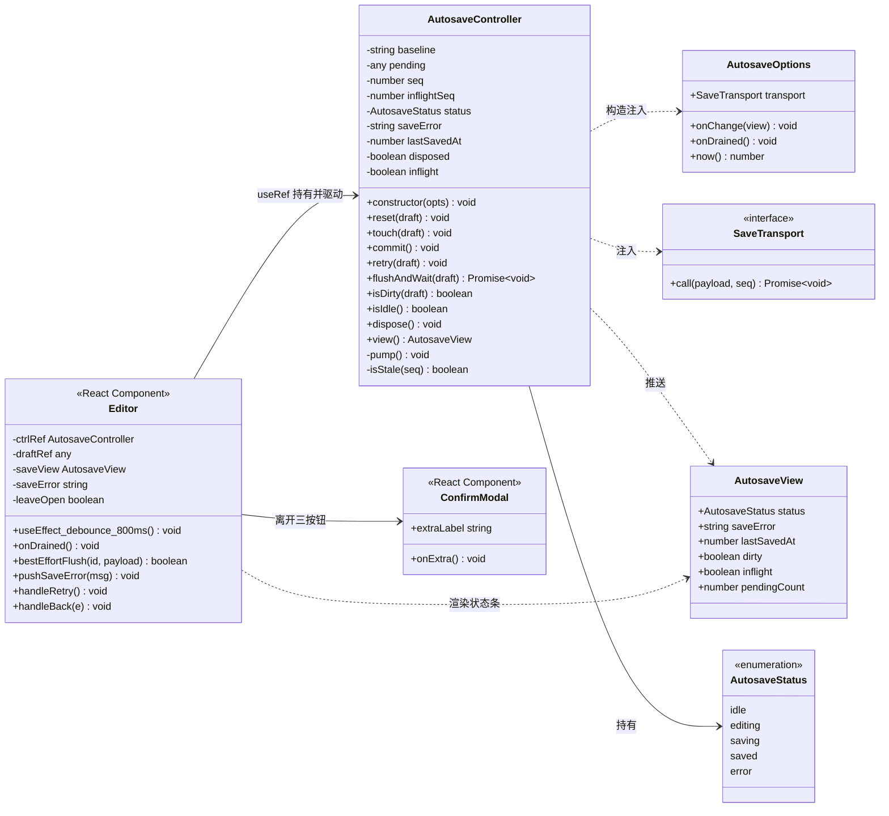
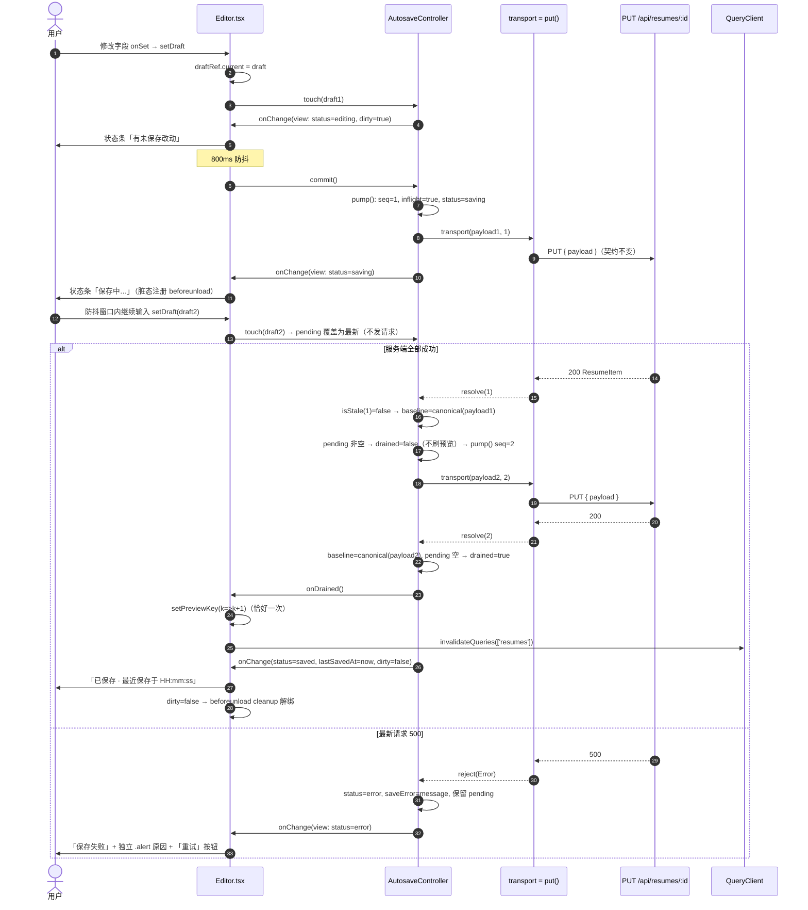
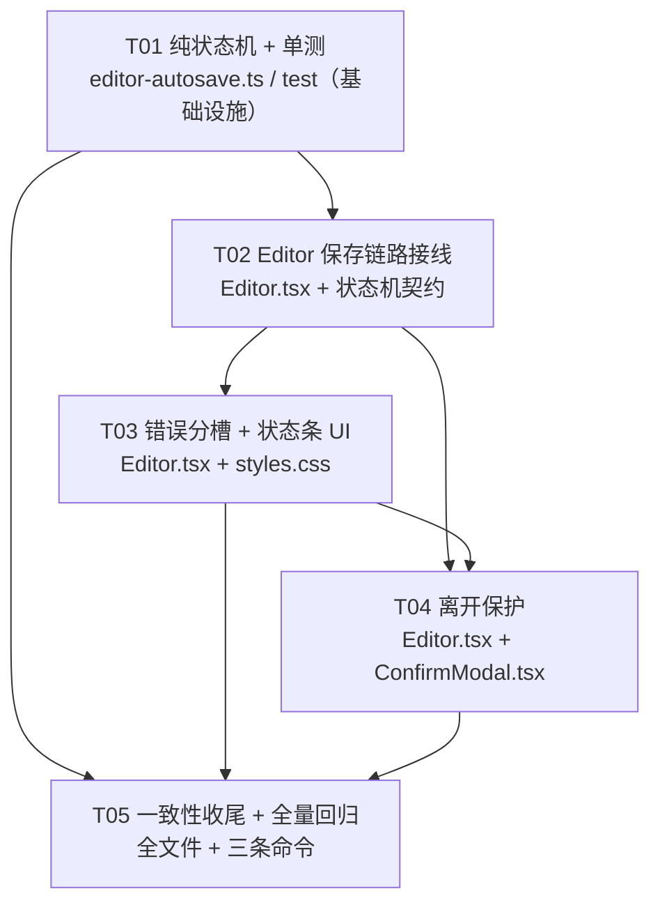

# 02 · 代码与实现逻辑审查 + 选点裁决 + 增量系统设计与任务分解

> 撰写人：高见远（架构师） · 轮次：软件团队首轮（主理人齐活林派单 · 任务 #2）
> 输入：许清楚《01 · 全项目功能盘点与增量 PRD》+ 主理人代码核验要点
> 本轮性质：**只做设计文档与代码审查，不修改任何源码**。工程师按本文 §3.5 任务列表实现。
> 项目根：`/Users/shenge/Documents/简历定制优化/career-agent`（CareerAgent，local-first 求职 Agent 工作台）
> 用户原始诉求：审查整个项目架构与实现逻辑，**挑选一个已有功能打磨**（不是新建模块）

---

## 0. 结论速览（给主理人 / 工程师）

1. **选点裁决：认可候选 A（简历编辑器 800ms 自动保存健壮性），不换选。** 技术理由见 §1.3。
2. PM 对 A 的 6 条痛点判断 **6/6 成立**，其中「并发乱序」比 PRD 描述更严重（旧响应还会覆盖「原始 JSON」文本框、误报已保存、多刷预览）。但「4 个文件」需修正为 **5 个文件**：PM 漏算了 `ConfirmModal.tsx`（现有组件只有两个回调，做不出 PRD 要求的三按钮）。
3. 审查新增 **4 个 PM 未发现、本轮必须一并处理的技术问题**：① `saving.savedAt` 污染 `baselineRef` 导致脏判断恒失效（主理人点名疑点，确认成立，且是根因）；② `setJsonText` 被旧响应覆盖；③ `tsconfig.json` **根本不检查本轮改动的 5 个文件**；④ `id` 参数切换时组件不卸载，脏状态会串简历。详见 §1.2。
4. **6 个设计疑点全部给出单一裁定**（不列多方案让工程师猜）：canonical 指纹口径 / 序号内聚在纯状态机 + 移除 `useMutation` / 单飞合并 / 原生 fetch 直发 keepalive 且 **48 KiB 阈值硬拦截** / beforeunload 只在脏态注册且一律原生确认 / 只新增 1 个 `saveError` 槽。详见 §2。
5. **精确文件清单 5 个（≤10）、零新增依赖、零 API 契约变更、零后端/迁移/同步改动**。任务 5 个（T01–T05），按实现顺序纵切，每项含依赖、文件、行号级改动点、验收点。见 §3.2 / §3.5。
6. 附图（设计产物，非工程师实现范围）：`docs/软件团队/class-diagram.mermaid`、`docs/软件团队/sequence-diagram.mermaid`。

---

# Part A · 代码级审查与选点裁决

## 1.1 逐条核验 PM 对候选 A 的痛点判断

核验方式：实读 `src/web/pages/Editor.tsx` 全文（1296 行）、`src/web/api.ts` L655–700、`src/server/resumes/resumes.service.ts` L1–90、`src/server/resumes/resumes.controller.ts` L55–58、`src/server/tenant/tenant-db.ts` L390–408、`src/web/pages/InterviewSession.tsx` L1–140 / L280–300、`src/web/components/ConfirmModal.tsx` 全文、`src/web/App.tsx` L76–105、`src/web/Layout.tsx` L1–60、`src/web/styles.css` L305–320 / L873–908、`vitest.config.mts`、`tsconfig.json`、`package.json`，并全项目 grep `savedAt` / `beforeunload` / `alert`。

| # | PM 判断 | 裁定 | 实测依据 |
|---|---|---|---|
| A1 | `Editor.tsx` L764–795 失败仅置 `status='error'` + `error` 文本，**无重试入口** | ✅ **成立** | L787–790 `onError` 只做 `setStatus('error'); setError(msg)`；L1035–1040 状态条只渲染文本，无按钮；全页 grep 无 retry/handleRetry |
| A2 | effect 依赖 `[draft,id]`，失败后 draft 不变即**永不再触发保存** | ✅ **成立（需精确化）** | L795 依赖数组确为 `[draft, id]`。失败路径只改 `status` / `error` 两个 state，`draft` 引用不变 → effect 不重跑。用户再改一个字会重跑（因 L772 恒判脏，见 §1.2①），但 L774 `setError('')` 会立刻清掉失败原因，且状态变 `editing`（L773）使「保存失败」提示消失 → 用户确实只能「瞎改碰运气」 |
| A3 | L774 `setError('')` 与 L927–983 导出/JSON/主题**共用 error 槽**，失败原因被冲掉 | ✅ **成立，且共用范围比 PRD 更大** | 共用 `error`（L707）的写入点共 6 处：`auditM.onError` L724、`downloadPdf` L928/951、`downloadText` L960/979、`themeM.onError` L1003、`applyJson` L1014/1016、保存 effect L774/789；唯一渲染槽 L1111。**反证**：L950 与 L978 的注释原文已写「导出失败与『自动保存失败』是两回事，只写 error 提示条，不污染保存状态」——**分槽本就是原作者意图，代码与注释不符**，本轮只是把注释落成实现 |
| A4 | 多个 `saveM.mutate` 可并发；服务端整份 payload 覆盖且无乐观锁，慢请求晚到回滚新内容 | ✅ **成立，且后果比 PRD 更严重** | L779 `saveM.mutate(saving, { onSuccess, onError })` 的 **per-call 回调各自捕获本次 `saving`**。旧请求晚到会执行 L781 `baselineRef = JSON.stringify(saving)`（**baseline 被旧快照写坏**）、L782 `setJsonText(JSON.stringify(saving))`（**覆盖用户正在编辑的「原始 JSON」文本框**）、L783 `setStatus('saved')`（**误报已保存**）、L784 `setPreviewKey(k=>k+1)`（**多刷一次预览**）。服务端 `resumes.service.ts` L32–52 只做 `PATCH_KEYS` 白名单后 `updateResume(id, allowed)`（L43），无版本号/ETag/乐观锁；`resumes.controller.ts` L55–58 直接透传 body |
| A5 | 全站 `beforeunload` 仅 `InterviewSession.tsx`，编辑器无离开保护 | ✅ **成立** | 全项目 grep `beforeunload` 仅命中 `InterviewSession.tsx` L110–111（及 L38 注释）；`Editor.tsx` 全文无。`InterviewSession.tsx` L98–112 是无条件注册 + `keepalive:true` + `.catch(()=>{})` 吞错，L289 恒显示「草稿已自动保存」 |
| A6 | idle「已同步」/ saved「已保存」文案不一致 | ✅ **成立** | L1039 `status==='idle' → '已同步'`；L1038 `status==='saved' → '已保存'` |
| A7 | 改动面 4 个文件、纯前端、风险低 | ⚠️ **需修正为 5 个文件** | PM 列的 4 个（`Editor.tsx`、新增纯状态机、`styles.css`、新增测试）正确，但 **PRD §4.5 要求「继续编辑 / 立即保存并离开 / 直接离开」三按钮，而 `ConfirmModal.tsx` L10–30 只有 `onConfirm` / `onCancel` 两个回调、L91–103 只渲染两个按钮** —— 不扩展该组件就做不出三按钮。见 §2.6 的纯增量方案 |

### 同时核验的高危边界（确认本轮确实不碰）

- `resumes.service.ts` L8–10 / L54–72：auto 版本 **2 分钟节流** + 内容去重 `JSON.stringify(lastAuto.snapshot) === JSON.stringify(payload)`。R1 单飞合并会进一步降低其触发次数，不需改后端。
- `tenant-db.ts` L403–408：`updateResume` 自行 `.set({ ...patch, updatedAt: new Date(), savedAt: Date.now() })` —— **行级 `resumes.saved_at` 列由后端维护，与 `payload.savedAt` 无关**。
- `api.ts` L699–700：`put = (path, body) => api(path, { method:'PUT', body: JSON.stringify(body ?? {}) })` → `api()` L665 `fetch('/api'+path, ...)`。请求体契约 `{ payload }` 全程不变。
- `App.tsx` L77 `<HashRouter>` + L79 `<Routes>`（**非 data router**），`Layout.tsx` L2/L48 侧栏用 `NavLink` + `useNavigate` → `useBlocker` / `unstable_usePrompt` 确实不可用，PRD §4.6 的技术注意成立。
- `vitest.config.mts` L5 `environment:'node'`、L6 `include:['test/**/*.test.ts']` → 纯 TS 类可直接单测，无需 jsdom / testing-library 等新依赖。`package.json` L30–66 无新增依赖需求。

### 候选 B–H 抽核验（用于换选判断）

- **B**：`InterviewSession.tsx` L81–84 `savePracticeDraft(...).catch(() => {})`、L289 恒显「草稿已自动保存」＝假成功，PM 判断成立。但其正解恰是复用 A 的状态机；且 `practice` service 1046 行、有 `practice.e2e.test.ts`，本轮并行做会变成「两处功能」，回归面大于 A。**→ 明确列为下一轮前置复用项，本轮不合并。**
- **C**：1255 行页面 + 5 处 `...(company?.payload)` 浅合并整份 PUT，回归矩阵过大。
- **E**：`Attachments.tsx` 上传链路 + `blobs/` 回归；**F**：只改总览不彻底；**D**：属「补新能力」非「打磨」；**H**：靠近 settings 跨设备同步语义。均不满足「一轮内 + 低回归 + 单功能」。
- **G**：纯文档，不作主选（PM 判断成立）。

---

## 1.2 审查新增：4 个 PM 未覆盖、本轮必须处理的问题

### ① `saving.savedAt` 污染 `baselineRef` —— 主理人点名疑点，确认成立且是根因

代码事实链：

```
L756–759  p = deepClone(data.payload); setDraft(p); baselineRef = JSON.stringify(p)
L777–778  saving = deepClone(draft); saving.savedAt = Date.now()
L779      saveM.mutate(saving, { onSuccess: ... })
L781      baselineRef.current = JSON.stringify(saving)      // ← 含 savedAt
L771–772  current = JSON.stringify(draft); if (current === baselineRef.current) return
```

`draft` 由 `data.payload` 灌入（L757），后续 `onSet/undo/redo/applyJson` 都只是 `setAt` 深拷贝（L797–807、L849–863、L1012），**从不把 `savedAt` 写回 draft**。因此保存成功后 `current`（不含/含旧 savedAt）与 `baselineRef`（含新 savedAt）**恒不相等**，L772 的「不脏则跳过」永远失效。

> 主理人原话「脏判断因此恒为 false」——准确表述是：**`current === baselineRef.current` 恒为 `false`，即永远被判为脏**。

影响（比「多发一次 PUT」更广）：

| 影响 | 说明 |
|---|---|
| 保存成功后不重复 PUT | **目前靠 effect 依赖 `[draft,id]` 侥幸成立**（成功回调不改 draft/id，effect 不重跑）。但任何一次 `setDraft` 都会让 effect 重跑 → 误判脏 → 800ms 后多发一次**内容完全相同**的 PUT：`applyJson()` L1012（用户点「应用 JSON」但内容未变）、`undo()` L851 / `redo()` L861 均命中 |
| 与乱序叠加 | 旧请求晚到把 baseline 写成旧快照（L781），脏判断彻底失准，可能反复保存 |
| 主题切换 | `themeM.onSuccess` L996 `baselineRef.current = JSON.stringify(p)` 是**原始含 savedAt 的 payload**，与新状态机 baseline 口径不一致 → 若不改为 canonical，主题切换后立刻被判脏、多发一次 PUT |
| `setJsonText` | L782 用含新 savedAt 的 `saving` 重写「原始 JSON」文本框，与 draft 不一致；旧响应晚到时会把用户正在编辑的 JSON 换成旧快照 |

**同产品已有正解（重要设计依据）**：`legacy/js/app.js` L774–776 注释「统一内容指纹：只看 `{data,fonts,spacing,v}`，**剔除 savedAt**（每次生成必变的时间戳，混进哈希会让『内容未变跳过写盘』永不成立）」；`legacy/js/feishu/feishu-sync.js` L764–765 同样「显式剔除 savedAt/id/name 等易变元数据」。**本轮直接沿用该口径，不是发明新机制。**

**裁定：保留 `saving.savedAt = Date.now()` 写入 payload，只修「比较口径」。** 理由（不能顺手删字段）：
- `legacy/js/app.js` L261 `currentPayload()` 产出含 `savedAt` 的完整 payload；L268–270 `pickResumeSource(doc, memSavedAt)` **用 `doc.savedAt` 仲裁「库文档 vs 基底」谁新**；L900 / L936 用 `obj.savedAt` 设 `lastSavedAt`。
- `src/server/render/legacy-renderer.ts` L263 注释明确「输入必须是 v1 的完整 payload（data / fonts / spacing / v / **savedAt**）」，L280 `ctx.ResumeEditor.applyImported(payload)` 会消费它。
- 删字段会触及 v1 渲染 / 导入仲裁语义，落入 PRD §4.7「不改 `legacy/` 渲染管线」的 P2 禁区。
- 附带说明：因 savedAt 每次必变，`resumes.service.ts` L61 的 auto 版本「内容去重」永不命中，只靠 L58 的 2 分钟节流兜底。**本轮不改后端**；R1 单飞合并把一次连续编辑压到 1–2 个 PUT，反而降低该路径压力。若后续要优化，须在后端侧剔除 savedAt 再比指纹（明确记为下一轮事项）。

**方案**：`canonical(payload)` = `JSON.stringify(浅拷贝并删除顶层 savedAt)`。`baseline` 存 canonical 字符串，`dirty = canonical(draft) !== baseline && (pending 或 error/saving)`。保存成功 `baseline = canonical(当次 draft)`。初次加载 L759、主题应用 L996 同步改为 `canonical(p)`。

### ② `setJsonText(JSON.stringify(saving))`（L782）覆盖用户未应用的 JSON 编辑

**裁定：保存成功不再写 `jsonText`**，只在初次加载（L758）与主题应用（L997）时设置。既消灭 R2「旧响应覆盖 jsonText」的通道，也不打断用户尚未点「应用 JSON」的编辑。属保存链路内部调整，不修改 JSON 折叠区的 UI / 交互（PRD §4.5「不改变原始 JSON 折叠」仍成立）。

### ③ `tsconfig.json` 根本不覆盖本轮改动文件

`tsconfig.json` L20 `"include": ["src/server/**/*.ts", "src/shared/**/*.ts"]`、L21 `"exclude": ["node_modules", "dist-server", "src/web", "test"]`、L14 `"strict": false`。

> **结论：`npx tsc -p tsconfig.json --noEmit` 完全不检查 `src/web/**` 与 `test/**`，即本轮全部 5 个文件都不在类型检查范围内。**

验收命令仍按约定全跑（不可省），但工程师与 QA 必须清楚：web/test 的保证来自 `npm run build`（Vite/esbuild 解析全部 web 源码）+ `npm test`（Vitest 真实执行纯状态机）。因此 **T01 的单测必须写得足够实**（覆盖全部状态转换与乱序），不能因为「tsc 过了」就以为类型安全。本轮不修改 `tsconfig.json`（改它会把全站 web 代码纳入 strict 检查，属于超范围）。

### ④ `id` 参数切换时组件不卸载

`App.tsx` L88 `<Route path="/editor/:id" element={<Editor />} />`：从 `/editor/A` 跳到 `/editor/B` 时 React Router 只更新 params，**不卸载 `Editor` 实例**。既有 L753–762 靠 `loadedIdRef.current !== id` 重新灌 draft，但新引入的 controller / 队列 / `beforeunload` / 卸载 flush 若不在 `id` 变化时 `reset()`，A 的脏状态、在飞 PUT、`lastSavedAt` 会串到 B。**→ 写入 T02 接线与 T05 验收。**

---

## 1.3 选点裁决：认可 A，不换选

**裁定：本轮打磨对象 = 候选 A「简历编辑器 800ms 自动保存链路健壮性与防丢失」。** 不从候选池换选。

补充 PM 产品理由之后的**技术理由**：

1. A 是唯一同时满足全部硬约束的候选项：改动集中在 `src/web/`（5 文件 ≤10）、`PUT /api/resumes/:id` 契约不变、后端/迁移/同步/`tenant-db.ts` 零改动、可纯函数单测（`vitest.config.mts` node 环境，零新依赖）、`git diff --name-only` 可机器核验禁区。
2. **同产品内已有两套成熟范式可直接对齐**，属「交互一致性欠账」而非发明新交互：`InterviewSession.tsx` L98–112 的 `beforeunload + keepalive` 写法；`legacy/js/app.js` L774 的「剔除 savedAt 的内容指纹」+ `SaveStatus.markSaving()` 防抖期即时状态反馈。风险显著低于任何需要从零设计状态机的候选项。
3. 审查新增的 4 个问题（§1.2）都能在 A 的 5 文件内闭环，不需要扩大范围；反过来，若选 B/C/E/F/H，这些问题仍要面对且缺范式。
4. B 的正确修法正是复用 A 的状态机（把 `savePracticeDraft` 的错误上抛 + 接入 controller），**A 是 B 的前置**，本轮做 A 不浪费。
5. 回归网现成：`versions.e2e.test.ts`、`render.e2e.test.ts`、`business-change-log.e2e.test.ts`、`sync-*.e2e.test.ts`、`migration.test.ts` 全部保持通过即可证伪「碰了底座」。

---

# Part B · 六个设计疑点的单一裁定

> 原则：**每个疑点只给一个选定方案 + 理由**，不留「二选一」给工程师猜。

## 2.1 疑点一：`savedAt` 污染 baseline →「保存成功后不重复 PUT」「预览恰好刷新一次」如何保证

**裁定：引入 `canonical()`（剥离顶层 `savedAt` 的稳定指纹），`baseline` / 脏判断 / 幂等判断全部走 canonical；保留 `saving.savedAt` 写入 payload 不动。** 完整理由与 v1 依据见 §1.2①。

```ts
/** 剥离顶层 savedAt 后的稳定指纹；沿用 legacy/js/app.js 的 contentHash 口径。
 *  只删顶层，不递归删 data 内字段，避免改动渲染层数据结构。 */
export function canonical(payload: any): string {
  if (!payload || typeof payload !== 'object') return JSON.stringify(payload ?? null);
  const { savedAt: _ignored, ...rest } = payload;
  return JSON.stringify(rest);
}
```

三条保证：

| 目标 | 保证机制 |
|---|---|
| 保存成功后不重复 PUT | `touch(draft)` 幂等：`canonical(draft) === baseline` 且无 pending、非 error/saving 时直接 return；`commit()` 也检查「无 pending 则 no-op」。**不再依赖 effect 依赖数组侥幸** |
| 脏判断正确 | `dirty = canonical(draft) !== baseline \|\| !!pending \|\| status === 'saving' \|\| status === 'error'` |
| 预览恰好刷新一次 | 状态机只在 **`drained`（队列完全排空且最后一次成功）** 时回调 `onDrained()`；React 把 `setPreviewKey(k=>k+1)` 与 `qc.invalidateQueries(['resumes'])` **只放在 `onDrained`**。连续快速输入产生 2 个 PUT 时，第 1 次成功 `drained=false` 不刷预览，第 2 次排空才刷一次 |

另：`setJsonText` 移出成功回调（§1.2②）；初次加载 L759 与 `themeM.onSuccess` L996 两处 `JSON.stringify(p)` 改为 `canonical(p)`；`applyJson` L1012 的 parsed 可能含 savedAt，canonical 会自动剥离，安全。

## 2.2 疑点二：`useMutation` 回调捕获旧 `saving` → 序号机制放哪层、如何与 TanStack Query 共存

**裁定：序号机制 100% 内聚在纯状态机 `AutosaveController` 内；React 层与 mutate 回调层都不放任何序号逻辑；本轮直接移除 `saveM` 这个 `useMutation`，transport 改用现成的 `put<ResumeItem>()`。**

- 状态机持有单调递增 `seq`（每次真正发请求 `++seq`）与 `inflightSeq`。**任何响应（成功/失败）回来先做 `isStale(seq)`**：不是最新已发序号 → 直接丢弃，**不触发 `onChange`、不发 `onDrained`、不改 baseline、不刷预览、不多余保存**。React 只渲染 `AutosaveView`，天然不会被旧响应回退。
- 与 TanStack Query 共存方式：
  - **移除 `Editor.tsx` L764–766 的 `saveM = useMutation(...)`，删除 L779 `saveM.mutate(saving, {onSuccess,onError})` 的 per-call 回调写法**，改为在 controller 的 `transport` 里 `await put<ResumeItem>(\`/resumes/${id}\`, { payload })`。
  - 理由：① 保存状态已由状态机全接管，`useMutation` 的 `isPending`/`retry`/`onMutate` 一个都没用，纯冗余；② per-call 回调正是「旧响应污染状态」的**载体**，移除即从根消灭；③ `api.ts` 零改动、`{ payload }` 契约零改动；④ 避免组件卸载后 mutate 回调触发 React 状态更新警告。
  - **保留** `qc.invalidateQueries({ queryKey: ['resumes'] })` 在 `onDrained`（`Library.tsx` L37/L320 的 `savedAt` 缩略图与「保存于」靠它刷新）。注意其 key 前缀是 `['resumes']`，与 `['resume', id]` 不同，**不会**触发本页 `useQuery` refetch，因此不会重置 draft（与既有行为一致）。
- 单测可通过注入 **deferred transport** 精确构造「旧请求晚到」，断言 `view()` 不被回退、`onDrained` 不重复、transport 调用次数受控。这是 R7 的核心验收点。

## 2.3 疑点三：串行队列「单飞 + 合并最新」 vs 「排队逐次」

**裁定：单飞 + 合并最新 draft（coalescing）。** 同一时刻最多 1 个 PUT 在飞；飞行期间的新改动只覆盖 `pending` 为最新快照，不排队、不逐次发。

理由：

| 维度 | 排队逐次 | **单飞合并（选定）** |
|---|---|---|
| 最终落库内容 | 服务端整份覆盖、无锁（`resumes.service.ts` L43），N 个 PUT 与只发最后一个结果**完全一致**，纯写放大 | 只发最后一个，结果相同 |
| `savedAt` | 每次 PUT 都带新 `savedAt`，使 `autoSnapshot` L61「内容去重」永不命中，且每次触发一次 `listVersions`（L59） | 一次连续编辑压到 1–2 个 PUT，节流窗口内最多 1 条 auto 版本 |
| 版本留痕 | 节流窗口边界可能多写版本 | 与后端 2 分钟节流 + 去重天然契合 |
| 重试语义 | 「重试旧失败快照」与「队列里还有更新快照」产生歧义 | `retry()` 语义统一为「以**当前最新 draft** 发一次」，与合并完全一致 |

**状态转换表**（`AutosaveStatus = idle | editing | saving | saved | error`）：

| 当前 | 事件 | 动作 | 新状态 |
|---|---|---|---|
| idle / saved | `touch(d)`，`canonical(d)===baseline` 且无 pending | 丢弃（幂等） | 不变 |
| idle / saved | `touch(d)`，canonical 不同 | `pending = d`，`onChange(status=editing, dirty=true)`（**不发请求**） | editing |
| editing | `commit()`（800ms 防抖到期） | `pump()`：`seq++`，`inflight=true`，调 `transport(payload, seq)` | saving |
| saving | `touch(d)` | 仅 `pending = 最新 d` 覆盖，**不发请求** | saving |
| saving | 响应成功，`isStale(seq)===true` | **整体丢弃**（不改 baseline / 状态 / 预览） | saving |
| saving | 响应成功，最新，`pending` 为空 | `baseline = canonical(d)`；`lastSavedAt = now()`；`saveError=''`；发 `onDrained()`（刷预览 + invalidate + 解绑 beforeunload） | saved |
| saving | 响应成功，最新，`pending` 非空 | `baseline = canonical(d)`；**`drained=false`（不刷预览）**；立即 `pump()` 发 pending | saving |
| saving | 响应失败，`isStale(seq)===true` | 丢弃 | saving |
| saving | 响应失败，最新 | `saveError = err.message`；保留 pending；**不自动重试**（P0 不含 R8） | error |
| error | `retry(d)` | `pending = 当前最新 d`；`saveError=''`；立即 `pump()` | saving |
| error | `touch(d)`（用户继续编辑） | 覆盖 pending；**不清空 `saveError`**（R4）；不自动重试 | error |
| 任意 | `reset(d)` / `dispose()` | 清 pending/baseline/seq，标记 disposed，之后所有响应丢弃 | idle |
| 任意 | `flushAndWait(d)` | 见 §2.5；永不 reject，失败写 `saveError` | — |

> `pending` 数量恒为 0 或 1（`pendingCount` 仅供诊断，**不渲染**，P1 的 R9 本轮不做）。

## 2.4 疑点四：keepalive 体量上限、`api.ts` 关系、退化策略

**核验结论**：`api.ts` L659–694 `api()` 内部就是 `fetch('/api' + path, { ...init, credentials:'include', headers })`；`put`（L699–700）签名只有 `(path, body)`，**没有 `init` 参数**。虽然 `api()` 用 `...init` 展开、理论上能透传 `keepalive`，但 `put` 无法注入 → **不改 `api.ts` 就无法注入 `keepalive`**。

**裁定：本轮零改动 `api.ts`，在 `Editor.tsx` 新增专用 `bestEffortFlush(id, payload)`，直接原生 `fetch`**（复刻 `api()` 的必要约定，与 `InterviewSession.tsx` L102–108 同款写法）：

```ts
function bestEffortFlush(id: string, payload: any): void {
  const body = JSON.stringify({ payload });                 // 与 put() 完全一致
  const bytes = new TextEncoder().encode(body).length;
  if (bytes > KEEPALIVE_LIMIT) {                          // 48 * 1024
    // 不发必然失败的请求：改走硬拦截 + 可见提示（见 §2.5）
    return false;
  }
  fetch(`/api/resumes/${encodeURIComponent(id)}`, {
    method: 'PUT', credentials: 'include', keepalive: true,
    headers: { 'Content-Type': 'application/json' }, body,
  }).catch(() => { /* 不吞：写同一 saveError 槽 */ });
  return true;
}
```

**体量上限与「不静默丢弃」的三重保证**：

- Chromium 系对 `keepalive` 请求体有 **64 KiB** 上限，超出时 `fetch` 直接 reject / 请求被丢弃。简历 payload 常含多段经历、项目、量化成果，JSON 可达数十 KB 甚至更多。
- 取**保守阈值 `KEEPALIVE_LIMIT = 48 * 1024`**（预留 16 KiB 给 headers 等开销）。
  - `bytes <= 48 KiB` → 发 keepalive flush（尽力），**同时仍触发 `beforeunload` 原生确认**（§2.5），用户知情；
  - `bytes > 48 KiB` → **不发 fetch**，把 `beforeunload` 设为硬拦截，并向独立错误槽写入**可见**中文提示：「内容较大，无法自动保存；请点击状态条『重试』保存后再离开」。用户按「取消」留在页面即可看到提示并手动保存；
  - `fetch` 的 `.catch()` **不静默**：写同一 `saveError` 槽（文案同上），状态条「重试」按钮始终可用。
- **明确不做**：不把简历明文写 localStorage、不做跨页草稿恢复、不用 `sendBeacon`（同样有体量上限且无法带自定义 header / 凭据语义不同）、不改 `api.ts` 的 `put` 签名（避免扩大「PUT 契约」的审查面）。

## 2.5 疑点五：`beforeunload` 注册位置、成功即解绑、HashRouter 下 SPA 跳转边界

**实现位置：`Editor.tsx` 内一个专用 effect**，依赖 `dirty`（由 `saveView.dirty` 派生）：

```ts
useEffect(() => {
  if (!saveView.dirty) return;                 // 成功 → dirty=false → cleanup 自动解绑
  const onBeforeUnload = (e: BeforeUnloadEvent) => {
    e.preventDefault();
    e.returnValue = '';                       // 原生确认（文案由浏览器决定，不可自定义）
    const ok = bestEffortFlush(id, draftRef.current);
    if (!ok) pushSaveError('内容较大，无法自动保存；请点击状态条「重试」保存后再离开');
  };
  window.addEventListener('beforeunload', onBeforeUnload);
  return () => window.removeEventListener('beforeunload', onBeforeUnload);
}, [saveView.dirty, id]);
```

**统一策略（避免两套路径打架）**：脏状态下 `beforeunload` **一律**弹原生确认（这是浏览器唯一能保证用户知晓的机制），**同时**发一次 best-effort flush。用户选「离开」→ flush 尽力完成；选「取消」→ 留在页面，状态条仍显示脏/错误可重试。这样「刷新有原生确认」与「刷新后重开内容为最新输入」两条验收都覆盖，**且不会静默丢失**。保存成功 → `dirty=false` → effect cleanup 解绑，不污染其它页面。

**SPA 内跳转（`beforeunload` 不触发）的明确边界**：`App.tsx` L77 `HashRouter` + L79 `<Routes>`（非 data router），`useBlocker` 不可用；`Layout.tsx` L2/L48 侧栏 `NavLink` / `useNavigate` 只替换 `Routes` 子树，`Editor` 卸载但不触发 `beforeunload`。

| 场景 | **做到** | **明确不做** |
|---|---|---|
| 「← 简历库」（L1028 `<Link className="back" to="/resumes">`） | 保留 `<Link>`，在 `onClick` 里 `if (dirty) { e.preventDefault(); setLeaveOpen(true); }` → 弹 `ConfirmModal` 三按钮。**这是唯一可保证「已落库再离开」的受控路径**：「立即保存并离开」`await ctrl.flushAndWait(draftRef.current)` 成功后 `navigate('/resumes')` | 不改成 `<a href>`；不跳过确认直接跳 |
| 组件卸载（侧栏 `NavLink` / hash 变化导致 Editor 卸载） | `useEffect` cleanup 里发**一次** `bestEffortFlush`，**仅当 `ctrl.isIdle()` 为真**（队列空闲）才发，避免与在飞 PUT 乱序导致旧内容后到覆盖。需引入 `useNavigate` | 不保证 100% 落库（页面即卸载无法反馈）；不谎称「已保存」 |
| 真实刷新 / 关闭标签 | `beforeunload` 原生确认 + 尽力 flush + 超阈值硬拦截提示 | — |
| 全站路由 | — | **不引入 data router / `useBlocker` / 全局路由守卫；不改 `Layout.tsx`；不拦截浏览器后退/前进、外部 `<a href>`、`window.location` 直接赋值；不做跨页持久化草稿** |

> 与 `InterviewSession.tsx` L98–112 的差异（有意为之）：那边是**无条件**注册 beforeunload 且 `.catch(()=>{})` 吞错；本轮只在脏态注册、保留原生确认、失败写可见错误槽。这是「补齐到并略优于同产品水位」，不是照抄。

## 2.6 疑点六：错误分槽（几个 state、命名、与 `error` / L1111 `.alert` 共存）

**裁定：只新增 1 个 state：`saveError`。现有 `error`（L707）完全保留给「非保存类操作」，一行不改。**

| 槽 | 变量 | 写入点 | 渲染槽 |
|---|---|---|---|
| **保存错误（新增）** | `const [saveError, setSaveError] = useState('')` | 状态机 `onChange` 时按 `view.saveError` 同步；超阈值 / flush reject 时追加提示 | 新增 `{saveError && <div className="alert save-error-line">{saveError}</div>}`（L1111 之后或之前） |
| **其它错误（原样）** | `error` / `setError` L707 | `auditM.onError` L724、`downloadPdf` L928/951、`downloadText` L960/979、`themeM.onError` L1003、`applyJson` L1014/1016 —— **全部保持原样** | 原 L1111 `{error && <div className="alert">{error}</div>}` |

具体改动：

- **删除** L774 `setError('')`（保存 effect 不再清别人的槽）、**删除** L789 `setError((e as Error).message)`，改由状态机 `view.saveError` 驱动 `setSaveError`。
- 保存成功（`drained`）时 `setSaveError('')`；**保存失败期间执行导出 / 切主题 / 体检 / 应用 JSON 均不会清掉 `saveError`，状态条「重试」按钮与原因始终在**。
- 两个 `.alert` 可并存，互不覆盖、互不清除；`.save-error-line` 复用 `styles.css` L311–319 的 `.alert`，只增少量布局修饰。
- `themeM.onSuccess` L996 的 `baselineRef.current = JSON.stringify(p)` 改为 `canonical(p)`（属状态机接线，**不是**错误分槽，别漏）。
- **不改**导出 / 主题 / 体检 / JSON 折叠 / 撤销重做 / 快捷键 / 双栏布局 / A4 预览 / 主题变量的任何逻辑。

**状态条 UI 与文案（R6）** —— 位置不变，仍是 `.editor-head .editor-actions .save-state`（L1035–1040）：

```
<span className={'save-state ' + status} aria-live="polite">
  {status === 'saving'  ? '保存中…' :
   status === 'editing' ? '有未保存改动' :
   status === 'error'   ? '保存失败' : '已保存' /* idle 与 saved 统一，去掉「已同步」 */}
  {lastSavedAt && <span className="save-state__time">最近保存于 {formatSavedAt(lastSavedAt)}</span>}
  {status === 'error' && (
    <button className="mini save-state__retry" aria-label="重试保存" onClick={handleRetry}>重试</button>
  )}
</span>
```

`formatSavedAt(ts)` 放纯状态机模块，手动 `getHours/getMinutes/getSeconds().padStart(2,'0')` 拼接，**不依赖 locale**，单测可断言格式。

**三按钮 `ConfirmModal` 的裁定（PM 漏项）**：现有组件 L10–30 只有 `onConfirm` / `onCancel`，做不出 PRD 的三按钮。**给 `ConfirmModal.tsx` 增加两个可选 props（纯增量、默认值不改、其它调用方零影响）**：

```ts
extraLabel?: string;
onExtra?: () => void;
// 在 .btn-row 中，onExtra 存在时在 cancel 与 confirm 之间渲染第三个按钮，复用 busy 禁用
```

Editor 侧映射：`onCancel` = 继续编辑、`onExtra` = 立即保存并离开、`onConfirm` = 直接离开（`danger`）。焦点陷阱 L51–55 用 `querySelectorAll('button, [href], ...)` 会自动把新按钮纳入 Tab 循环，无需改。`busy` 由 Editor 在 `flushAndWait` 期间置 true；**若保存失败，保持弹窗打开并把错误写入独立 `saveError` 槽，绝不静默跳走**。

> 备选（不作为本设计）：把三按钮压成两按钮可少改 1 文件，但 PRD §4.5 / §4.6 明确写三按钮，QA 会按此验收，故以三按钮为准。

---

# Part C · 增量系统设计

## 3.1 实现方案与选型理由

**架构模式：纯逻辑内核 + 薄 React 适配层（MVVM 式）。** 把保存链路的全部不变量 —— canonical 脏判定、串行单飞、序号丢弃、状态机、时间格式 —— 下沉到 **无 DOM / 无 React / 无 fetch** 依赖的 `AutosaveController`（网络能力由 `SaveTransport` 注入）；`Editor.tsx` 只保留四件事：800ms 防抖触发、`setSaveView` 渲染、`onDrained` 刷预览/invalidate、生命周期钩子（beforeunload / 卸载 flush / 离开确认）。

| 决策 | 理由 |
|---|---|
| 用 **TS class** 而非 `useReducer` / 自定义 hook 承载状态机 | `vitest.config.mts` L5 是 `environment:'node'`，纯类可在 `test/editor-autosave.test.ts` 用 deferred transport 精确构造乱序与排空；hook 无法在 node 环境单测，且队列/序号需跨 render 稳定引用，类更直观。**不引入任何新依赖**（jsdom / testing-library 都不需要） |
| **移除 `useMutation`，transport 用现成 `put()`** | 见 §2.2；消灭 per-call 回调这个污染载体，`api.ts` 零改动 |
| **单飞合并** | 见 §2.3 |
| **保留 `saving.savedAt` 写入** | 见 §1.2①（v1 渲染 / 导入仲裁消费它，删字段超出范围） |
| **canonical 指纹剔除 `savedAt`** | 见 §2.1；同产品 v1 已有正解 |
| **`drained` 才刷预览** | 保证「恰好刷新一次」，兼顾连续快速输入 |
| **keepalive 走原生 fetch + 48 KiB 硬拦截** | 见 §2.4；`put` 无法注入 init，且不能静默丢弃 |
| **只新增 `saveError` 一个槽** | 见 §2.6；与 L950/L978 原注释意图一致，改动最小 |

**范围控制**：P0 仅 R1–R7；**P1（R8 指数退避自动重试、R9 排队数展示、R10 README 修订）本轮一律不做**；不设计任何需要改后端、迁移、路由架构、API 契约、`legacy/` 渲染管线的方案。工程师一轮可完成（5 文件、约 300–400 行新增/调整）。

## 3.2 精确文件清单（5 个，≤10；相对项目根）

| # | 相对路径 | 新增/修改 | 改动要点 | **禁止触碰** |
|---|---|---|---|---|
| 1 | `src/web/pages/editor-autosave.ts` | **新增** | 纯 TS：`canonical` / `formatSavedAt` / `AutosaveStatus` / `AutosaveView` / `SaveTransport` / `AutosaveOptions` / `AutosaveController`；**不得 import react / DOM / fetch** | 无 |
| 2 | `test/editor-autosave.test.ts` | **新增** | ≥8 例（建议 12），node 环境、deferred transport，风格对齐 `test/theme.test.ts` | 无 |
| 3 | `src/web/pages/Editor.tsx` | **修改** | ① 引入状态机、`ctrlRef`/`draftRef`/`saveView`/`saveError`/`lastSavedAt`/`leaveOpen`；② 移除 `saveM`（L764–766）与旧 effect（L768–795）；③ L759 / L996 baseline 改 `canonical(p)`；④ 状态条（L1035–1040）+ 独立错误槽；⑤ `bestEffortFlush` / beforeunload / 卸载 flush / back Link 拦截 / `ConfirmModal` 三按钮；⑥ `id` 变化时 `reset()` | **不改** `downloadPdf` L927–955 / `downloadText` L957–983 / `applyJson` L1008–1018 / `auditM` L718–725 / `themeM` L990–1004 的 `setError`；不改双栏布局、A4 预览、语义表单、JSON 折叠区 UI、撤销重做、体检、主题画廊、导出菜单、快捷键、主题变量 |
| 4 | `src/web/styles.css` | **修改** | 在 L886–895 之后增量：`.save-state__time`、`.save-state__retry`、`.save-state` 内 flex/gap、`.save-error-line`（复用 `.alert` L311–319）；必要时 `.save-state.saved` 淡色 | 不动主题变量与其它组件样式 |
| 5 | `src/web/components/ConfirmModal.tsx` | **修改** | 增加可选 `extraLabel?: string` / `onExtra?: () => void` 两个 props + 第三个按钮（放在 cancel/confirm 之间，复用 `busy`） | **不改**现有两按钮行为、默认值、焦点陷阱 L35–75、`danger` 语义 |

**明确不修改**（QA 可用 `git diff --name-only` 机器核验）：`src/web/api.ts`、`src/server/**`（含 `resumes.service.ts`、`resumes.controller.ts`、`tenant/tenant-db.ts`）、`drizzle/**`、`src/server/sync/**`、`src/web/App.tsx`、`src/web/Layout.tsx`、`legacy/**`、`package.json`、`package-lock.json`、`vitest.config.mts`、`tsconfig.json`、任何 `.sql`、README / ROADMAP（R10 不做）、`desktop/**`。

## 3.3 数据结构与接口定义

### 3.3.1 TypeScript 签名（`src/web/pages/editor-autosave.ts`）

```ts
/** 保存状态机状态。idle 与 saved 在 UI 上统一渲染「已保存」。 */
export type AutosaveStatus = 'idle' | 'editing' | 'saving' | 'saved' | 'error';

/** 状态机推给 React 的不可变视图；React 只渲染它，不自行推导状态。 */
export interface AutosaveView {
  status: AutosaveStatus;
  saveError: string;          // 保存错误（与导出/主题错误分槽）
  lastSavedAt: number | null; // 最近一次成功落库时间戳（ms）
  dirty: boolean;             // 是否有未落盘内容（决定 beforeunload 注册）
  inflight: boolean;          // 是否有 PUT 在飞
  pendingCount: number;       // 0 或 1，仅诊断，不渲染
}

/** 网络能力由外部注入：纯状态机零 DOM / 零 fetch 依赖。 */
export type SaveTransport = (payload: any, seq: number) => Promise<void>;

export interface AutosaveOptions {
  transport: SaveTransport;
  /** 状态变化时推送视图；必须是稳定引用（React 侧用 setSaveView 或 useCallback 包一层）。 */
  onChange: (view: AutosaveView) => void;
  /** 队列完全排空且最后一次成功时调用：React 在此刷预览 + invalidate + 清空 saveError。 */
  onDrained?: () => void;
  /** 可注入时钟，单测确定「最近保存于」时间戳。 */
  now?: () => number;
}

export class AutosaveController {
  constructor(opts: AutosaveOptions);

  /** 载入 / 切换简历：设置 baseline = canonical(draft)，清空全部状态。id 变化时必须调用。 */
  reset(draft: any): void;

  /** 用户编辑或防抖窗口开始：立即给出 editing 反馈 + 记录最新快照；不发请求；幂等。 */
  touch(draft: any): void;

  /** 800ms 防抖到期：队列空闲且有 pending 时 pump 一次；无 pending 则 no-op。 */
  commit(): void;

  /** R3：以「当前最新 draft」立即重试，清空 saveError，不受「draft 未变」限制。 */
  retry(draft: any): void;

  /** 离开受控路径：等待在飞请求结束 + pending 落库；永不 reject（失败写 saveError）。 */
  flushAndWait(draft: any): Promise<void>;

  /** 是否有未落盘内容：canonical(draft)!==baseline || !!pending || saving || error。 */
  isDirty(draft: any): boolean;

  /** 队列是否空闲（决定卸载时能否发 bestEffortFlush，避免与在飞 PUT 乱序）。 */
  isIdle(): boolean;

  /** 卸载 / id 切换：标记 disposed，之后所有响应一律丢弃。 */
  dispose(): void;

  /** 只读当前视图（单测断言用）。 */
  view(): AutosaveView;

  // —— 内部（不对外暴露，单测通过 view() 与 deferred transport 观察）——
  // private pump(): void
  // private isStale(seq: number): boolean   // seq !== inflightSeq || disposed
}

/** 剥离顶层 savedAt 的稳定指纹（沿用 legacy/js/app.js contentHash 口径）。 */
export function canonical(payload: any): string;

/** 输出 HH:mm:ss；手动 padStart，不依赖 locale / Intl，单测可断言。 */
export function formatSavedAt(ts: number): string;
```

**关键不变量（工程师必须遵守）**：
1. `isStale(seq)` 判定 = `disposed || seq !== inflightSeq || seq !== latestIssuedSeq`；命中则**整个响应丢弃，不调用任何回调**。
2. `pump()` 只在 `!inflight && pending != null && !disposed` 时执行；`inflight` 期间 `touch` 只覆盖 pending。
3. `onDrained()` 只在「最新响应成功 且 pending 为空」时触发一次；pending 非空时立即再 `pump()` 且**不**触发。
4. `flushAndWait()` 永不 reject；transport 抛错时把 `err.message` 写入 `view.saveError` 后 resolve，Editor 据此决定不跳走。
5. `reset()` / `dispose()` 后所有在飞响应被丢弃；但服务端仍会落库该请求携带的 payload（期望行为，不回滚）。

### 3.3.2 React 侧 hook / ref 约定（`Editor.tsx`）

```ts
const ctrlRef   = useRef<AutosaveController | null>(null);
const draftRef  = useRef<any>(null);                     // 每 render 同步：draftRef.current = draft
const [saveView, setSaveView] = useState<AutosaveView>(INITIAL_VIEW);
const [saveError, setSaveError] = useState('');          // 独立槽，供 beforeunload/flush 直接写
const [leaveOpen, setLeaveOpen] = useState(false);
const navigate = useNavigate();                           // 新增（原只 import Link, useParams）
```

- **`draftRef.current = draft` 写在 render 体内**（与 `InterviewSession.tsx` L79 `draftRef.current = {...}` 同款），保证 `retry` / `beforeunload` / 卸载 flush 永远拿到最新 draft。
- controller **惰性创建一次**（`if (!ctrlRef.current) ctrlRef.current = new AutosaveController({...})`），`transport` 与 `onChange` / `onDrained` 用 `useCallback` 且闭包 `id` / `qc`；**`id` 变化时 `dispose()` + 重建 + `reset(newDraft)`**。
- `onChange` 用稳定引用（`setSaveView` 本身稳定），同时把 `view.saveError` 同步到 `setSaveError`（或直接从 `saveView.saveError` 渲染，二者选一，避免双份状态漂移 —— **推荐直接渲染 `saveView.saveError`，`setSaveError` 只用于 beforeunload/flush 的额外提示**，此时需合并显示）。
- `onDrained` 内**只做**：`setPreviewKey(k => k+1)`、`qc.invalidateQueries({ queryKey: ['resumes'] })`；`setSaveError('')` 也在此或 `onChange` 里完成。
- 防抖 effect（替换 L768–795）：
  ```ts
  useEffect(() => {
    if (!draft) return;
    const c = ctrlRef.current; if (!c) return;
    c.touch(draft);                                   // 立即「有未保存改动」
    const timer = setTimeout(() => c.commit(), 800);  // 到期才发 PUT
    return () => clearTimeout(timer);
  }, [draft, id]);
  ```
- `transport`：
  ```ts
  const transport: SaveTransport = useCallback(
    (payload, _seq) => put<ResumeItem>(`/resumes/${id}`, { payload }).then(() => undefined),
    [id],
  );
  ```
  `_seq` 只用于调试；**序号不参与 React 逻辑**。
- `bestEffortFlush` / `pushSaveError` / `handleRetry` / `handleBack` / `ConfirmModal` 接线见 §2.4–§2.6 与 T04。

### 3.3.3 类图

见附图 `docs/软件团队/class-diagram.mermaid`，内嵌版本：



## 3.4 程序调用流程（时序图）

### 3.4.1 正常编辑 → 防抖 → 单飞合并 → 排空刷预览



### 3.4.2 失败重试 / 旧响应丢弃 / 离开保护

```mermaid
sequenceDiagram
    autonumber
    actor U as 用户
    participant E as Editor.tsx
    participant C as AutosaveController
    participant CM as ConfirmModal
    participant F as bestEffortFlush（原生 fetch）
    participant B as window.beforeunload
    participant N as useNavigate

    U->>E: 点「重试」（error 态）
    E->>C: retry(draftRef.current)
    C->>C: pending=最新 draft; saveError=''; commit() seq++
    C->>E: onChange(status=saving)
    Note right of C: 成功 → drained → 「已保存」+ 重试按钮消失

    U->>E: 脏状态点「← 简历库」
    E->>E: handleBack: dirty → e.preventDefault(); setLeaveOpen(true)
    E->>CM: 打开（继续编辑 / 立即保存并离开 / 直接离开）
    U->>CM: 「立即保存并离开」
    CM->>E: onExtra; busy=true
    E->>C: await flushAndWait(draftRef.current)
    C->>C: 等待 inflight 排空 + pending 落库；永不 reject
    C-->>E: resolve（失败则 view.saveError 有值）
    alt saveError 为空
        E->>N: navigate('/resumes')
    else 保存失败
        E->>CM: busy=false，保持弹窗不跳走
        E->>E: 独立 .alert 写入原因
    end

    U->>B: 脏状态刷新 / 关闭标签
    B->>E: beforeunload
    E->>B: e.preventDefault(); e.returnValue=''（原生确认）
    E->>F: bestEffortFlush(id, payload)
    alt bytes <= 48KiB
        F->>F: fetch PUT keepalive（尽力）
    else bytes > 48KiB 或 fetch reject
        F->>E: pushSaveError('内容较大，无法自动保存；请点击状态条「重试」…') + 硬拦截
    end
```

> 附图 `docs/软件团队/sequence-diagram.mermaid` 另存了这两张图。

## 3.5 有序任务列表（T01–T05，按实现顺序；工程师照做即可）

> **组织说明**：本轮为**存量项目增量打磨**，全部源码改动仅 5 个文件，无配置文件/入口文件/依赖声明变更（这些属于通用模板里「项目基础设施」任务的内容，本轮不存在）。因此按主理人派单要求以「实现顺序 + 纵切模块」组织，每任务均非单文件、均含明确验收点；T01 即本轮的「基础设施/数据层」（纯逻辑内核 + 回归网），其余任务在它之上逐层接线。任务数 5 ≤ 上限。

### T01 · 纯状态机与串行队列 + 单测（本轮基础设施）

- **优先级**：P0 ｜ **依赖**：无
- **涉及文件**：`src/web/pages/editor-autosave.ts`（新增）、`test/editor-autosave.test.ts`（新增）；并**输出 §3.3.1 的导出契约**供 T02 引用
- **实现要点**：
  1. 按 §3.3.1 完整实现 `canonical` / `formatSavedAt` / 类型 / `AutosaveController`，严格不含 `react`、`document`、`window`、`fetch` 任何引用。
  2. 严格实现 §2.3 状态转换表与 §3.3.1 五条不变量（`isStale` 整体丢弃、单飞、drained 才回调、`flushAndWait` 永不 reject、`dispose` 后丢弃）。
  3. `canonical` 只删**顶层** `savedAt`，不递归处理 `data` 内字段；`formatSavedAt` 用本地 `getHours/getMinutes/getSeconds` + `padStart(2,'0')`，不用 `toLocaleTimeString`。
  4. 测试风格对齐 `test/theme.test.ts`（`import { describe, expect, it } from 'vitest'`），用辅助函数 `deferred()` 构造可控 transport。**至少 8 例，建议 12 例**：
     - `canonical` 剥离顶层 savedAt：仅 savedAt 不同的两个 payload 指纹相同
     - `canonical` 对 `data` 内改动敏感（内容不同 → 指纹不同）
     - `formatSavedAt` 输出 `HH:mm:ss`（固定时间戳 / 正则断言）
     - 幂等：相同内容 `touch` + `commit`，transport 调用 0 次
     - 单飞：第 1 个 PUT 挂起期间多次 `touch`+`commit`，transport 调用数 = 1，且 pending 合并为最后一次内容
     - 排空续发：第一个 resolve 后自动发第 2 个且内容最新，`onDrained` 只在最后一次触发 **1** 次
     - **乱序丢弃**：第 1 个 deferred 晚于第 2 个 resolve，断言 `view()` 状态不被旧响应回退、baseline 不被旧快照污染、`onDrained` 不重复
     - 失败可恢复：transport reject → `status='error'` + `saveError`；`retry(最新 draft)` → 成功且 transport 收到的是最新内容
     - `error` 态下 `touch` **不清空** `saveError`、不自动发请求（R4 + 不做 R8）
     - `reset()` 清空状态；`dispose()` 后所有响应被丢弃
     - `flushAndWait` 队列忙时等待排空后 resolve、失败也 resolve 且写 `saveError`
     - `isIdle()` 在 inflight 时为 false、空闲为 true
- **验收点**：`npx vitest run test/editor-autosave.test.ts` 全绿，用例数 ≥8；`grep -E "react|document|window|fetch" src/web/pages/editor-autosave.ts` 无命中（除注释外）；导出签名与 §3.3.1 逐字一致。

### T02 · Editor 保存链路接线（R1 / R2 / R3 / R6 主干）

- **优先级**：P0 ｜ **依赖**：T01
- **涉及文件**：`src/web/pages/Editor.tsx`（修改 L1–5 import、L701–766、L768–795、L753–762、L996）、`src/web/pages/editor-autosave.ts`（引用契约）
- **实现要点**：
  1. `import { AutosaveController, canonical, formatSavedAt, type AutosaveView } from './editor-autosave'`；`import { Link, useNavigate, useParams } from 'react-router-dom'`；**移除 `useMutation` 中仅用于 saveM 的部分**（`auditM`/`themeM`/`snippet` 的 `useMutation` 保留）。
  2. **删除** L764–766 `saveM` 定义与 L768–795 旧 effect；按 §3.3.2 建立 `ctrlRef` / `draftRef` / `saveView` / `transport` / 防抖 effect / `onDrained`。
  3. `onDrained` 内：`setPreviewKey(k=>k+1)` + `qc.invalidateQueries({ queryKey:['resumes'] })` + 清 `saveError`（若采用独立 `saveError` state）。
  4. L759 `baselineRef.current = JSON.stringify(p)` → 改为 `ctrl.reset(p)`（内部 baseline = `canonical(p)`）；**删除 `baselineRef`**。`themeM.onSuccess` L996 同理改为 `ctrl.reset(p)`（注意主题切换会重设 baseline 与状态为 idle/saved，符合「主题即一次服务端写入」语义）。
  5. **保留** L778 语义但移入 transport 前的 payload 组装：`const saving = deepClone(draft); saving.savedAt = Date.now();` —— 仍写入 payload（§1.2① 裁定），但 **baseline 用 `canonical(saving)` 或 `canonical(draft)`，二者等价**。
  6. **删除 L782 `setJsonText(JSON.stringify(saving, null, 2))`**（§1.2②）；`jsonText` 只在 L758 与 L997 设置。
  7. `handleRetry = () => ctrl.retry(draftRef.current)`（T03 挂到状态条按钮）。
  8. **`id` 变化处理**：在 `useEffect(() => { ctrl.dispose(); ctrlRef.current = null; ... rebuild ...; }, [id])` 中重建 controller；或复用 L753–762 的 `loadedIdRef` 分支，在 `loadedIdRef.current !== id` 时先 `dispose()` 再 `reset(p)`。二者择一，**必须实现**，避免 A 简历脏状态串到 B。
- **验收点**：dev server 编辑一个字段 → 800ms 内出现「保存中…」→ 成功变「已保存」+ 时间戳 → A4 预览恰好刷新一次；网络面板连续快速输入无重叠 PUT；`GET /api/resumes/:id` 的 payload 与最后输入一致；从 `/editor/A` 直接改 hash 到 `/editor/B` 不出现 A 的状态/请求残留。

### T03 · 错误分槽 + 状态条 UI + 样式（R4 / R6）

- **优先级**：P0 ｜ **依赖**：T02
- **涉及文件**：`src/web/pages/Editor.tsx`（修改 L707 附近、L1035–1040、L1111 附近）、`src/web/styles.css`（修改 L886–895 之后）、`src/web/pages/editor-autosave.ts`（引用 `formatSavedAt`）
- **实现要点**：
  1. 按 §2.6 只新增 `saveError`（若 T02 已引入则复用）；`error`/`setError` 及 6 个写入点**一行不改**。
  2. 状态条按 §2.6 代码扩展：`aria-live="polite"`、idle/saved 统一「已保存」、`.save-state__time` 小字、error 态「重试」按钮（`aria-label="重试保存"`）。
  3. 独立错误槽 `{saveError && <div className="alert save-error-line">{saveError}</div>}`，与 L1111 原 `.alert` 并存。
  4. `styles.css` 增量：`.save-state { display:inline-flex; align-items:center; gap:8px; }`（覆盖 L886–893 的同名属性需谨慎，用追加规则而非改原值）；`.save-state__time { font-size:11px; opacity:.75; }`；`.save-state__retry { padding:1px 8px; }`；`.save-error-line { display:flex; align-items:center; justify-content:space-between; }`。**不动主题变量**。
  5. `lastSavedAt` 取自 `saveView.lastSavedAt`，用 `formatSavedAt()` 渲染。
- **验收点**：注入 `PUT` 500 → 状态「保存失败」+ 独立 `.alert` 原因 + 「重试」；**期间执行一次导出 / 切换主题 / 体检后，失败提示与重试按钮仍在**；恢复服务点「重试」→ 一次成功、`GET` payload 一致；页面不再出现「已同步」字样；状态条与错误槽不撑破 `.editor-actions` 布局（flex-wrap 已有 L885）。

### T04 · 离开保护（R5）

- **优先级**：P0 ｜ **依赖**：T02、T03
- **涉及文件**：`src/web/pages/Editor.tsx`（修改 L1028 back Link、新增 `bestEffortFlush` / beforeunload effect / 卸载 cleanup / `leaveOpen` 状态与 `ConfirmModal` 渲染）、`src/web/components/ConfirmModal.tsx`（修改：新增可选 `extraLabel?` / `onExtra?` + 第三按钮）
- **实现要点**：
  1. `ConfirmModal.tsx`：按 §2.6 加两个可选 props + 第三按钮（复用 `busy` 禁用）；其余逻辑零改动，确认其它调用方（如 `ResumeEditor` L676 删除确认）不受影响。
  2. `Editor.tsx`：实现 `bestEffortFlush(id, payload): boolean`（§2.4，阈值 `48*1024`，超阈值/fetch reject 时 `pushSaveError(...)`）、`pushSaveError(msg)`、beforeunload effect（§2.5，依赖 `saveView.dirty` 与 `id`，cleanup 解绑）。
  3. 卸载 cleanup：`useEffect(() => () => { if (ctrl.isDirty(draftRef.current) && ctrl.isIdle()) bestEffortFlush(id, draftRef.current); ctrl.dispose(); }, [id])` —— **只在队列空闲时发一次**，避免与在飞 PUT 乱序。
  4. `handleBack(e)`：脏则 `e.preventDefault(); setLeaveOpen(true)`；`ConfirmModal` 三按钮接线：`onCancel` 继续编辑、`onExtra` 立即保存并离开（`busy=true` → `await ctrl.flushAndWait(draftRef.current)` → 无 `saveError` 才 `navigate('/resumes')`，否则 `busy=false` 保持弹窗）、`onConfirm` 直接离开（`navigate('/resumes')`，`danger`）。
  5. `ConfirmModal` 的 `title="有未保存的改动"`、`message="确定离开吗？"`、`cancelLabel="继续编辑"`、`extraLabel="立即保存并离开"`、`confirmLabel="直接离开"`。
- **验收点**：脏状态刷新/关标签出现浏览器原生确认；「← 简历库」弹三按钮；选「立即保存并离开」后 `GET` 校验内容已落库；保存失败时弹窗不跳走且错误可见；保存成功（dirty=false）后刷新**不再**弹确认；侧栏 `NavLink` 跳转不报错且组件卸载只发 ≤1 次 flush；`ConfirmModal` 的其它调用方行为不变。

### T05 · 一致性收尾 + 全量回归

- **优先级**：P0 ｜ **依赖**：T01、T02、T03、T04
- **涉及文件**：`src/web/pages/Editor.tsx`（复核全部接线点）、`src/web/styles.css`（微调）、`test/editor-autosave.test.ts`（补边界用例）、`src/web/components/ConfirmModal.tsx`（复核 props 向后兼容）
- **实现要点**：
  1. 逐项复核 §3.6「共享知识」10 条约定是否全部落地；特别检查：L759 / L996 两处 baseline 是否都走 `canonical`、L782 `setJsonText` 是否已删、`id` 切换是否 `reset`、导出/主题/体检/JSON 的 `setError` 是否原样。
  2. **全量命令**：`npm test`、`npx tsc -p tsconfig.json --noEmit`、`npm run build`（注意 §1.2③：tsc 不覆盖 web/test，必须靠前两者兜底）。
  3. `git diff --name-only` 核验：文件数 ≤10（预期 5），**不存在** `drizzle/`、`src/server/sync/`、`src/server/tenant/tenant-db.ts`、任何 `.sql`、`src/server/resumes/resumes.service.ts`、`src/web/api.ts`、`src/web/App.tsx`、`src/web/Layout.tsx`；`package.json` / `package-lock.json` 无变化。
  4. 按 PRD §4.6 的 6 条手工验收逐条走一遍（含注入 500、快速连输、刷新重试、`GET` 比对）。
- **验收点**：`npm test` 全量通过（基线约 294 通过 / 3 跳过，由 QA 复核）+ 新增 ≥8 例全通过；tsc 与 build 通过；`git diff` 无禁区文件；无新增依赖；`PUT /api/resumes/:id` 请求/响应契约未变。

### 3.5.1 任务依赖图



## 3.6 共享知识（跨文件约定，工程师必须逐条遵守）

| # | 约定 |
|---|---|
| 1 | **canonical 口径**：`baseline` / 脏判断 / 幂等判断一律用 `canonical(payload)`（只剥离**顶层** `savedAt`），**不得**用 `JSON.stringify(draft)` 直接比较。依据 `legacy/js/app.js` L774 |
| 2 | **`saving.savedAt = Date.now()` 仍写入 payload**（v1 渲染 / 导入仲裁消费它），但**绝不参与**任何比较与状态判断。行级 `resumes.saved_at` 由后端 `tenant-db.ts` L406 自行 `Date.now()` 维护，两者无关 |
| 3 | **唯一写入口**：`PUT /api/resumes/:id`，请求体恒为 `{ payload }`（`api.ts` L699–700 → `resumes.controller.ts` L55–58 → `resumes.service.ts` L32–52）。**零契约变更、零新端点、零乐观锁** |
| 4 | **序号**：`seq` 单调递增，只认最新；`isStale(seq)` 命中即**整体丢弃响应**（不改状态、不改 baseline、不刷预览、不刷 jsonText、不多余保存）。序号逻辑只在状态机内，React 不感知 |
| 5 | **单飞**：同一时刻最多 1 个 PUT；`pending` 恒为最新快照、数量 0 或 1；只有 `drained`（排空且最后成功）才 `setPreviewKey` + `invalidateQueries(['resumes'])` |
| 6 | **错误双槽**：`saveError`（保存）与 `error`（导出/JSON/主题/体检）互不覆盖、互不清除；两个 `.alert` 并存；`error` 的 6 个写入点一行不改 |
| 7 | **脏定义**：`canonical(draft) !== baseline || !!pending || status in {saving,error}`；`beforeunload` 只在脏态注册、成功即解绑；SPA 非受控跳转只做 best-effort，不谎称已保存 |
| 8 | **keepalive 阈值** `KEEPALIVE_LIMIT = 48 * 1024`；超出或 fetch reject 一律**硬拦截 + 可见 `saveError` 提示**，绝不静默丢弃；不写 localStorage、不用 sendBeacon |
| 9 | **时间格式** `HH:mm:ss`（`formatSavedAt`，手动 padStart，不依赖 locale）；`lastSavedAt` 由状态机在 drained 成功时置入 `AutosaveView` |
| 10 | **类型检查覆盖面**：`tsconfig.json` exclude `src/web` 与 `test`，`npx tsc --noEmit` **不检查本轮 5 个文件**；保证来自 `npm test`（纯状态机真实执行）+ `npm run build`（Vite 解析 web 源码）。本轮不改 `tsconfig.json` |

## 3.7 依赖包（Required Packages）

**无新增依赖。** 沿用现有：`react@19`、`react-router-dom@7`、`@tanstack/react-query@5`、`typescript@5.9`、`vite@8`、`vitest@5.1`。不引入 jsdom / @testing-library / 任何状态管理库（`vitest.config.mts` L5 为 node 环境，纯 TS 类可直接单测）。`package.json` 与 `package-lock.json` **零改动**。

## 3.8 风险与回滚方案

| 风险 | 触发条件 | 缓解 | 回滚 |
|---|---|---|---|
| 改动 `ConfirmModal` 影响其它调用方 | 新增 props 未做到向后兼容 | 两个 props 全**可选**、默认值不变；`onExtra` 缺失时不渲染第三按钮；焦点陷阱自动纳入但不改逻辑 | 单文件 `git checkout -- src/web/components/ConfirmModal.tsx`，并把 Editor 改为两按钮 |
| 保存链路改造导致「不再自动保存」 | controller 接线漏 `commit()` / transport 未接 `put` | T02 验收点明确要求「800ms 后状态流转 + GET 一致」；T01 单测覆盖 pump 全路径 | 单文件还原 `Editor.tsx` 的 L764–795（改动全部集中在该文件与新增文件，无数据格式变更） |
| keepalive 超限静默丢数据 | 简历 JSON > 64 KiB | 48 KiB 保守阈值 + 超阈值硬拦截 + 可见 `saveError` + 状态条常驻「重试」 | 无需回滚，属设计内退化路径 |
| `id` 切换串状态 | 未 `dispose()`/`reset()` | T02 明确要求 + T05 复核 | 补 `reset` 即可，局部改动 |
| 「预览恰好刷新一次」被 QA 判为多次 | `onDrained` 被误放在每次成功 | §2.1 / §3.3.1 不变量第 3 条 + T01「排空续发」单测断言 `onDrained` 次数 = 1 | 局部改 `pump()` |
| 误改后端 / 迁移 / 同步铁律 | 工程师越界 | 文件清单 §3.2 白名单 + T05 `git diff --name-only` 机器核验 | — |
| `tsc --noEmit` 通过但 web 有类型错 | §1.2③ 覆盖面 | 靠 `npm run build` + `npm test`；T01 单测要实 | — |

**回滚总原则**：本轮**无数据库迁移、无数据格式变更、无 API 契约变更、无新增依赖**，5 个文件全部是纯前端源码/测试/CSS，可整体 `git checkout -- <5 files>` 一键回滚，不产生残留数据。服务端与 `pgdata/` 完全不受影响。

## 3.9 待明确事项（Anything UNCLEAR）

1. **keepalive 阈值 48 KiB** 为 Chromium 64 KiB 上限的保守取值。若 QA 实测某份真实简历超限，会走已设计的「硬拦截 + 可见提示」退化路径，**不需要改代码**；若主理人希望更大简历也能自动 flush，属于下一轮（需服务端支持或分片），本轮不做。
2. **浏览器原生离开确认的文案由浏览器决定**（只能 `preventDefault()` + `returnValue=''`，不能自定义中文）。页面内的中文提示只能靠状态条与独立 `.alert`；用户按「取消」留在页面后才能看到。这是浏览器限制，非实现缺陷。
3. **`ConfirmModal` 的 `busy` 由 Editor 控制**；「立即保存并离开」失败时必须保持弹窗打开、把错误写入 `saveError`、不跳走（§2.6 / T04）。若主理人接受「两按钮」方案可少改 1 文件，但本设计按 PRD 三按钮定稿。
4. **`id` 切换时 A 简历的在飞 PUT**：`dispose()` 后其响应在前端被丢弃，但服务端仍会落库 A 的最后一份 draft —— 这是期望行为（不丢 A 的编辑），**不做回滚**，需在 QA 说明中注明。
5. **`resumes.service.ts` L61 的 auto 版本内容去重因 `savedAt` 每次必变而永不命中**，仅靠 2 分钟节流兜底。本轮**不改后端**；若后续要优化，需在后端侧对 payload 做同样的 canonical 剔除再比指纹（下一轮事项，不在本轮 P0/P1）。
6. **P1（R8 指数退避自动重试 / R9 排队数展示 / R10 README 修订）本轮一律不做**；若主理人要求追加，需重新评估文件数与回归面。**B（面试练习草稿）明确列为下一轮复用本状态机的前置项**，本轮不合并。
7. **`npm test` 基线数量**（PRD 写「约 294 通过 / 3 跳过」）由 QA 在 T05 / 任务 #4 复核，本设计不假定精确值。
8. 本轮**不修改** `tsconfig.json`（§1.2③）；若主理人希望把 web/test 纳入类型检查，属独立的基础设施改造，超出「打磨一个已有功能」范围。

---

## 附录 · 可追溯依据索引（本轮实读）

| 主题 | 文件与行号 | 结论 |
|---|---|---|
| 保存 effect / 并发回调 | `src/web/pages/Editor.tsx` L747–795（尤 L771–772、L774、L778–791、L795） | 失败不可重试、错误共槽、per-call 回调捕获旧 saving、savedAt 污染 baseline |
| baseline 灌入 / 主题重置 | `Editor.tsx` L753–762（L759）、L990–1004（L996） | 两处 `JSON.stringify(p)` 须改 canonical |
| 错误共槽写入点 | `Editor.tsx` L724、L928/951、L960/979、L1003、L1014/1016、L1111 | 6 处共槽；L950/L978 注释已声明应分槽 |
| 状态条 / 文案 | `Editor.tsx` L1035–1040；`styles.css` L886–895、L311–319（`.alert`） | idle「已同步」/ saved「已保存」不一致；样式可复用 |
| 离开链接 / 路由 | `Editor.tsx` L1028（`<Link className="back">`）；`App.tsx` L77–101；`Layout.tsx` L2/L48 | HashRouter + `<Routes>`，无 useBlocker；back Link 可 onClick 拦截 |
| PUT 封装与契约 | `src/web/api.ts` L659–700；`src/server/resumes/resumes.controller.ts` L55–58；`resumes.service.ts` L32–52；`tenant-db.ts` L403–408 | `put` 无 init 参数；整份覆盖无锁；行级 saved_at 后端自维护 |
| savedAt 语义（v1） | `legacy/js/app.js` L261、L268–270、L774–776、L900/936；`legacy/js/feishu/feishu-sync.js` L764–765；`src/server/render/legacy-renderer.ts` L263/L280；`src/server/db/schema.ts` L83 | **不可删除 payload.savedAt**；canonical 口径已有先例 |
| auto 版本节流 | `resumes.service.ts` L8–10、L54–72 | 2 分钟节流 + 内容去重（受 savedAt 影响） |
| 同产品 keepalive 范式 | `src/web/pages/InterviewSession.tsx` L81–84、L98–112、L289 | 无条件 beforeunload + `.catch(()=>{})` 吞错；本轮只在脏态注册并给出可见错误 |
| ConfirmModal | `src/web/components/ConfirmModal.tsx` L10–30、L35–75、L91–103 | 仅两回调两按钮；需纯增量加可选第三动作 |
| 测试 / 类型基建 | `vitest.config.mts` L3–11；`test/theme.test.ts`、`test/formats.test.ts`（风格）；`tsconfig.json` L14/L20–21；`package.json` L13–19、L30–66 | node 环境纯函数单测可行；**tsc 不覆盖 src/web 与 test**；无新增依赖 |

---

> 交付给工程师：请直接按 **§3.5 T01 → T05** 顺序实现，接口以 **§3.3.1** 为准，疑点裁定以 **§2** 为准，跨文件约定以 **§3.6** 为准。
> 交付给主理人 / QA：选点裁决见 **§1.3**，禁区与文件白名单见 **§3.2**，验收与回滚见 **T05 / §3.8**。
