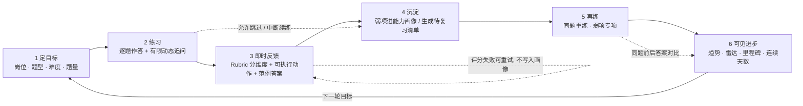
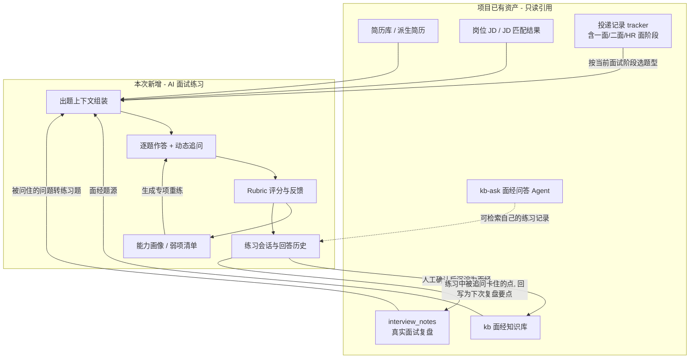
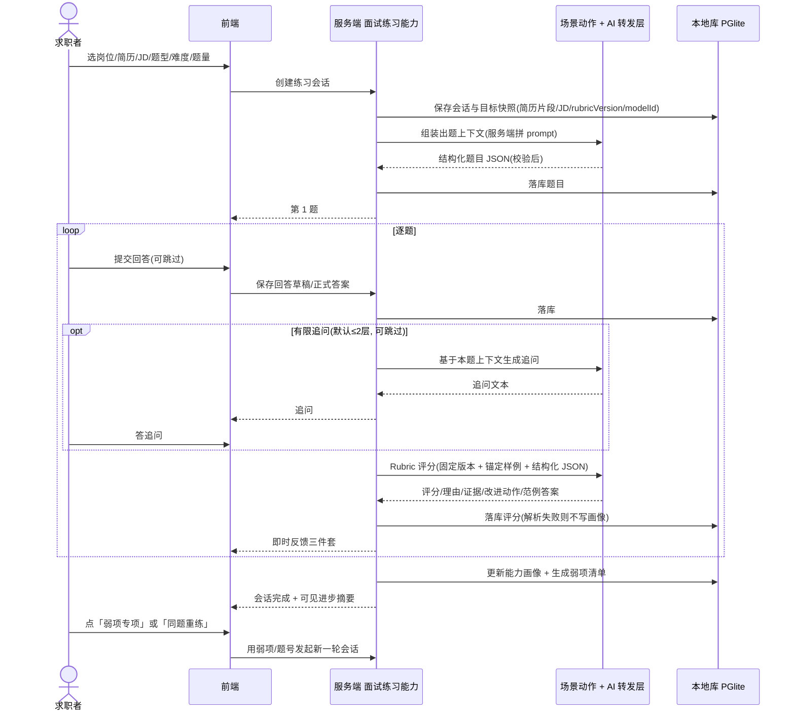
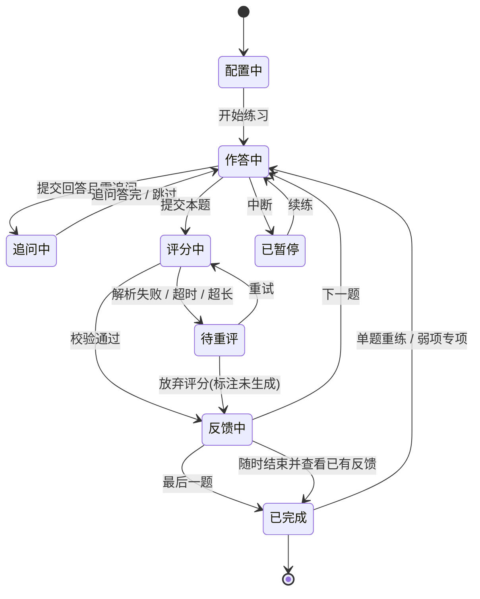
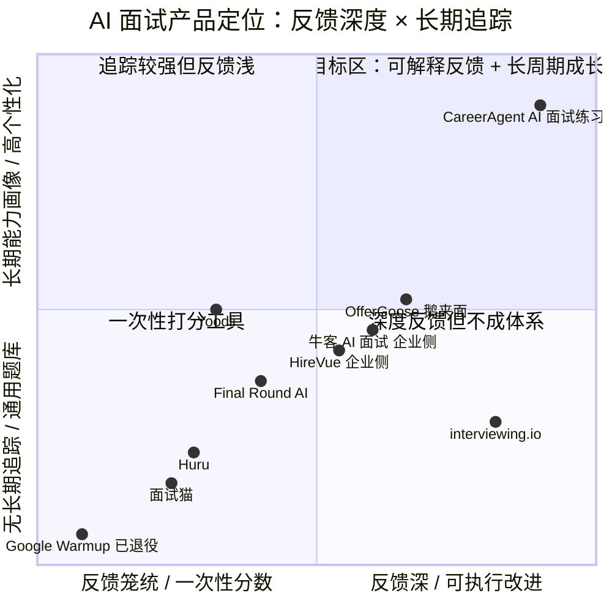

# AI 面试练习 · 完整 PRD

> **建议编号**：N14（接续 N13；待需求文档维护者确认）　**优先级**：P0（本轮主线）　**状态**：调研完成 · 待评审
> **调研时间**：2026-11-12　**调研方式**：多轮联网检索（中英文关键词）+ 官方一手页面抓取
> **文档类型**：**完整 PRD**（用户明确要求「实现功能前调研现在所有主流的 AI 面试软件及流程」，故在简单 PRD 之上补齐竞品分析、象限图与详细需求分析）
> **借鉴来源**：Google Interview Warmup（已退役）/ Yoodli / Final Round AI / Huru / interviewing.io / Pramp→Exponent→Aced / OfferGoose 鹅来面 / 面试猫 / 牛客 AI 面试 / BOSS 直聘·智联·讯飞智聘（企业侧）/ HireVue（企业侧）/ LLM-as-a-Judge 与刻意练习方法论
> **对齐标尺**：[00-产品定位与评审标尺](./00-产品定位与评审标尺.md)（护城河 / 价值 / 成本 / 依赖四问）

---

## 文档边界声明（请先读）

1. 本文**只定义「做什么、为谁做、怎么验收、什么不做」**，不定义模块划分、API 契约、表结构、状态机实现与技术选型——这些由架构师在设计阶段决定。文中出现的现有实体名（`applications` / `interview_notes` / `kb` / `ai_configs` / `ai_usage` 等）均为**对现状事实的引用**，不是新增设计。
2. **事实与分析严格分开**：第一部分是联网调研的**事实层**（带引用编号〔Rxx〕，出处见附录 A）；凡是本产品的判断、归纳、取舍，一律显式标注「**【本产品分析】**」。查不到或来源互相矛盾处一律写明「**未查证**」或列出冲突口径，不做填补、不编造。
3. 本次是**新增「AI 模拟面试练习」能力**，不是 ROADMAP 中「⏸ AI 写作闭环」的解冻；同时**构成对 N7 §七「不做面试模拟对话」的正式范围扩张**（仅限纯文本、非实时形态），须在评审记录显式留痕。边界与立项依据见 §5.3 / §5.4。
4. 全篇 UI 设计严格遵守项目**黑白灰三色规范**，不含任何其他颜色；针对「文档铁律 vs `styles.css` 存量彩色」的偏差，§11 给出**唯一可执行的 QA 裁决口径**。
5. 按团队指派**仅产出这一份文档**：未改动 `00-需求总览.md` / `README.md` 索引、未改任何源码；索引登记与重命名属移交事项（§5.4 / Q12 / Q14）。

---

## 〇、执行摘要（给架构师的一页速读）

**【本产品分析】** 五条核心结论：

1. **市场普遍断在「闭环」而非「能力」**。2025–2026 年的产品不缺出题、不缺打分、不缺语音，但绝大多数是「练一次 → 给一个分数 → 结束」：Google Warmup 明确不评分〔R1〕〔R24〕，Yoodli 只评「怎么说」不评「说了什么」〔R2〕〔R3〕〔R23〕，多数横评把「no growth tracking / no session recall」列为共性缺陷〔R1〕〔R25〕〔R26〕。企业侧（HireVue / 牛客）有多维评分和能力画像，但那套数据归 HR，**不回流给候选人练习**〔R6〕〔R16〕。
2. **真正在补齐闭环的都是 2026 年的新动作**：Final Round AI 官网已上线「Debrief → 下一轮自动拾取弱项」〔R22〕；Aced（原 Pramp/Exponent）给免费 peer mock 加了 AI 评分〔R29〕； interviewing.io 加了免费 AI interviewer〔R27〕；BOSS 直聘企业侧数字人面试官带追问与报告，2026-08-25 财报电话会称日跑 1 万+ 场〔R19〕。**趋势明确指向「追问 + 可解释评分 + 弱项回流」**，这正是我们要做且能做出差异的地方。
3. **差异化定位**：不做「更像真人的面试官」，做**「可反复练、看得见进步、且题目锚定自己简历与 JD 的本地练习闭环」**。三个支点：① 简历 + JD + 面经 + 真实面试复盘共同出题（竞品多为通用题库，最多贴一份 JD）；② Rubric 驱动的可解释评分 + 一条可执行改法 + 一版参考范例；③ 跨场次能力画像、弱项清单、同题前后答案对比——**把「进步」做成一等公民**。
4. **本期 P0 必须是纯文本、且只依赖现有 LLM 转发层**（用户自配 OpenAI 兼容 baseUrl/model/apiKey）。实时语音对话（Realtime API / WebRTC / 低延迟 TTS-ASR）、摄像头多模态、数字人面试官**一律不进 P0，且本期明确不做**——它们需要云厂商专用实时语音能力与额外硬件，与「local-first + 用户自填兼容接口」硬约束冲突（证据见 §4）。
5. **正反馈是可度量的**，不是口号：以「复练率 / 同题提升幅度 / 弱项收敛率 / 闭环完成率 / 周活跃练习天数」为北极星指标（§13），并用「不显示总分、改进动作必须可执行、进步图优先于绝对分、允许跳过与中断、失败不惩罚」五条规则防止变成打击人的负反馈（§6.3）。

---

# 第一部分 · 联网调研（事实层）

## 一、调研方法与口径

| 项 | 说明 |
|---|---|
| 时间口径 | 检索执行于 **2026-11-12**；优先采纳 2025–2026 年资料，2026 年官方页面优先 |
| 检索轮次 | 共 **5 轮**，中英文关键词混合；每轮取Top结果去重后交叉验证 |
| 关键词组 | ① `AI mock interview tools comparison 2026 / Final Round AI Yoodli Huru Google Interview Warmup`；② `AI 模拟面试 工具 2025 2026 牛客 面试猫 多面鹅 OfferGoose 讯飞智聘`；③ `HireVue AI video interview scoring controversy 2025 2026`；④ `structured behavioral interview STAR rubric follow-up probing`；⑤ `AI interview cheating detection 2026`；⑥ `OpenAI Realtime API / GPT-Live WebRTC low latency`；⑦ `agentic AI interviewer adaptive follow-up resume JD 2026`；⑧ `LLM as a judge scoring drift structured JSON rubric anchored calibration`；⑨ `spaced repetition deliberate practice interview progress tracking`；⑩ `BOSS直聘 智联 讯飞智聘 数字人面试官 2025 2026`；⑪ `Pramp Exponent interviewing.io 2026`；⑫ `Google Interview Warmup 2026 retired` |
| 抓取的一手页面 | HireVue 官方 SIOP LEC 2026 总结（2026-10-13）〔R6〕、OpenAI 官方 GPT-Live 工程文（2026-08-03）〔R14〕、Final Round AI 官方定价/功能页〔R22〕、Yoodli 官方定价页〔R23〕 |
| 来源分级 | **A 级**：厂商官方页 / 官方文档 / 官方博客；**B 级**：第三方横评、行业媒体、财报电话会转述；**C 级**：厂商自述营销稿、SEO 软文、测评带货文（含「S 级评分」「押题命中率 91.2%」等无法核验的数字） |
| 诚实性规则 | 关键事实尽量标〔Rxx〕；**价格/日期出现口径冲突时并列列出，不擅自取一个**；C 级数据只作为「厂商宣称」引用并注明；查不到写「未查证」；以下所有「【本产品分析】」段落均为分析，不属于检索事实 |

> ⚠️ 特别说明：**本轮未找到** BOSS 直聘 / 智联招聘 / 讯飞智聘面向**求职者个人**的「反复练习 + 长期能力追踪」产品形态的可靠资料；检索到的均为**企业招聘侧** AI 面试能力。此项记为「**未查证（个人侧）**」，不据此推断竞品能力。国内个人侧工具（OfferGoose、面试猫、超级简历 AI 面试等）的资料多为 C 级软文，其自报指标一律按「厂商宣称」处理。

---

## 二、维度 A：主流 AI 面试 / 模拟面试产品

### 2.1 速览总表

> 「反馈机制」列按用户要求的四问拆解：**逐题评分 / 改进建议 / 可重练 / 长期追踪**。「新动向」列限定 2025–2026 可查证内容。

| # | 产品 | 侧别 / 目标用户 | 逐题评分 | 改进建议 | 可重练 | 长期追踪 | 商业模式 | 2025–2026 可查证新动向 |
|---|---|---|---|---|---|---|---|---|
| A1 | **Google Interview Warmup** | 个人 / 零门槛初学者 | ✗ 官方明确「不评分、不判定对错」〔R1〕〔R24〕 | ✗ 仅词频、话题、岗位术语提示〔R1〕〔R25〕 | ✓ 可反复答 | ✗ 不保存音频与转写、无跨会话记忆〔R24〕〔R26〕 | 全免费 | **已退役**：官方地址 2025-12 中旬起重定向，2026-04 出现「spring cleaning」退役通知；Google 未发正式公告，改引导至 Gemini Live〔R24〕〔R25〕〔R26〕〔R28〕 |
| A2 | **Yoodli** | 个人 + 企业 L&D / 表达训练 | 部分（**仅表达层**：语速、填充词、简洁度、眼神）〔R2〕〔R3〕 | ✓ 表达层具体 | ✓ 角色扮演可重复 | △ 有进度/Measure 看板，但**企业侧**为主〔R23〕 | 官方：Starter $0（累计 5 次）/ Pro $8 月（年付）/ Advanced $20 月（年付）/ Business·Enterprise 按席位〔R23〕〔A 级〕 | 官网已改定位为「**AI Platform for Human Skills**」，重心转向团队/L&D、自定义 rubric、SSO、SOC 2 Type 2〔R23〕 |
| A3 | **Final Round AI** | 个人 / 技术+行为面、真实面试现场辅助 | △ 有 Practice Debrief（what worked / next to improve）〔R22〕 | ✓ 有，但第三方批其「分数泛泛、不贴回答」〔R3〕 | ✓ 8 种场景模拟〔R22〕 | △ 官方称「下一轮练习拾取上次弱项」〔R22〕；第三方仍列「no structured capability tracking」〔R1〕 | 官方：Free $0（仅目标与材料）/ Pro **$25+/月**（年付最多省 40%）〔R22〕〔A 级〕；第三方并列 $90/月、$148/月、$149/月等口径〔R1〕〔R27〕〔R28〕，**口径冲突** | 官网 2026 版已把流程改成「Prepare → Perform → Review」并上线自动 Debrief〔R22〕；Stealth Mode / Screen Help 引发诚信争议〔R13〕〔R22〕 |
| A4 | **Huru** | 个人 / 移动端行为面练习 | △ 基础评分（偏表达层）〔R1〕〔R2〕 | ✓ 有 | ✓ 主打「repeat practice at volume」〔R5〕 | △ 有限〔R1〕〔R2〕 | 第三方：$24.99/月 或 ~$99/年〔R2〕〔R27〕；另有 $8–25/月 口径〔R1〕，**口径冲突**；有限免费档 | Chrome 插件抓取 LinkedIn/Indeed JD 定制题目、多语言支持〔R2〕〔R3〕；用户反馈插件不稳、反馈偏表达层不评内容〔R2〕 |
| A5 | **interviewing.io / Pramp（→Exponent→Aced）** | 个人 / 技术面（真人 peer 与资深工程师） | ✓ 结构化书面反馈（真人）〔R27〕〔R30〕 | ✓ 质量最高〔R1〕 | △ 需排期、按次付费 | ✗ 无结构化能力追踪〔R1〕〔R30〕 | interviewing.io：免费 peer 档 + 付费 **$179–225+/场**〔R27〕〔R30〕；Pramp 核心 peer 免费，Exponent/Aced 会员 ~$12–79/月〔R27〕〔R29〕 | Pramp 被 Exponent 收购后于 **2026-08 更名 Aced**，并新增「按招聘 rubric 的 AI 评分」〔R29〕；interviewing.io 新增**免费 AI interviewer**（约 200 题）〔R27〕〔R30〕 |
| A6 | **OfferGoose 鹅来面（原多面鹅）/ 面试猫 / 超级简历 AI 面试** | 国内个人 / 校招与程序员 | ✓ 厂商宣称「六维复盘」「深度面试复盘」〔R8〕〔R9〕 | ✓ 宣称给改法与话术重写〔R8〕 | ✓ 宣称可反复练 | △ 官网宣称「持续分析强弱项」〔R8〕，**未见可核验的跨场次量化机制** | 官网未列公开价目（**未查证**）；C 级测评文互相打分〔R9〕〔R10〕 | 原「多面鹅」更名「鹅来面」；主打 AI 模拟面试 + 实时提醒 + 简历/JD 定制 + 多语言 + AI 面试官追问〔R8〕；面试猫被指「追问通常只有 1 层、不支持简历上传、评分维度较粗」〔R10〕〔C 级，仅作参考〕 |
| A7 | **牛客 AI 面试** | **企业侧** HR / 校招批量初筛 | ✓ 多维自动评分 + 排名〔R16〕〔R17〕 | ✗ 面向 HR 决策，非给候选人练习 | — | ✓ 企业侧人才画像与复用〔R16〕〔R17〕 | 企业付费（未公开报价，**未查证**） | 官方 2025 系列文章：**智能追问引擎**（称 2 秒响应、还原思维路径图、区分「背诵答案」与「真实能力」）、情境模拟、能力雷达、360° 画像〔R16〕〔R17〕〔R18〕 |
| A8 | **BOSS 直聘 / 智联招聘 AI 版 / 讯飞智聘 / 中智「光眸」** | **企业侧**招聘全流程 | ✓ 自动生成面试报告与评分〔R19〕〔R20〕〔R21〕 | ✗ 给 HR | — | ✓ 企业侧人才库画像〔R21〕 | 打包进企业付费产品，不单独计价〔R19〕 | BOSS 直聘 2026-08-25 财报电话会：企业侧 AI 面试**日跑 1 万+ 场**，含**可定制数字人面试官 + 追问 + 报告**，并首次把 AI 功能列为客户 ARPPU +7% 的驱动之一〔R19〕；智联 AI 版 2025-11 大会展示「视频分析微表情/语速/用词 → 胜任力报告」〔R20〕；讯飞智聘 3D 虚拟面试官 + 多模态评测〔R21〕；中智「光眸」以**动态追问**为卖点〔R38〕 |
| A9 | **HireVue**（企业侧参照系） | **企业侧**大规模结构化初筛 | ✓ 按 competency 对**转写文本**评分〔R6〕〔A 级〕 | ✗ 面向 HR | — | ✓ 企业侧报告 | 第三方估 ~$35,000/年起，多年合同，**非官方报价**〔R7〕 | 官方 2026-10-13 明确：AI 只评「候选人说了什么」，**不评面部表情/肢体/环境/语气**；「Interview Insights」把行为证据链到 competency 与转写时间戳；新增 **AI Interviewer 双向对话 + probing follow-ups**，问题与 rubric 由招聘团队审批〔R6〕；作弊信号只触发人工复核、绝不自动淘汰〔R6〕 |

> 补充参照：Exponent / Big Interview / Interview Query / Mocklingo / Fluently / Skillora / Sensei AI / LockedIn AI / Verve AI 等在横评中被反复列出〔R3〕〔R4〕〔R5〕〔R11〕〔R12〕，形态可归入上述 9 类（课程型 / peer 型 / 实时辅助型 / 表达型），不逐一展开。**Sensei AI、LockedIn AI、ParakeetAI** 等属于「真实面试中实时喂答案」的 Copilot 品类，第三方横评普遍指出其「不构建持久能力、存在伦理与企业反制风险」〔R2〕〔R3〕〔R13〕。

### 2.2 逐款关键事实与出处（补充上表未展开的交互流程）

**A1 Google Interview Warmup**〔R1〕〔R24〕〔R25〕〔R26〕〔R28〕
- 交互流程：选职业方向 → 5 道固定题 → 语音或文字作答 → 实时转写 → 展示高频词 / 话题点 / 岗位术语 → 结束。
- 反馈机制：官方 FAQ 明确「insights 不评分、不告诉你哪部分对或错」；无追问、无视频/肢体反馈、不能读简历；Google 称不保存音频与转写，可自行下载转写。
- 商业：全免费、无需注册。
- 新动向：**已退役**。第三方于 2026-09-18 / 2026-10-22 / 2026-10-26 多次核查，官方地址重定向到「How to prepare for an interview」或 Grow with Google 目录，部分区域返回 404；Wayback 显示主页面最后可用快照 2025-12-14，2025-12-16 起重定向，退役通知于 2026-04-23 被抓取，措辞为「spring cleaning」。**Google 未发布正式公告、未说明原因**；其替代建议为 Gemini App 的 Gemini Live。
- **【本产品分析】** 这是本次调研最有价值的信号之一：连「免费、零门槛、大厂背书」的单点工具都退场了，而第三方总结的用户流失原因恰恰是「**no scoring / no feedback narrative / no session recall**」〔R26〕——即**没有闭环**。这从反面支持了本 PRD 把闭环而非「题库量」作为核心。

**A2 Yoodli**〔R2〕〔R3〕〔R23〕〔A 级官方〕
- 交互流程：录制/上传一段口语回答或实时 AI roleplay → 分析语速、填充词、简洁度、眼神（用摄像头时）→ 给表达层反馈。Toastmasters International 使用〔R3〕。
- 反馈机制：**只评「怎么说」不评「说了什么」**——「一段节奏完美、零填充词但答非所问的回答依然失败」〔R2〕。
- 长期追踪：官方个人档以「次数配额」为主（Starter 累计 5 次 / Pro 每周 10 次 / Advanced 无限）〔R23〕；Measure 看板、自定义 rubric、数据不进 AI 训练等能力主要在 Business/Enterprise 档〔R23〕。
- 新动向与口径修正：官网现定位「AI Platform for Human Skills」，个人档只是入口。第三方横评里常见的 $16.99/月〔R1〕、$10/月〔R2〕、$24/月〔R28〕均与**当前官方页不一致**，本 PRD 以官方页为准〔R23〕，其余标为过时/冲突。

**A3 Final Round AI**〔R1〕〔R2〕〔R3〕〔R13〕〔R22〕〔A 级官方〕〔R28〕
- 交互流程（官网 2026 版）：**Prepare**（上传简历、目标岗位、JD、准备材料，生成定制练习）→ **Perform**（AI 面试官按 8 种场景：Coding / System Design / Behavioral / Product Case / Salary Negotiation 等；或真实面试中开 CoPilot）→ **Review**（自动生成 Interview Debrief：WHAT WORKED / NEXT TO IMPROVE / readiness）〔R22〕。
- 反馈与重练：官方明确「**下一轮练习会拾取上次 Debrief 标记的弱项**」〔R22〕——这是竞品里最接近我们要做的闭环的一处。**但第三方仍指出**其「分数感觉泛泛、未绑定到具体回答内容」〔R3〕、无结构化能力追踪〔R1〕、ChatGPT/通用模型式「默认鼓励、很少说答案弱」的问题〔R2〕。
- 商业：Free $0（仅建 Goal、解析 JD、桌面端）；Pro **$25+/月**（年付最多省 40%，含无限 CoPilot、Stealth、自动 Debrief、模拟面试、Screen Help），官网写明「**无免费试用，实时会话需有效 Pro 订阅**」〔R22〕。第三方并存 $90/月、$148/月、$149/月、$96/月（季付）等口径〔R1〕〔R27〕〔R28〕，**判定为月付/年付/旧版套餐差异，不擅自统一**；多家提到取消与扣费投诉〔R3〕〔R27〕。
- 2025–2026 动向：官网 10M+ 用户、SOC 2 Type I/II、CCPA/GDPR 徽章、支持 76 种语言、覆盖 Zoom/Meet/Teams 及 HackerRank/CoderPad/CodeSignal/HireVue〔R22〕；Stealth Mode 与 Screen Help 明确把「实时辅助」产品化〔R13〕〔R22〕。

**A4 Huru**〔R1〕〔R2〕〔R3〕〔R5〕〔R27〕
- 流程：Chrome 插件从 LinkedIn/Indeed 抓取 JD（或粘贴）→ 生成该岗位模拟题 → 录视频作答 → 反馈语速/填充词/语气/自信度 + 模型答案对比〔R2〕〔R27〕。
- 反馈偏表达层，不评内容相关性与深度〔R2〕；一种面试形式、无轮次变化〔R2〕；第三方称免费档极有限〔R1〕、插件导入有 bug〔R2〕〔R27〕。
- 价格口径冲突：$24.99/月 或 ~$99/年〔R2〕〔R27〕 vs $8–25/月〔R1〕，并列保留。

**A5 interviewing.io / Pramp→Exponent→Aced**〔R1〕〔R5〕〔R27〕〔R28〕〔R29〕〔R30〕
- Pramp/Exponent：免费 peer-to-peer，30–45 分钟互相面试、共享代码编辑器、互写反馈；覆盖 coding / system design / PM / behavioral〔R29〕〔R30〕。痛点：反馈质量取决于匹配到的同伴、需排期、约 1/5 no-show〔R27〕〔R29〕。
- 沿革：Exponent 2021-11 收购 Pramp、2024-07 迁移 peer mock、**2026-08 更名 Aced**，并新增「按招聘 rubric 的 AI 评分」与结构化 track〔R29〕。
- interviewing.io：匿名匹配 Meta/Google/Amazon/OpenAI 工程师做真人技术模面，反馈质量被公认最佳〔R1〕〔R27〕〔R30〕；$179–225+/场〔R27〕〔R30〕，免费 peer 档 + **免费 AI interviewer（约 200 题）**〔R27〕；无结构化能力追踪、偏技术岗〔R1〕。
- **【本产品分析】** 真人反馈质量最高但**不可高频复练**（贵、要排期）；AI 反馈可无限次但容易浅。这正好界定了我们的位置：**用 AI 做高频复练闭环，把真人面试留给真实战场**，不试图替代真人。

**A6 国内个人侧（OfferGoose / 面试猫 / 超级简历 AI 面试）**〔R8〕〔R9〕〔R10〕〔R11〕
> 资料以 C 级测评/软文为主，以下按「厂商宣称 / 第三方测评说法」引用，**不视为经核验事实**。
- OfferGoose 鹅来面（原多面鹅）官网自述：AI 模拟面试、实时面试提醒（捕获系统音频识别问题，宣称 95% 识别率 / 1 秒生成回答 / 20 秒深入分析）、一键 AI 简历、深度面试复盘、多语言、AI 面试官「针对你说的内容追着提问」、「持续分析你的强弱项」〔R8〕。
- 第三方横评比矩阵（厂商自家博客，C 级）列其「Mock Interviews / Deep Review / End-to-end Coverage」五星，并给出「Clarity 54→76、Logic 85」等案例数字〔R9〕——**无法独立核验**。
- 面试猫被指「追问逻辑较浅（通常只有 1 层）、不支持简历上传和个性化调整、面经数据源不透明」；超级简历 AI 面试「追问深度有限、评分维度较粗（仅整体打分，无逐题分析）」〔R10〕〔C 级〕。
- **未查证**：这三款的公开定价、是否提供跨场次能力画像的量化口径、是否可导出个人练习数据。

**A7 牛客 AI 面试（企业侧）**〔R16〕〔R17〕〔R18〕〔R32〕〔R33〕
- 流程：岗位模型设定（胜任力与能力维度评分标准）→ 智能追问（针对关键回答自动深挖项目拆解/解决思路，官方称 2 秒响应、生成「思维路径图」、区分背诵答案与真实能力）→ 情境模拟（团队协作、销售议辩，含语音/表情/内容分析）→ 自动化初筛打分 + 能力雷达 + 报告〔R16〕〔R18〕。
- 反馈对象：HR 与用人部门，**不回流给候选人做练习**〔R16〕〔R17〕。官方亦建议「提供模拟练习降低候选人焦虑」〔R16〕，但这是给企业的建议，非面向个人的产品。
- 商业与规模数据均为厂商自述（如「3000 万+ 真实岗位数据训练」「效率提升 62%」「录用率提升 18%」）〔R17〕〔R18〕〔R33〕，**C 级、无独立核验**，本 PRD 不采信为事实。

**A8 国内企业侧平台**〔R19〕〔R20〕〔R21〕〔R37〕〔R38〕
- BOSS 直聘：2025-08-20 电话会披露面向大型国企的 AI 面试产品（可定制**数字人面试官 + 追问 + 面试报告**），已支持 20+ 场校招 AI 面试、近 3 万人参与；2026-03-18 AI 辅助面试在平台自有面试间全量上线；**2026-08-25 电话会称企业侧 AI 面试日跑 1 万+ 场**，并首次把扩展的 AI 功能列为 ARPPU 同比 +7% 的驱动之一〔R19〕〔B 级，财报电话会转述；原文亦注明「AI 只是多个驱动之一，未拆分贡献」〕。
- 智联招聘 AI 版（2025-11-28/29 第三届全国人力资源服务业发展大会）：从职位发布、简历筛选、面试邀约到 AI 面试全流程自动化；「AI 面试官通过视频分析技术识别微表情、语速和用词习惯，提供胜任力评估报告」〔R20〕〔R38〕。
- 讯飞智聘：3D 虚拟面试官（模拟真人声音/表情/行为）、7×24 可配置面试间、语言/语义/职业素质多维评测、AI 面试报告与总分排名、实时分析表情体态〔R21〕；讯飞数字人平台升级中「星火陪练」结合企业知识库模拟真实业务场景，宣称年 1000 万+ 次实战陪练〔R37〕。
- 中智「光眸」AI 数字人面试系统以**动态追问技术**为大会焦点〔R38〕；湖北展馆「AI 模拟面试舱」语音交互完成全流程并实时生成能力评估报告〔R38〕。

**A9 HireVue（企业侧，评分方法论的最佳参照）**〔R6〕〔A 级〕〔R7〕〔R12〕〔R13〕〔R15〕
- 评分依据（官方 2026-10-13）：AI 评分的视频面试**只评估「候选人说了什么」**，基于**面试转写文本**；**不评估面部表情、肢体语言、环境背景、语气**；2022 年发布业内首个 AI Explainability Statement；「Interview Insights」把行为证据链接到具体 competency 与转写时间戳，让 HR 看见每个分数的依据〔R6〕。
- 退役史：2021-01 官方宣布停用视觉分析（自研发现视觉数据对预测力增量极小，第三方称约 0.25%）；面部分析组件据 SHRM 报道 2020-03 即停用〔R12〕〔R13〕；2023-02 相关模型的集体诉讼以 375 万美元和解〔R15〕〔B 级〕。
- 争议与合规：Illinois AI Video Interview Act 及 HB 3773（2026-01-01 生效）、NYC Local Law 144 要求偏见审计、EU AI Act 2024/1689 将就业类列为高风险、ACLU of Colorado 2025-03 无障碍投诉〔R7〕〔R15〕；英国 Data (Use and Access) Act 2025 自 **2026-02-05** 起以 Articles 22A–22D 取代原 GDPR Art.22，ICO 称招聘决策属「可能有重大影响」〔R12〕。ISE 2025-11-12 调查：53% 雇主全自动情境判断测验，但面试与测评中心 **94–100% 仍由人主导**；怀疑候选人违规的雇主占比从 7% 翻倍到 15%，其中 61% 指向「未经披露在面试中使用 AI」〔R12〕。
- 作弊信号处置（官方）：Candidate Image Capture / Browser Focus Tracking / 可定制诚信声明；**「作弊标记不等于作弊」，只触发人工复核，绝不自动拒掉候选人**；完整性监控与基于转写的评分**相互隔离**〔R6〕〔R13〕。
- 新动向：官方上线 **AI Interviewer**——自然的双向对话、**带 probing follow-ups**，问题与 rubric 由招聘团队审批，AI 按岗位特定标准评估并解释证据；guardrails 含 script locking、review records、无障碍适配、AI opt-out、人工监督〔R6〕。官方亦指出「**对话式/角色扮演 AI 能产出更丰富的行为证据，但评估难度显著更高**」〔R6〕。

### 2.3 事实冲突与「未查证」清单（诚实性记录）

| 项 | 冲突 / 缺口 | 本 PRD 处理 |
|---|---|---|
| Final Round AI 价格 | 官方 $25+/月〔R22〕 vs 第三方 $90 / $148 / $149 / $96 月〔R1〕〔R27〕〔R28〕 | 以官方为准，其余并列标注为不同计费周期/旧套餐口径，**不统一** |
| Yoodli 价格 | 官方 $0 / $8 / $20（年付）〔R23〕 vs 第三方 $10 / $16.99 / $24 / $12〔R1〕〔R2〕〔R28〕〔R30〕 | 以官方为准，其余标注「过时或口径不一致」 |
| Huru 价格 | $24.99/月·$99/年〔R2〕〔R27〕 vs $8–25/月〔R1〕 | 并列，不取中值 |
| Google Warmup 退役日期 | 2025-12 中旬开始重定向〔R25〕 vs 第三方普遍称 2026-04〔R24〕〔R26〕〔R28〕 | 并列；并注明「Google 未发正式公告，2026-04 是退役通知被抓取的时间而非首次停服时间」〔R25〕 |
| HireVue 定价 | 第三方估 $35,000–145,000/年〔R7〕〔R24〕 | 明确「**非官方报价，第三方估计**」；官方未公开定价 |
| 国内个人侧工具定价 / 长期追踪量化口径 | 未找到可靠公开资料 | **未查证**，不推断 |
| 牛客 / 讯飞 / 智联的效率提升百分比、押题命中率 | 仅厂商自述或 C 级软文 | 标注「**厂商宣称，未独立核验**」，不作为设计依据 |
| 38.5% 面试被标记疑似 AI 辅助 | 第三方口径（2025-07~2026-01，19,368 场）〔R15〕〔C 级，原文自标置信度 C〕 | 仅作为趋势线索引用，不作为定量结论 |
| HireVue 是否检测 ChatGPT 生成文本 | 官方及核查文章均称**未公布任何机制**；声称有「相似度阈值/隐藏分类器」的说法无法追溯到官方来源〔R13〕 | 明确写「**未查证，官方无此机制**」，不引用传言 |

---

## 三、维度 B：真实面试流程与评估方法

### 3.1 面试类型矩阵（事实层）

| 类型 | 考察什么 | 典型结构 / 评分关注点 | 出处 |
|---|---|---|---|
| **结构化面试** | 岗位胜任力 | 同一岗位**同一组问题、同一顺序、同一 rubric**，面试官**独立打分后再讨论**；结构化面试预测效度显著高于非结构化〔R31〕〔R34〕 | 〔R31〕〔R34〕〔R35〕 |
| **行为面试（STAR）** | 过去行为预测未来行为 | Situation / Task / Action / Result，加 Learning/Reflection；**Action 应占约 60%**；最关键追问是「**你个人具体做了什么**」（区分「我们」）〔R31〕〔R33〕〔R34〕〔R35〕 | 〔R31〕〔R33〕〔R34〕〔R35〕 |
| **技术面（算法 / 项目深挖 / 系统设计）** | 专业深度与推理 | 系统设计 45–60 分钟：需求澄清（5–10）→ 高层设计 → 深挖 → 权衡与瓶颈；rubric 看「是否先问澄清问题、能否用数字论证组件选择、能否主动识别单点故障、约束改变时能否调整设计」〔R32〕 | 〔R32〕〔R33〕 |
| **HR 面 / 动机面** | 稳定性、动机、价值观匹配 | 用「values-fit 锚定到具体行为」，避免「culture-fit / 能不能一起喝一杯」式偏见生成器〔R31〕 | 〔R31〕〔R34〕 |
| **压力面 / 追问施压** | 一致性、推理深度、情绪稳定 | 2026 年出现「超个性化追问链」：一个问题可展开 6+ 分支，考察一致性、推理、自省与压力下自控〔R40〕〔R41〕 | 〔R40〕〔R41〕 |
| **群面 / 无领导小组** | 协作、影响力、推进 | 本轮检索**未找到**可靠的 AI 群面评分 rubric 公开资料 → **未查证**；企业侧牛客以「情境模拟 + 团队协作 Roleplay + 能力雷达」近似〔R16〕 | 〔R16〕 |
| **企业侧 AI 异步视频面试（HireVue 式）** | 大规模结构化初筛 | 邮件链接 → 设备自检 → 未计分练习题 → 每题 2–3 分钟准备、90 秒–2 分钟作答、到时**自动停录** → 提交；HireVue 官方称多数评估 **5–8 题**，重考次数由雇主设定〔R12〕 | 〔R12〕〔R6〕 |

### 3.2 常见评分 Rubric 维度（归纳自多源交叉）

| 维度 | 可观察判据（1–4 锚定，见下） | 出处 |
|---|---|---|
| 内容结构化 / 完整性 | STAR 四段是否齐全、Action 是否占主体、是否有 Reflection | 〔R31〕〔R32〕〔R33〕〔R35〕 |
| 相关性 / 岗位匹配度 | 是否回答了被问的问题、例子难度是否与目标岗位相当、是否命中 JD 能力要求 | 〔R31〕〔R34〕〔R40〕 |
| 量化证据与具体性 | 是否点名人物/时间/数字；是否区分「我」与「我们」；泛泛而谈或假设式回答降档 | 〔R31〕〔R33〕〔R34〕〔R35〕 |
| 表达清晰度与简洁度 | 主线是否 20 秒内成立、有无跑题与冗余；**注意 LLM 评委有「偏好长答案」偏差，需在 rubric 里显式反制** | 〔R31〕〔R43〕〔R45〕〔R47〕 |
| 逻辑自洽 / 抗压 | 因果是否成立、被追问后是否塌、能否自圆其说并承认失误 | 〔R31〕〔R40〕〔R41〕 |
| 时间控制 / 篇幅 | 单题约 5 分钟、不让一个故事吃完整场；文本形态可用字数/要点密度/段落数作**代理指标** | 〔R31〕〔R34〕〔R50〕 |
| 自省与成长（Reflection） | 能否说出「学到什么 / 下次会怎么做」；背模板的答案往往「第一维高、第二三维低」 | 〔R31〕〔R33〕 |

**1–4 锚定量表（业界通用范式）**〔R33〕〔R35〕：
- **4**：具体、第一手、难度不低于目标岗位的例子；描述了推理过程和结果；无需引导即展现该行为。
- **3**：具体、第一手、满足岗位需要；一两个追问补齐了小缺口。
- **2**：笼统、假设式、多为「团队」、或来自简单得多的场景；追问也没补上缺口。
- **1**：没有例子，或例子展现的是该能力的反面。

**校准机制（防止评分漂移，事实层）**〔R32〕〔R33〕〔R34〕：
- 每个维度独立打分，**讨论前先独立提交**，避免权威锚定；hiring manager 最后发言。
- 每维度写「证据摘要」，**引用候选人原话**而不是印象。
- 定期 calibration：分发同一份转录/录像 → 独立打分 → 同时揭晓 → 对分差 ≥2 的维度讨论 → 把达成共识的例子**存为参考锚例**；触发信号包括「无法为自己的分数举出具体证据」「同一人同一维度被打 4 和 1」〔R32〕。

### 3.3 「追问（follow-up probing）」在真实面试中的作用（重点）

> 用户明确要求调研「流程」，追问是其中最容易被产品忽略、却决定分数有效性的一环。

1. **「分数来自追问，不来自第一版答案」**：多数第一版回答是概括，评分要靠追问补齐 STAR 缺失项。业界给出的 probe 表：缺 Situation →「选一次具体的时间，当时发生了什么？」；缺 Task →「你个人具体负责什么？」；缺 Action →「你个人做了什么？你说了什么？」；缺 Result →「结果是什么？怎么知道有效？」；缺 Reflection →「下次会怎么做不同？」；遇假设式「我通常会…」→「说一次真实发生过的」〔R33〕〔R34〕〔R35〕。
2. **区分背书与真实能力**：一个背下来的 STAR 答案在第一维（具体性）得分高，但在自省、反思维度低；追问能把这个差异暴露出来〔R31〕〔R40〕〔R41〕；牛客企业侧也把「思维路径图 / 区分背诵答案与真实能力」作为智能追问的卖点〔R18〕。
3. **2026 年企业侧把「自适应追问」当作反作弊主手段**：权威结论是「可靠的鉴别器不是候选人看起来如何，而是**当你改变问题时他能否即时推理**」；被标记的作弊案例中约 79% 使用实时 overlay 或语音模式 LLM，而**实时、自适应的追问是脚本无法预判的**〔R36〕〔R13〕。HireVue 官方亦把 probing follow-ups 纳入 AI Interviewer〔R6〕。
4. **追问要克制**：「一旦证据够评分就停止追问；一题连追 5 次就变成盘问，还挤占了其他能力项的时间」〔R33〕。
5. **追问不能改 rubric**：个性化可以改「问什么、追多深」，**评分标准必须固定绑定岗位要求**，否则「个性化面试」会变成不可比的面试〔R41〕。

### 3.4 企业侧 AI 异步视频面试的评分维度与争议

- **评分维度现状**：HireVue 官方只按**转写文本 + 经效度验证的 competency 量表**评分，且把行为证据链接到 competency 与转写时间戳〔R6〕；「 Interview Insights 帮助解释分数但**不改变分数**」〔R6〕。国内企业侧（智联、讯飞、牛客、中智）则普遍宣称纳入**微表情 / 语速 / 眼神 / 体态 / 情绪色彩**〔R16〕〔R20〕〔R21〕〔R38〕——**这是国内外最显著的方法论分歧**。
- **争议点**：① 视觉/声纹属生物识别，在 Illinois 属受规制标识、EU AI Act 属就业高风险用途，HireVue 正是因此退役视觉分析并付出和解成本〔R7〕〔R12〕〔R15〕；② 「I-O washing」——用心理学话术包装预测效度与去偏见宣称却拿不出效度研究、不良影响分析与独立审计〔R6〕；③ 对话式/角色扮演 AI 证据更丰富但**评估难度显著更高**，官方自己也把它列为待深入评估项〔R6〕；④ 只剩文本作判断依据时，文本恰恰最容易被 LLM 代写，录像作为信号的含金量随之下降〔R15〕〔R13〕；⑤ 候选人体验：单向录像被认为不近人情、需注册导致约 20–25% 流失〔R7〕。
- **合规参照（仅作事实罗列，非正式法律意见）**：Illinois AI Video Interview Act + HB 3773（2026-01-01 生效）、NYC LL144 偏见审计、EU 2024/1689 Art.5 与附件三第 4 项、UK DUAA 2025（2026-02-05 起 Art.22A–22D）、中国《个人信息保护法》〔R7〕〔R12〕〔R15〕〔R16〕。

### 3.5 AI 辅助作弊与企业侧反制 / 诚信边界

- **企业侧检测栈（2025–2026）**：HackerRank 2026-07 加入有限可用的 Gaze Detection 与截图分析，官方称抄袭模型约 93% 精度但声明「human oversight remains crucial」〔R36-B〕；CodeSignal 2025-05-28 发布 Cosmo（Full AI Co-Pilot / Guided Support 两模式），**所有候选人–AI 交互留完整转录 + 会话回放**，另有 Suspicion Score（相似度 / 遥测 / 复制粘贴）〔R36-B〕；CoderPad 文档（2026-07-02 更新）称 AI Assist 默认可用，**所有 prompt 与 AI 输出在回放中留存**〔R36-B〕；Sherlock / Pindrop Pulse / Reality Defender 等加入 Zoom/Meet/Teams 做深伪与代考识别〔R36-D〕〔R36-E〕。
- **关键共识**：厂商准确率是**营销数字不是审计结果**；独立 2026 分析把商用 AI 文本检测器置于 **<60% 准确率 + 双位数误报**〔R36〕；「**检测标记只能作为线索，不能作为结论**」，不得据此自动淘汰〔R6〕〔R36-E〕；CoderPad 官方亦写 alerts 应视为「要求澄清的提示，而非立即取消资格」〔R36-B〕。
- **规则正在转向「允许但可见」**：HireVue SIOP LEC 2026 第 3 条明确要求企业**先决定这个环节测的是「有效使用 AI」「无辅助能力」还是两者**，再给候选人清晰规则〔R6〕；Meta 在 2025 年末起设「指定可使用 AI 工具的面试轮」〔R13〕〔B 级〕。
- **【本产品分析】诚信边界**：**练习（practice）与代考（live assistance）必须切开**。我们要做的是「面试前把能力练出来」，不是「面试中把答案递进去」。因此「实时 Copilot / 隐身悬浮窗 / 捕获面试官音频实时给答案」**明确不做**（§5.2）。这条边界也直接来自用户原话「**反复练习并形成正反馈**」——练的是自己，不是外挂。

### 3.6 【本产品分析】现有产品普遍在哪个环节断掉闭环（→ 我们的差异化）

> 以下为**本产品的分析结论**，不属于检索事实。依据为 §2 与 §3 的交叉归纳。

| # | 断点 | 证据 | 我们的对策 |
|---|---|---|---|
| **B1** | **只给一次分数，不给「下一步做什么」** | Google Warmup 不评分〔R1〕〔R24〕；Final Round AI / Huru 被批「分数泛泛、不贴具体回答」〔R2〕〔R3〕；面试猫/超级简历「仅整体打分、无逐题分析」〔R10〕〔C 级〕。而练习科学明确「只说『很棒』或『慢一点』的反馈不提升表现，有效反馈要点名具体结构缺陷并给具体改法」〔R52〕〔R50〕 | 每条反馈必须含**可执行动作**（动词句、可直接替换原句）+ 一版**参考范例答案**，见 §6.2 |
| **B2** | **不追踪跨场次进步，练完即忘** | 横评把「no growth tracking」列为共性短板〔R1〕；Warmup「不保存、无 session recall」被列为三大流失原因之一〔R26〕；interviewing.io 反馈质量最高但「无结构化能力追踪」〔R1〕〔R30〕 | 能力画像 + 弱项清单 + 趋势图/雷达图/里程碑/连续练习天数，见 §6.4–6.5 |
| **B3** | **题目与自己的简历 / 目标 JD 脱节** | Warmup 固定题库、不能读简历〔R24〕〔R25〕；Huru 插件导入不稳〔R2〕〔R27〕；面试猫「不支持简历上传和个性化调整」〔R10〕；通用题库练习「不针对目标公司实际看重的情境」〔R48〕 | 复用项目已有**简历库 + JD + 投递记录 + 面经 + 真实面试复盘**共同出题，见 §6.6 |
| **B4** | **弱项不回流成下一轮目标** | 刻意练习要求「针对具体弱点、在能力边缘练习、并收到反馈」，随机刷题不产生复利〔R48〕〔R49〕〔R51〕；只有 Final Round AI 官网 2026 版开始做「下一轮拾取弱项」〔R22〕，Yoodli/牛客的追踪在企业侧〔R23〕〔R16〕 | 弱项清单 → 一键生成「专项重练」；间隔重复排期（P1），见 §6.1 / §10 |
| **B5** | **没有「同题前后对比」，进步不可见** | 检索中**未见**任何产品提供「同一道题第 1 次 vs 第 2 次答案 + 各维度分数对照」；练习科学强调「回答同一题 5 次、每次精炼结构」的 5-rep 法〔R52〕 | 单题重练 + 前后答案 Diff 对照 + 维度分变化，见 §6.5 / P0-9 |
| **B6** | **缺少或滥用「追问」** | 追问才是分数来源〔R33〕〔R34〕，也是 2026 反作弊主手段〔R36〕；但多数国内工具「追问只有 1 层」〔R10〕，Warmup 完全无追问〔R24〕；反过来 2026 无限追问又会造成「被掏空」的压迫感〔R40〕 | P0 做**有限追问（默认最多 2 层）**，可跳过、可随时结束；难度自适应列 P1 |
| **B7** | **评分口径不可解释、会漂移** | LLM-as-judge 已知有位置偏差、冗长偏差、自偏好、整体偏宽松、**rubric drift（慢慢变成按「语感/自信/流畅度」打分）**、对提示词措辞敏感〔R43〕〔R44〕〔R45〕〔R46〕〔R47〕；连 GPT-4 Turbo 与人类标签的一致率也仅 61.5%〔R43〕 | 固定 Rubric 版本 + 1–4 锚定样例 + 结构化 JSON（reason 先于 score）+ 证据引用 + 版本冻结，见 §6.4 |
| **B8** | **数据在云端、归平台/雇主，练习者拿不回来** | 候选人侧无长期画像〔R1〕；企业侧画像归 HR〔R6〕〔R16〕；Warmup 干脆不保存〔R24〕 | local-first：答案、简历、评分、画像**只存本机**，可导出，断云完整可用 |

**【本产品分析】一句话差异化**：竞品在卖「一场更像真的面试」，我们卖「**一条看得见自己在变强的练习曲线**」——且这条曲线锚定在用户自己的简历、JD、面经与真实复盘上，全部留在本机。

---

## 四、维度 C：2025–2026 前沿趋势与可落地性判定

### 4.1 趋势清单（事实层）

| 趋势 | 2025–2026 可查证证据 | 成熟度判断 |
|---|---|---|
| **T1 LLM 实时语音对话（WebRTC / Realtime API / 低延迟 TTS-ASR）** | OpenAI 2026-05-04 发文重构 WebRTC 栈（split relay + transceiver）以支撑 >9 亿周活的语音 AI〔R14-A〕；2026-08-03 官方发文 **GPT-Live**：第三代语音系统、**full-duplex（边听边说）**、**把 turn detector 从音频链路移除**、WebRTC 为传输底座、WARP 把媒体启动从 6 次往返压到 1 次、目标 **sub-second responsiveness**、将支撑 upcoming GPT-Live API〔R14〕〔A 级〕。实践建议：1:1 实时语音「默认从 Realtime + WebRTC 起步」，**只有需要检查/存储/审批中间文本时才用 ASR→文本模型→TTS 的级联链路**〔R14-B〕 | 技术已成熟，但**强绑定云厂商专用实时语音服务与媒体基础设施**〔R14〕〔R14-A〕 |
| **T2 多模态反馈（摄像头 / 语速 / 停顿 / 眼神）** | Yoodli 测语速、填充词、眼神〔R2〕〔R3〕；国内企业侧普遍宣称微表情/体态/情绪分析〔R16〕〔R20〕〔R21〕〔R38〕 | **方向相悖**：HireVue 已于 2021 退役视觉分析且付出和解成本，官方 2026 明确「不评表情/肢体/语气」〔R6〕〔R12〕〔R15〕；生物识别合规风险高 |
| **T3 Agentic 面试官（按回答动态追问、自适应难度）** | HireVue AI Interviewer 带 probing follow-ups、问题与 rubric 由人审批、含 script locking 等护栏〔R6〕；牛客「智能追问引擎 / 思维路径图 / 区分背诵答案」〔R18〕；BOSS 直聘数字人面试官带追问〔R19〕；中智「光眸」以动态追问为卖点〔R38〕；2026 出现「超个性化无限追问」现象与应对讨论〔R40〕〔R41〕；个性化出题被拆为 **competency confirmation / gap exploration / depth probing** 三类，且**rubric 保持固定**〔R41〕 | **纯文本即可实现**（多轮 LLM 调用 + 上下文管理），无需实时语音 |
| **T4 基于简历 + JD 的个性化出题与深挖** | Final Round AI 官网 Prepare 环节明确「上传简历 + 目标角色 + JD → 练习与实时建议按岗位定制」〔R22〕；Huru 插件抓 JD〔R2〕；HireVue Assessment Builder 用 JD 推荐经效度验证的评估内容〔R6〕；Skillora 等以 JD/简历生题〔R39〕；国内教程把「JD + 简历 + 岗位画像」当作模拟面试三件套，并强调「一次只问 1 个、答完再追」〔R39-B〕 | **纯文本即可实现**，且本项目已有简历/JD 结构化资产 |
| **T5 Rubric 驱动的可解释评分** | HireVue「Interview Insights 把行为证据链到 competency 与转写时间戳」「解释分数但不改变分数」〔R6〕；LLM-as-judge 工程共识：**rubric 才是 eval，模型只是执行器**、用可核验的 yes/no 判据替代笼统 1–10 分、**reason 字段放在 score 之前**、强制 JSON 结构化输出、每档配 worked example、约 20% 标注集留作 few-shot 锚点、用人标 golden set 周期性重算一致率〔R43〕〔R44〕〔R45〕〔R46〕〔R47〕；Rubrics-as-Rewards 用「essential/important/optional/pitfall」分类让错误可定位〔R44〕 | **纯文本 + 现有 LLM 转发层即可实现** |
| **T6 长周期能力画像 + 间隔重复（spaced repetition）** | 刻意练习 + 弱项定向 + 按间隔回访 + 跨维度追踪才能产生复利，随机刷题不产生〔R48〕〔R49〕〔R51〕〔R52〕；已有产品把 SRS（艾宾浩斯遗忘曲线）、主动回忆、Readiness Score、mastery-gated repetition（达到阈值才进下一类）做成卖点〔R49〕〔R50〕；Vektify 以「简历-JD 差距 → 定向练习计划 → 间隔复习」为产品主张〔R48〕 | **纯文本 + 本地库即可实现**（本期 P0 做画像与清单，排期算法列 P1） |
| **T7 数字人面试官** | 讯飞智聘 3D 虚拟面试官〔R21〕、星火陪练〔R37〕、BOSS 直聘可定制数字人面试官〔R19〕、KPMG UK 用名为 Leah 的 AI avatar 出 6 道预录题〔R12〕 | 需音视频渲染与云端资产，**本期不做** |
| **T8 AI 辅助作弊 / 企业反制 / 诚信边界** | 见 §3.5；另：HireVue 官方提出「区分测 AI 使用能力 vs 无辅助能力」〔R6〕；ISE 2025-11 调查怀疑违规雇主 7%→15%〔R12〕；Meta 指定可用 AI 的面试轮〔R13〕 | 属**产品立场与合规约束**，不是功能 |

### 4.2 可落地性判定表（硬约束下的取舍）

> **项目硬约束**（来自 team-lead 确认的现状）：local-first 本地单机应用（Windows/macOS，内置 PGlite）、用户自填大模型 apiKey（**OpenAI 兼容接口**，现有 `src/server/ai/` 转发层，SSE 流式透传）、**无云端业务库、无对外账号体系**、严格黑白灰视觉、全部业务数据按 `user_id` 行级隔离。

| 趋势 | 本期判定 | 判定理由 |
|---|---|---|
| T3 Agentic 追问（有限层数） | ✅ **P0 可做** | 纯文本多轮对话，走现有 LLM 转发层；上下文由服务端组装，无需新依赖 |
| T4 简历 + JD 个性化出题 | ✅ **P0 可做** | 项目已有简历库 / 派生简历 / JD 匹配 / 投递记录 / 面经 / 复盘；纯文本输入 |
| T5 Rubric 可解释评分 | ✅ **P0 可做** | 固定 Rubric 提示词 + 结构化 JSON 输出 + 服务端校验，纯文本 |
| T6 能力画像 / 弱项清单 / 前后对比 | ✅ **P0 可做** | 本地 PGlite 存结构化评分即可，无需外部服务 |
| T6 间隔重复**自动排期** | 🟡 **P1** | 需要复习调度与「到期提醒」的产品语义，可在画像稳定后追加；P0 先给静态待复习清单 |
| T3 自适应难度 / 无限追问 | 🟡 **P1** | 需先积累评分数据与追问策略评估；且 2026 无限追问已被指出会造成压迫感〔R40〕，与「不制造负反馈」冲突，须谨慎 |
| T1 **实时语音对话**（Realtime API / WebRTC / 低延迟 ASR-TTS） | ❌ **本期明确不做，禁止写入 P0** | 需云厂商**专用实时语音端点与媒体基础设施**（OpenAI 自建 relay/transceiver/WARP 才做到 sub-second〔R14〕〔R14-A〕）；本项目用户自填的是「OpenAI 兼容 Chat 接口」，不保证提供 Realtime/WebRTC 能力；且 local-first 单机不应引入云媒体链路与额外账号/计费。**浏览器本地语音转文字**（把口述变文本后走同一纯文本链路）可作为 **P1 可选增强**，仍不是实时语音对话 |
| T2 多模态（摄像头 / 眼神 / 微表情 / 语速） | ❌ **本期明确不做** | ① 需摄像头硬件与音视频处理依赖；② 生物识别合规风险（Illinois / EU AI Act / NYC LL144）〔R7〕〔R15〕；③ 与 HireVue 2021 退役视觉分析、2026 官方「只评转写文本」的行业方向相悖〔R6〕〔R12〕；④ 与黑白灰、纯文本练习定位不符 |
| T7 数字人面试官 | ❌ **本期明确不做** | 需云端数字人资产/渲染与音视频，超出 local-first 边界 |
| T8 实时面试辅助 / Copilot / 隐身窗口 | ❌ **本期明确不做（诚信红线）** | 与用户「反复练习形成正反馈」相悖，且企业侧 2026 反制与合规压力上升〔R6〕〔R13〕〔R36〕 |
| 向量库 / embedding 检索 | ❌ **本期不做** | 沿用 N12 决策：单人量级用关键词 + 全文检索即可，零外部依赖〔项目内文档 N12 §5.2〕 |

### 4.3 【本产品分析】「跟上时代的脚步」如何理解

**【本产品分析】** 「跟上时代」不等于把 2026 年最炫的能力全堆上。基于 §4.1–4.2，本期选择跟上的是**方法层面的时代**：**动态追问（T3）、简历+JD 个性化（T4）、Rubric 可解释评分（T5）、长周期能力画像（T6）**——这四项恰好是 2026 年 HireVue、Final Round AI、Aced、牛客、BOSS 直聘同时加码的方向〔R6〕〔R22〕〔R29〕〔R18〕〔R19〕，而且**全部能用纯文本 + 现有 LLM 转发层落地**。

而**形态层面**的实时语音、多模态、数字人，虽然声量最大，却同时与三条硬约束冲突（local-first / 用户自填兼容接口 / 黑白灰纯文本），且多模态正处在合规退潮期。**把它们写进 P0 会让功能无法在现有架构下交付**。因此本 PRD 的判断是：**本期用「文本形态 + 时代方法」跟上时代；形态升级留到 P1/P2 且需重新评估依赖与合规**。这一取舍需在评审时向用户明确说明。

---

# 第二部分 · 产品设计与正反馈闭环

## 五、产品目标与非目标

### 5.1 产品目标（3 个正交、可度量）

| # | 目标 | 度量判据 | 正交性 |
|---|---|---|---|
| **G1 闭环** | 让求职者能在本机**反复练习**并走完「练 → 评 → 沉淀 → 再练」的完整回路 | 闭环完成率（完成练习→看反馈→产生一次重练的会话占比）≥ 40%；复练率 ≥ 40% | 管「能不能持续练」 |
| **G2 可见进步** | 让进步**可看见、可归因**，而不是一次性的分数 | 同题提升幅度中位数 ≥ +0.5 档（1–4 量表）；弱项 3 次练习后升档比例 ≥ 50% | 管「练了有没有变强」 |
| **G3 贴身相关** | 题目与反馈**锚定用户自己的简历、JD、面经与真实复盘** | 关联了简历/JD 的会话占比 ≥ 60%；反馈中「引用了答案原文」的比例 = 100% | 管「练的是不是我要面的那个岗」 |

> **一句话产品定义**：CareerAgent 里一个**本地、纯文本、可反复练、看得见进步**的 AI 模拟面试练习场。

### 5.2 非目标（明确不做什么）

1. **不做**实时语音对话（Realtime API / WebRTC / 低延迟 ASR-TTS 全双工）、**不做**摄像头/眼神/微表情/语速多模态评分、**不做**数字人面试官（理由见 §4.2）。
2. **不做**真实面试中的实时辅助 / Copilot / 隐身悬浮窗 / 捕获面试官音频（诚信红线，§3.5）。
3. **不做**把 AI 评分用于真实录用决策、不提供「导出给 HR / 企业版评分报告」；评分只对用户自己可见、只作自我练习参考。
4. **不做**通用聊天机器人 / 无限对话（沿用评审标尺红线：Agent 是**场景化动作**〔00-产品定位与评审标尺 §五〕）。
5. **不做**云端业务库、账号体系对外、练习数据上云；不做排行榜、不做社交/社区、不做他人能力对比。**练习/反馈数据本期仅本机保存、不跨设备同步**（详见第 10 条与 Q7）。
6. **不做**自动「一键海投」、不做替用户参加真实面试。
7. **不做**向量库 / embedding（沿用 N12 §5.2 决策）。
8. **本期不做**算法在线判题（OJ）、代码编译执行、白板协作画布；技术面以「项目深挖 / 系统设计口述结构化」的文本题为主。
9. **本期不做**群面/无领导小组模拟（评分 rubric 未查证，§3.1）。
10. **本期练习/反馈数据仅本机持久化、不跨设备同步（已对齐架构师决策）**：本期新建 5 张练习/反馈表**不挂同步三元组、不进云同步白名单**（技术类比 `ai_usage`，纯本地统计表）。产品后果显式声明：会话、回答、评分、能力画像、弱项清单**换设备或重装应用后不保留、跨设备不可见**；本期只承诺「同一台电脑上跨会话 / 跨重启持久化」。跨设备同步与本地导出兜底列 P1（P1-8 / P1-10），见 Q7。

### 5.3 与「AI 写作闭环」及既有需求的边界（重要）

| 相邻项 | 是什么 | 与本次的关系 |
|---|---|---|
| **ROADMAP ⏸ AI 写作闭环**（润色 / 诊断 / 逐字稿起草）〔ROADMAP.md §⏸〕 | 作用于**简历文本内容生产与修改**，暂不实施 | **本次不解冻、不依赖、不重启**。两者共用同一 AI 转发层与「人工审批 / 可撤销」的交互原则，但对象不同：写作闭环改「文档」，本次做「问答练习与能力评估」 |
| **N7 求职信与面试准备**〔N7 §七〕 | 生成**结构化面试准备文本**；§七 非目标白纸黑字写「**不做**面试模拟对话（语音/视频 mock interview）——本期只做结构化准备文本，实时 mock 是更重的产品，另行评估」 | ⚠️ **本次构成对 N7 §七 的正式范围扩张，须在评审记录里显式确认解除该限制**。扩张边界严格限定为「**纯文本、非实时、可中断、可反复练**」的模拟面试练习；**语音/视频 mock、实时语音对话仍按 N7 §七 与本文 §5.2 第 1 条保留为非目标**。N7 是「看材料」，本次是「练对话」，不重做材料生成；若 N7 材料已存在，可作为出题上下文之一 |
| **N12 RAG 与 Agent 工作台**〔N12〕 | 已有 `review-interview`（面试复盘结构化整理）、`kb-ask`（面经问答）、`interview_notes` / `kb` 实体 | **复用不改契约**：本次新增「出题 / 追问 / 评分」场景动作，不修改已有 action；`interview_notes`（真实面试）与本次练习会话是**两个独立实体**，通过弱项与题目双向回流（§6.6） |
| **N2 AI 润色闭环**〔N2 §六〕 | **AI 五原则**：Diff 审阅 / 范围显式 / 可撤销 / guard 事实护栏 / 可脱敏；核心闭环「选中 → 触发 → AI 生成 → **Diff 审阅卡片** → 应用或撤销」 | **沿用 N2 的既有语义，不自造名词**，逐条适用性见下表。N7 §三/§六 亦明确面试准备同样遵守 AI 五原则，本次延续同一套门控语言 |
| **投递追踪 tracker / 公司档案 / 附件库 / 云同步** | 既有资产 | 只读引用（岗位、JD、公司、投递阶段）；**新产生的练习数据本期不纳入云同步**（待确认问题 Q7） |

**N2 AI 五原则在本次的逐条适用性**（避免评审误以为另起炉灶）：

| 原则 | 本次 | 落地方式 |
|---|---|---|
| Diff 审阅 | **不适用（改用「前后对比」）** | 练习答案由用户本人撰写、AI 不改动用户正文，故无「AI 补丁」可审阅；但**同题重练的前后答案对照**（P0-9）沿用同一套「灰底 + 加粗标差异、只读不编辑」视觉语言 |
| 范围显式 | ✅ 适用 | 出题/评分的作用范围显式绑定到当前题与当前会话，不得越界读取或改写其他会话、简历、JD 正文 |
| 可撤销 | ✅ 适用（语义等价） | 历史回答与评分**只增不改**；「重新评分」产生新记录不覆盖；沉淀面经、回写复盘要点均需确认且可撤销 |
| guard 事实护栏 | ✅ 适用 | 出题与范例答案不得编造用户的经历/公司名/数字/时间段（P0-2 AC2、P0-6 AC3） |
| 可脱敏 | ✅ 适用 | 调用上游前提示并可替换姓名/电话/邮箱/公司名（§14 R-2） |

### 5.4 立项依据与现状口径（衔接既有评审材料）

| 依据 | 原文要点 | 本次如何承接 |
|---|---|---|
| `docs/产品与竞品分析/产品原型思路与交互流程梳理-优化建议与迭代方向.md:162` **FL-03** | 「AI 仍是独立试用页；4 个动作是固定提示词 + 单次 complete，**无写作闭环、无质量评测、无反馈闭环**；面试逐字稿分析是占位」 | 本次补的是其中「**无反馈闭环**」在**面试练习侧**的缺口：把「单次 complete」升级为「出题 → 作答 → 追问 → 评分 → 沉淀 → 再练」的多轮闭环。**写作闭环侧不在本次范围** |
| 同文件 `:201` **OPT-07** | 建议「输出走 Diff 审阅 → 人工接受/拒绝 → 可撤销；补质量评测集与字段级反馈；**AI 未配置/低置信度必须降级为草稿并明示**；不得绕过权限改正式数据」 | 承接「**降级为草稿并明示**」（P0-11 无 Key / 断云降级、§11.3 异常态）、「不得绕过权限改正式数据」（P0-12 AC3）、「字段级反馈」（6 维 Rubric + 每维证据引用）；**质量评测集**以固定 Rubric + 锚定样例 + 版本冻结的轻量形态落地（§6.4），不建独立评测集 |
| 同文件 `:335` **Q3** / `:354` **R-07** | Q3「是否接受 AI 写作闭环（Diff 人工审阅）作为 V3 主线」；R-07「AI 场景化写作闭环」状态**待评审（依赖 Q3）** | ⚠️ **诚实说明：本次不回答 Q3、不启动 R-07**。写作闭环仍待评审；本次是与之并列的「面试练习闭环」，共用 AI 转发层与门控语言，但互不前置、互不替代 |
| `ROADMAP.md:99` / `:35` | ⏸ AI 写作闭环「转发层与试用台已就绪，写作流程等 D8 落地后接」；面试逐字稿 / 求职准备材料待办 | 与 §5.3 一致：本次不解冻写作闭环；面试准备材料若已有可作题源 |
| **现状口径**（据 context-scout 全量只读摸底） | `src/` 中**不存在**任何 feedback / practice / 评分 / 评测 的表或代码（纯增量）；但 `src/server/agent/` 已有 4 个 AI 场景动作、`src/server/interview/` 已有面试复盘记录 + 面经库、AI 转发层与 SSE 试用台已就绪 | 本文「现状」一律表述为：**场景化 AI 动作 + 面试事实沉淀已就绪，缺的是「练习过程」与「反馈闭环」**，而不是「AI 能力从零开始」。因此本需求是纯增量，不改造既有核心 |
| **定级论据** | `00-产品定位与评审标尺.md:45` 优先级铁律「**求职闭环（投递/跟进/面试/复盘）> 内容生产 > 排版美化**」 | 本功能落在最高优先级档（面试环节的「练」），是定 **P0** 的直接依据，非主观拔高 |

> **索引与命名移交**：按团队指派，本文落盘为 `AI面试练习-完整PRD.md`（未采用 `N14-<中文短名>.md` 命名），且本次仅授权产出这一份文档，**未改动** `docs/需求文档/00-需求总览.md`（唯一总入口）与 `docs/需求文档/README.md` 索引表。索引登记、文件重命名与状态流转（待评审 → 待开发）需由文档维护者 / team-lead 决定，见 Q12、Q14。
>
> **格式说明**：因用户明确要求「完整 PRD + 详细调研」，本文在需求文档八段固定结构之上扩展了调研与闭环章节，八段仍可一一对应：背景与竞品参照（§一~§四 / §九）｜用户价值（§5.1 / §七）｜需求描述（§六 / §八 / §十 / §十一）｜数据结构（§十二）｜验收标准（§10.1 逐条 AC / §13）｜工程护栏（§十五）｜非目标（§5.2）｜评审结论（§十七）。

---

## 六、正反馈闭环（本次需求的灵魂）

### 6.1 闭环链路（六步）+ 流程图

**【本产品分析】** 把「反复练习并形成正反馈」拆成六步可验收的链路，每一步都有产物落库，任一步都可中断、可回到上一步：

| 步 | 名称 | 用户动作 | 系统产物 |
|---|---|---|---|
| 1 | **定目标** | 选岗位（可关联已有投递记录）/ 选简历 / 选或粘贴 JD / 选题型（行为 STAR、项目深挖、HR、系统设计口述）/ 选难度 / 定题量 | 一个练习会话（含目标快照：简历片段、JD、rubric 版本、模型标识） |
| 2 | **练习** | 逐题作答（纯文本）；每题可触发有限追问（默认 ≤2 层）；可跳过、可中断 | 题目 + 回答 + 追问轮次记录 |
| 3 | **即时反馈** | 查看 | ① 分维度 Rubric 打分（1–4 锚定 + 理由 + 引用答案原文）② **一条可执行改进动作** ③ 一版**参考范例答案**（标注「示范，非标准答案」） |
| 4 | **沉淀** | 确认弱项 | 弱项写入能力画像；生成「待复习清单」 |
| 5 | **再练** | 单题重练 / 弱项专项重练 / 下一轮 | 新回答与上次形成对照；同题可无限次重练 |
| 6 | **可见进步** | 查看成长页 | 趋势图、雷达图、里程碑、连续练习天数、同题前后对比 |



**闭环成立的判据**：一次会话结束后，用户能在**不重新配置**的情况下，一键从「弱项」或「某道题」再开一轮；且这一轮结束后能看到与上一轮的对比。这是 P0 的最小完整闭环，缺任一步即视为未达成。

### 6.2 即时反馈的「三件套」（缺一不可）

**【本产品分析】** 依据「有效反馈要点名具体结构缺陷并给具体改法」〔R52〕〔R50〕与 Rubric-as-Rewards 的可核验判据〔R44〕：

1. **分维度 Rubric 打分**：6 个维度各 1–4 档（§6.4），每档附文字锚；**每维必须输出「理由」+「引用了答案里的哪句原文」**。理由字段在结构化输出中**排在分数之前**（降低 LLM 凭语感打分〔R45〕〔R46〕）。
2. **一条可执行改进动作**（不是评价，是动作）：
   - ✗ 反例：「表达不够清晰」「逻辑有待加强」「建议多练」。
   - ✓ 正例：「把第 2 段的『我们上线了』改成『我主导了灰度方案，把回滚时间从 40 分钟压到 5 分钟』——补上**你个人的动作**和**一个数字**。」
   - ✓ 正例：「你的回答停在 Action 就结束了，补一句 Result：『上线后次日留存 +3.2%，我复盘发现…』」
   - **验收约束**：改进动作必须能被「复制 → 粘回原文 → 直接改」；每条至少含一个动词与一个可替换的具体片段。
3. **一版参考范例答案**：基于**用户自己的简历 + 该 JD** 生成（不得编造经历，沿用 N12 §6.4「只引用简历中真实存在的经历」护栏），明确标注「**AI 生成的示范，不是标准答案，请用自己的话重说**」，避免照抄产生挫败或失真。

### 6.3 如何避免「负反馈」（六条硬规则）

**【本产品分析】** 用户要的是「正反馈」，因此以下为**设计约束而非建议**，逐条需可验收：

| # | 规则 | 具体做法 | 反面（禁止） |
|---|---|---|---|
| **N1** | **不显示总分、不显示「不及格」** | 反馈页首屏是 6 个维度条 +「相对上次的变化」（灰阶箭头）；绝对档位可展开查看；量表用 1–4 档而非 0–100 分 | 「本次得分 58 / 100」「未通过」「较弱」 |
| **N2** | **改进动作必须可执行** | 见 §6.2；每次反馈**至少 1 条「做得好」+ 1 条「下一步」**，且「做得好」置顶 | 笼统评价、只批不赞 |
| **N3** | **进步可视化优先于绝对分数** | 成长页首屏是趋势/雷达/连续天数/里程碑；单次分数放在二级位置 | 一进页面先甩一个分数 |
| **N4** | **允许跳过、中断、随时结束** | 每题「跳过」、会话「暂停」、随时「结束并查看已有反馈」；暂停后可续练且不丢草稿 | 必须答完才能退出、倒计时强制提交 |
| **N5** | **失败不惩罚** | 状态只有「进行中 / 已暂停 / 已完成」，**没有「失败 / 未通过」**；不设连胜中断清零、不设排行榜、不与他人比较；无红色/警示色（且黑白灰规范本就不允许） | 连续天数断掉即归零并提示 |
| **N6** | **不制造压迫感** | 追问默认 ≤2 层、每层可跳过；「压力模式 / 计时模式」仅列 P1 且必须可关闭〔R40〕 | 无限追问直到答崩 |

> 补充：**LLM 输出不可信时不制造负反馈**——评分解析失败/超时/超长时，**不产出低分、不写画像**，只提示「这次评分没生成，答案已保留，可以重试」（见 §14）。

### 6.4 能力画像（维度 / 跨场次可比 / 防打分漂移）

**【本产品分析】**

**6 个固定维度**（合并归纳自 §3.2，与团队给出的 Rubric 列表一一对应；合并处显式说明）：

| 代号 | 维度 | 对应业界维度 | 1 档 ↔ 4 档锚（摘要） |
|---|---|---|---|
| **D1** | 结构与完整性 | 内容结构化（STAR） | 1 = 无结构/答非所问；4 = S/T/A/R + 反思齐全、Action 占主体 |
| **D2** | 相关性与岗位匹配 | 相关性 **+ 岗位匹配度**（合并） | 1 = 泛泛、与 JD 无关；4 = 直击问题且例子难度贴合目标岗位 |
| **D3** | 证据具体性 | 量化证据 | 1 = 全是「我们 / 通常 / 大概」；4 = 有数字、时间、个人动作、可核验结果 |
| **D4** | 表达清晰度与简洁度 | 表达清晰度 | 1 = 冗长跑题；4 = 主线 20 秒成立、无冗余（**rubric 显式写「不因篇幅长而加分」**） |
| **D5** | 逻辑自洽与抗压 | 逻辑 | 1 = 前后矛盾、一追就塌；4 = 因果成立、被追问后能补充并承认失误 |
| **D6** | 篇幅与时间控制 | 时间控制（**纯文本代理**） | 1 = 严重超长或过短；4 = 要点密度合理、段落分明。**明确标注这是「文本代理指标」，不等价于真实语速/时长** |

**跨场次可比的四条保证**：

1. **Rubric 版本冻结**：维度定义、每档文字锚、锚定样例（few-shot worked examples）打包为一个 `rubricVersion`。**每次评分把版本号随结果一起存**；版本升级后，旧分数保留旧版本标记，**不参与新版本的均值/趋势计算**，并在成长页提示「评分口径已更新」。
2. **量表一致**：永远 1–4 锚定档，**不做百分制、不做「相对所有用户的百分位」**（无他人数据，也不该做社交比较）。
3. **模型与提示词可追溯**：每次评分记录 `modelId` / `promptVersion` / 评分时间；用户切换上游模型时，成长页提示「评分口径可能变化，换模型前后的分数不建议直接比较」。提供「重新评分」但**保留历史评分，不覆盖**。
4. **进步指标优先用「相对量」**：同题第 N 次 vs 第 1 次的**维度差**、弱项是否升档，优先于跨题绝对均分。

**防止 LLM 打分漂移的具体手段**（对应 §3.2 校准机制与 T5 工程共识〔R43〕〔R44〕〔R45〕〔R46〕〔R47〕）：
- ✅ **固定 Rubric**：服务端统一组装评分提示词，**前端不拼 prompt**；题目、JD、简历、用户答案均为不可信输入，与 system 指令分隔（提示词注入防护，§14）。
- ✅ **结构化 JSON 输出**：显式字段（每维 `reason` → `evidence` → `level`，再有 `actions` / `sampleAnswer`），**字段顺序上 reason 先于 level**；服务端按契约校验，解析失败即判为「未生成」。
- ✅ **锚定样例**：每个维度每个档位内置 1 条 worked example（可用虚构样例，禁止用用户真实数据），随评分请求注入；参考 OpenAI eval flywheel 预留约 20% 标注集作 few-shot 锚点的做法〔R45〕。
- ✅ **反偏差指令**：rubric 中显式写「不因答案更长、格式更漂亮、语气更自信而加分」「不奖励空洞的自信表达」「只依据上面列出的可观察判据」——直接对治 verbosity bias / format bias / sycophancy / rubric drift〔R44〕〔R47〕。
- ✅ **先理由后分数、证据必须引用原文**：让评分可审计，用户能自己判断分数是否可信。
- ✅ **用户校准口**：允许用户对某维打分点「这档不准」并记一句理由（本地留痕），作为后续调整 rubric 的输入；**不自动改分**。
- ⚠️ **不承诺与人类评委一致**：调研显示 LLM 评委与人类标签一致率有限〔R43〕〔R46〕，产品文案必须写明「AI 评分仅作自我练习参考，不是录用判断」。

### 6.5 「可见进步」的四种呈现（全部灰阶）

**【本产品分析】** 严格黑白灰：不同维度/不同场次**只用灰阶深浅 + 线型（实线/虚线/点线）+ 加粗 + 描边**区分，禁止任何彩色。

| 呈现 | 内容 | 灰阶实现 |
|---|---|---|
| **趋势图** | 各维度随场次/日期的档位折线；可切「全部 / 单维」 | 6 条线用 6 级灰 + 4 种线型；当前选中维度加粗 |
| **雷达图** | 最近一次 vs 首次（或上次）的 6 维对比 | 两个多边形：浅灰填充 + 深灰描边（旧）／深灰填充 + 粗黑描边（新） |
| **里程碑** | 「首次完成 5 题」「D3 证据具体性连续 3 次 ≥3 档」「累计练习 20 题」「连续练习 3 天」 | 灰阶徽章 + 加粗文字，无彩色、无动画庆祝 |
| **连续练习天数** | 日历灰阶方格（练过=深灰，未练=浅灰） | **断了不清零、不提示「中断」**（N5），显示「累计 N 天」而非「连续」惩罚 |

**同题前后对比**（竞品空白点 B5）：并排两栏「第 1 次答案 / 本次答案」，差异处用**灰底 + 加粗**标出（沿用项目 Diff 审阅的视觉语言，但只读、不编辑），下方列 6 维「上次 → 本次 → 变化」。

### 6.6 与项目已有数据资产的联动（出题 / 回流 / 沉淀）

**【本产品分析】** 这是本项目相对竞品最不可替代的优势：竞品要用户临时上传一份简历/JD，而 CareerAgent **已经有整条求职旅程**。



**四条具体联动规则**：

1. **出题（读）**：默认取「当前投递记录的阶段」（如已进「二面」则偏项目深挖与系统设计口述；「HR 面」偏动机与稳定性）+ 该岗位关联的 JD + 该岗位用的那份派生简历 + 该公司/岗位已有的 `kb` 面经题目 + `interview_notes` 里**上次被问住/评分低的问题**。系统提示词明确「只依据提供的材料出题，不得编造用户的经历、公司名、数字」。
2. **复盘回流（读→练）**：真实面试复盘（`interview_notes`）中标记为「答得差 / 被追问懵」的问题，一键「**加入练习清单**」，成为下一轮的目标题；对应业界「卡壳点清单 → 下次演练前先复习」的做法〔R39-B〕。
3. **练习成果沉淀（练→读）**：练习结束后，用户可把「题目 + 自己的最佳一版答案 + 评分理由 + 改进动作」**人工确认后**沉淀为 `kb` 面经条目（沿用人工审批门控，不自动写入）。沉淀后 `kb-ask` 可检索到自己的练习答案，形成「面经 → 出题 → 练习 → 更好的面经」的二次闭环。
4. **不越界**：练习会话**不修改**简历、JD、投递状态、`interview_notes` 原始记录；「回写复盘要点」只新增一条带来源标记的备注，不覆盖原文。

---

## 七、用户故事（10 条，覆盖要求的全部场景）

| # | 角色 | 用户故事 | 验收要点 |
|---|---|---|---|
| **US-1** | 首次使用者 | 作为第一次用 AI 面试练习的求职者，我想在 1 分钟内不配置任何复杂参数就开始一场 3 题的行为面练习，以便立刻知道这个功能是干什么的 | 有「快速开始」默认配置；3 步内进入作答；无 Key 时也有明确引导 |
| **US-2** | 有明确目标的求职者 | 作为正在投某岗位的求职者，我想选一条已有的投递记录、自动带上那份简历和 JD 来出题，以便练的就是我要面的那个岗 | 题目中可追溯到简历/JD 具体片段；不关联时也能用通用题 |
| **US-3** | 被追问就卡壳的求职者 | 作为一被追问就答不下去的人，我想 AI 按我刚才的回答追 1–2 个具体问题，以便练习「临场把话讲圆」 | 追问必须引用上一轮回答内容；可跳过；层数可配置且默认 ≤2 |
| **US-4** | 想改一版答案的人 | 作为看完反馈的人，我想对**同一道题**立刻重答一次，并看到两次答案与 6 个维度分数的并排对比，以便确认自己真的改好了 | 同题重练无限次；前后 Diff 只读展示；显示维度变化 |
| **US-5** | 有明确弱项的人 | 作为发现「量化证据」总拿低分的人，我想一键生成只针对该弱项的 3 道专项练习，以便集中补短板 | 从能力画像/弱项清单直接发起专项会话；题目难度与该弱项绑定 |
| **US-6** | 时间碎片化的求职者 | 作为临时被打断的人，我想随时暂停会话、关掉页面，下次回来从**没答完的那题**继续，以便不丢已写的内容 | 草稿自动保存；续练恢复到题目与已输入文本；无「超时作废」 |
| **US-7** | 想看长期效果的人 | 作为坚持练了几周的人，我想看到 6 个维度的趋势、雷达对比、里程碑和练过的日历，以便确认自己在变强 | 成长页 4 种视图齐全；纯灰阶；断了不清零 |
| **US-8** | 没有 API Key 的用户 | 作为还没配大模型 Key 的人，我想仍能浏览本地题库、手动作答、用自评 Rubric 记录答案、并回看历史，以便功能「不报错不空白」 | 无 Key 时 AI 出题/追问/评分入口给出明确引导而非崩溃；本地题库 + 自评 + 历史记录完整可用；配置 Key 后无需重录 |
| **US-9** | 断网 / 离线使用者 | 作为在飞机上或断网的人，我想查看全部历史会话、答案、反馈、能力画像并继续用本地题库练习，以便本机永远可用 | 断云不影响任何本地读写；不出现「需要联网」阻塞态（符合 local-first「断云不降级」〔ROADMAP.md〕） |
| **US-10** | 刚面完真实面试的人 | 作为刚结束一场真实面试的人，我想把复盘里「被问住的问题」一键变成练习题，练完再把改进后的答案沉淀回面经库，以便同一个坑不踩两次 | 复盘→练习清单→沉淀 `kb` 全链路可走通；沉淀需人工确认；不覆盖原复盘 |

> 补充覆盖：跨账号隔离（US 隐含，见 P0-13）、成本可见（§14）、AI 评分不用于录用（§14）。

---

## 八、核心流程（时序图 + 状态流转）





> 状态集里**刻意没有「失败 / 未通过」**（N5）。

---

## 九、竞品分析表 + 象限图 + 市场定位结论

### 9.1 竞品分析表（选 7 款主竞品 + 2 款企业侧参照）

| 产品 | 定位 / 目标用户 | 核心交互流程 | 反馈机制 | 长期追踪 | 商业模式 | 最大优点 | 最大缺点（我们要打的） |
|---|---|---|---|---|---|---|---|
| **Final Round AI**〔R22〕 | 个人，全流程 + 真实面试辅助 | Prepare→Perform→Review，8 场景 | Debrief：what worked / next to improve | 官方称下一轮拾取弱项 | Free $0 / Pro $25+/月 | 产品化最完整、已有弱项回流意识 | 分数被批不贴具体回答；实时 Copilot 有诚信争议；云端、数据在平台 |
| **Yoodli**〔R23〕〔R2〕 | 个人 + 企业 L&D | 录音/roleplay → 表达层分析 | 语速/填充词/简洁度/眼神 | 个人档按次配额；看板在企业档 | $0 / $8 / $20 月（年付） | 表达层反馈最细 | **完全不评内容**；重心已转团队 L&D |
| **Huru**〔R2〕〔R27〕 | 个人，移动端行为面 | 抓/贴 JD → 视频作答 → 表达反馈 | 偏表达层 + 模型答案 | 弱 | ~$24.99/月（口径冲突） | 移动端 + JD 定制 | 反馈不评内容相关性；一种形式无轮次变化；插件不稳 |
| **OfferGoose 鹅来面**〔R8〕〔C 级〕 | 国内个人，校招/程序员 | 简历→模拟面→复盘；宣称 AI 追问 | 宣称六维复盘 / 深度复盘 | 宣称「持续分析强弱项」，未核验 | 未公开（未查证） | 中文场景、简历+JD、实时提醒 | 实时辅助为卖点（诚信边界）；量化口径不可核验；数据在云端 |
| **牛客 AI 面试**〔R16〕〔R18〕 | **企业侧** HR | 岗位模型→智能追问→情境模拟→自动打分 | 多维评分 + 能力雷达 | 企业人才画像 | 企业付费（未查证） | 追问引擎 + 能力雷达方法论最完整 | **数据归 HR，不回流给候选人练习** |
| **interviewing.io / Pramp(Aced)**〔R27〕〔R29〕〔R30〕 | 个人技术面 | peer 互面 / 资深工程师模面 | 真人结构化书面反馈（质量最高） | 无结构化追踪 | 免费 peer / $179+ 场 / 会员制 | 反馈质量天花板 | 贵、要排期、**不能高频复练**；Aced 刚加 AI 评分 |
| **HireVue**〔R6〕〔R12〕 | **企业侧**大规模初筛 | 5–8 题单向录像 → 转写文本按 competency 评分 | 可解释（证据链到时间戳） | 企业侧报告 | 第三方估 ~$35k/年起（非官方） | 评分方法论与合规最严谨、2026 上线追问式 AI Interviewer | 单向录像体验差；分数不面向候选人；明确不评表情/语气 |
| **Google Interview Warmup（已退役）**〔R24〕〔R25〕 | 个人零门槛 | 5 题固定 → 转写 → 词频提示 | **不评分** | 不保存 | 全免费 | 零摩擦 | **三个致命缺口：无评分 / 无反馈叙事 / 无会话记忆** |
| **BOSS 直聘 / 智联 / 讯飞智聘（企业侧）**〔R19〕〔R20〕〔R21〕 | 企业招聘全流程 | 数字人面试官 → 追问 → 报告 | 面试报告 + 评分 | 企业人才库 | 打包进企业产品 | 2026 规模化落地（BOSS 日 1 万+ 场）、动态追问 | 候选人侧无练习闭环；多模态合规风险 |

### 9.2 竞品象限图

> **X 轴**＝反馈深度 / 可执行性（左：笼统或一次性分数 → 右：分维度可解释 + 可执行改法）
> **Y 轴**＝长期追踪 / 个性化程度（下：无追踪、通用题库 → 上：跨场次能力画像 + 简历/JD 个性化）
> 分数为 **0–1 相对定位**（基于 §2/§9.1 的定性归纳，**非实测数据**），均匀分布以避免堆叠。



### 9.3 市场定位结论

**【本产品分析】**

1. **右上象限（quadrant-1）几乎空着**。已有产品要么「反馈深但不追踪」（interviewing.io 真人反馈、HireVue 企业侧可解释评分），要么「有追踪但反馈浅」（Yoodli 表达层进度、企业侧人才画像），要么两者都弱（Warmup、面试猫、Huru）。**唯一同时往右上走的信号**是 Final Round AI 2026 版「Debrief → 下一轮拾取弱项」〔R22〕和 Aced 新增 AI rubric 评分〔R29〕——说明方向对，但都还停在早期，且都在云端。
2. **我们的目标位置 [0.90, 0.90] 不是靠「更强的模型」，而是靠「更完整的资产 + 更克制的形态」**：反馈深度来自固定 Rubric + 证据引用 + 可执行动作 + 范例答案；长期追踪来自本机能力画像与同题对比；个性化来自项目已有的简历/JD/投递/面经/复盘全链路——**这三样恰好都是竞品没有而 CareerAgent 已经有的**。
3. **不与之正面竞争的部分**：不比「面试像不像真的」（真人模面 / 数字人 / 实时语音我们都不做），不比题库量（牛客社区面经量级远超单人本地库）。我们比的是「**同一个人在自己电脑上练一个月，能不能清楚地看到自己哪一维从 2 档涨到 3 档**」。
4. **商业定位**：本功能是 CareerAgent 本地工作台的**内建能力**，不单独收费、不做订阅档（区别于竞品 $8–225/场）。唯一成本是用户自填 apiKey 的大模型调用费——因此必须做**成本可见与降级可用**（§14、P0-11、P0-14）。
5. **风险提示**：右上象限空着也可能是因为「重、难做、用户未必买单」。因此 P0 必须**先交付最小完整闭环**（§6.1 判据），用 §13 的度量验证「复练率 / 闭环完成率」是否成立，再决定是否投入 P1。

---

# 第三部分 · PRD 必备章节

## 十、需求池 P0 / P1 / P2

> **P0 定义**：能在**现有项目技术栈**（NestJS + React + PGlite + 现有 OpenAI 兼容 LLM 转发层）落地的**完整最小闭环**，纯文本、零新增外部依赖。逐条给验收标准（AC）。
> 优先级口径：P0 = Must have；P1 = Should have；P2 = Nice to have / 或明确不做。

### 10.1 P0（Must have，共 12 条）

| ID | 需求 | 说明 | 验收标准（AC） |
|---|---|---|---|
| **P0-1** | **会话创建与目标配置** | 选岗位（可关联已有投递记录）/ 简历 / JD / 题型（行为 STAR、项目深挖、HR、系统设计口述）/ 难度 / 题量；提供「快速开始」默认配置；会话保存目标快照 | AC1：首次用户 ≤3 次点击进入作答。<br/>AC2：会话可追溯到所选简历、JD、投递记录与 rubricVersion / 模型标识。<br/>AC3：不选任何资产时可用内置通用题正常开始。<br/>AC4：跨用户访问他人会话返回 404 |
| **P0-2** | **基于简历 + JD + 面经的出题** | 服务端组装出题上下文（简历片段 + JD + 投递阶段 + `interview_notes` 弱项 + `kb` 面经），输出结构化题目 JSON | AC1：题目能与给定简历/JD 中的具体片段建立可追溯关联。<br/>AC2：提示词明确禁止编造用户经历/公司名/数字；出现编造可复现为校验失败。<br/>AC3：结构化输出解析失败时不落库脏题，给出可重试提示。<br/>AC4：题目一次只出 1 道或按配置逐题给，不一次性甩完整套 |
| **P0-3** | **逐题作答 + 有限动态追问** | 纯文本作答；追问必须引用上一轮回答内容；默认最多 2 层；每层可跳过；可随时结束 | AC1：追问文本可追溯到用户上一轮回答的具体内容（非通用追问模板）。<br/>AC2：追问层数默认 ≤2 且可配置；点「跳过」立即进入评分。<br/>AC3：不会因用户答得短而无限追问（追问次数有硬上限）。<br/>AC4：追问策略遵循 STAR 缺项补齐（S/T/A/R/Reflection），见 §3.3 |
| **P0-4** | **中断续练 / 草稿保存** | 自动保存已输入文本与当前题号；暂停后可从原题、原文本恢复 | AC1：输入后刷新页面/关闭重开，草稿不丢。<br/>AC2：状态只有「进行中 / 已暂停 / 已完成」，无「失败」。<br/>AC3：暂停不触发评分、不写能力画像 |
| **P0-5** | **Rubric 驱动的固定评分** | 6 维 1–4 锚定量表；固定 rubricVersion + 锚定样例；结构化 JSON（reason → evidence → level）；显式反冗长/反格式/反自信偏差指令；服务端拼 prompt 并校验 | AC1：每次评分结果含 6 维 level + 每维 reason + 引用答案原文 evidence。<br/>AC2：评分记录含 rubricVersion / modelId / promptVersion / 时间。<br/>AC3：用同一份答案连续评分 3 次，各维 level 波动 ≤1 档（内部一致性基线）。<br/>AC4：解析失败/超时/超长不产出低分、不写画像，仅提示重试。<br/>AC5：切换模型后成长页给出「口径可能变化」提示，历史评分不被覆盖 |
| **P0-6** | **反馈三件套** | ① 分维度分数 ② **≥1 条可执行改进动作** ③ 一版参考范例答案（基于用户简历/JD，标注「示范非标准答案」） | AC1：改进动作含动词 + 可替换的具体片段，可「复制→粘回原文直接改」；不出现「不够清晰/有待加强」类笼统评价。<br/>AC2：每条反馈首屏「≥1 条做得好」置顶。<br/>AC3：范例答案不编造简历中不存在的经历/数字（事实护栏）。<br/>AC4：不显示总分、不显示「不及格/未通过」 |
| **P0-7** | **能力画像 + 弱项清单** | 会话结束后更新 6 维画像；生成待复习清单（静态即可，排期列 P1） | AC1：画像按用户维度跨会话累积，可按时间筛选。<br/>AC2：弱项判定有明确规则（如「最近 N 次中 ≥2 次 ≤2 档」），规则可解释、可配置。<br/>AC3：rubricVersion 不同的评分不混入同一均值/趋势 |
| **P0-8** | **单题重练 / 弱项专项重练** | 从反馈页或弱项清单，一键发起同题重练或该题型的专项会话，无需重新配置 | AC1：重练会话自动继承原题/JD/简历/rubricVersion。<br/>AC2：同题可无限次重练，历史答案全部保留。<br/>AC3：专项会话的题目与该弱项维度明确绑定（可用题干/评分理由验证） |
| **P0-9** | **同题前后答案对比** | 并排展示两次答案 + 差异标出 + 6 维「上次→本次→变化」 | AC1：能选择任意两次历史作答对比。<br/>AC2：差异以灰底/加粗标出，**只读**、不可编辑历史答案。<br/>AC3：变化以档位差呈现，不使用百分制 |
| **P0-10** | **成长 / 复盘页** | 趋势图、雷达图（最近 vs 首次）、里程碑、练习日历；**严格黑白灰**，仅用灰阶/线型/加粗区分 | AC1：4 种视图齐全；**按 §11 视觉口径裁决验收**——对本次新增文件 / 新增选择器 grep 非灰阶 hex/rgb/hsl 应为 0 命中，且不得引用 `--accent`/`--success`/`--danger`/`--brand-text`；既有全局组件的存量彩色不计入失败。<br/>AC2：连续天数中断不清零、不提示「中断」（N5）。<br/>AC3：rubricVersion 变更时标注口径分段，不跨版本连线 |
| **P0-11** | **无 API Key / 断云降级** | 无 Key 时可用内置本地题库、手动作答、自评 Rubric 记录、完整回看历史；配置 Key 后无需重录 | AC1：无 Key 时不崩溃、不空白，AI 入口给出明确引导与配置入口。<br/>AC2：断网状态下所有本地读写（历史/画像/反馈/本地题库练习）完整可用。<br/>AC3：降级产生的自评记录与 AI 评分记录在 UI 上可区分，不混算进趋势 |
| **P0-12** | **与已有资产的双向联动 + 本地化与合规底线** | 只读引用简历/JD/投递/`interview_notes`/`kb`；复盘问题一键转练习题；练习成果**人工确认后**沉淀为 `kb` 面经；不修改任何既有原始记录 | AC1：`interview_notes` 中标记「被问住」的问题可一键加入练习清单。<br/>AC2：沉淀面经必须经过用户确认，且可追溯到来源会话。<br/>AC3：练习不改动简历/JD/投递状态/复盘原文；「回写复盘要点」只新增带来源标记的备注。<br/>AC4：全部新数据带 `user_id`，跨用户一律 404；答案与简历不出本机。<br/>AC5：每次 AI 调用计入现有用量统计并可见预估成本。<br/>AC6：页面固定声明「AI 评分仅作自我练习参考，不用于真实录用决策」 |

> **P0 完成判据（总）**：一名用户能在**不重新配置**的情况下走完 §6.1 六步，并产出「同题前后对比 + 至少一维档位变化」。任何一步缺失即视为 P0 未完整交付。

### 10.2 P1（Should have）

| ID | 需求 | 依赖 / 说明 |
|---|---|---|
| P1-1 | **浏览器本地语音转文字**（口述 → 文本 → 走同一纯文本链路） | 需浏览器/本地 ASR 能力；**不是实时语音对话**，不引云 Realtime 端点；需评估兼容性与权限 |
| P1-2 | **间隔重复复习排程** | 待 P0 画像稳定后，把静态「待复习清单」升级为按间隔到期提醒（依据 §4.1 T6） |
| P1-3 | **自适应难度 / 追问强度调节** | 需先积累评分数据；须保留「可关闭、不制造压迫感」开关（§6.3 N6） |
| P1-4 | **题型扩展**：技术算法思路口述、系统设计结构化、压力面、动机/HR 专项模板 | 纯文本，可复用 §3.1 rubric |
| P1-5 | **`kb-ask` 检索自己的练习记录** | 沿用 N12 本地关键词 + 全文检索，不引向量库 |
| P1-6 | **练习报告导出**（Markdown / PDF） | 复用项目导出能力；导出内容需带「AI 评分仅供参考」声明 |
| P1-7 | **用户校准反馈闭环**：对某维打分点「不准」并记理由，作为 rubric 迭代输入 | 本地留痕，不自动改分 |
| P1-8 | **新数据表纳入云同步**（change_log / HLC / 软删除语义） | **需架构师单独评估**；本期默认不纳入（Q7） |
| P1-9 | **计时 / 压力模式**（可关闭，默认关） | 针对 HireVue 式 90 秒–2 分钟作答节奏的模拟〔R12〕 |

### 10.3 P2 / 明确不做

| ID | 项 | 结论与理由 |
|---|---|---|
| P2-1 | 实时语音对话（Realtime API / WebRTC / 全双工 TTS-ASR） | ❌ **明确不做**（本期）。需云厂商专用实时语音与媒体基础设施〔R14〕〔R14-A〕，与「用户自填 OpenAI 兼容接口 + local-first」冲突；**禁止写入 P0** |
| P2-2 | 多模态反馈（摄像头 / 眼神 / 微表情 / 语速 / 停顿） | ❌ **明确不做**。硬件依赖 + 生物识别合规风险 + 与 HireVue 退役视觉分析的行业方向相悖〔R6〕〔R7〕〔R12〕〔R15〕 |
| P2-3 | 数字人 / 虚拟形象面试官 | ❌ **明确不做**。需云端资产与音视频渲染 |
| P2-4 | 实时面试辅助 / Copilot / 隐身悬浮窗 / 捕获面试官音频 | ❌ **明确不做（诚信红线）**，见 §3.5 |
| P2-5 | AI 评分用于真实录用决策 / 导出给 HR / 企业版 | ❌ **明确不做** |
| P2-6 | 通用聊天机器人 / 无限对话 | ❌ 违反评审标尺红线 |
| P2-7 | 向量库 / embedding | ❌ 沿用 N12 §5.2 决策 |
| P2-8 | 群面 / 无领导小组模拟 | ⏸ 暂缓：评分 rubric **未查证**（§3.1） |
| P2-9 | 公开云业务库 / 对外账号体系 / 排行榜 / 社区对比 | ❌ 违反 local-first 定位与 N5 不惩罚规则 |

---

## 十一、UI 设计稿

> **视觉铁律**：**仅黑 / 白 / 灰三色**。允许灰阶（沿用项目既有明度阶梯 `#fff/#fafafa/#f5f5f5/#ebebeb/#e0e0e0/#d9d9d9/#ddd/#ccc/#bbb/#999/#888/#777/#666/#555/#444/#333/#222/#1a1a1a/#000` 及等价 rgba/hsla 灰阶）、加粗、字重、线型（实线/虚线/点线）、描边粗细、留白与边框；**禁止任何色相**（不用红=差、绿=好、蓝=主色）。所有状态（好/差、升/降、选中/未选、进行中/已完成）一律用**灰阶深浅 + 加粗 + 线型 + 图标形状**表达。
> **路由**：HashRouter 单页应用，新页面建议 `#/interview`（练习入口与会话列表）、`#/interview/:sessionId`（练习与反馈）、`#/interview/growth`（成长/复盘）。与现有 `#/kb`、`#/tracker` 平级，从全局导航进入。

#### ⚠️ 视觉口径裁决（必须显式处理，否则 QA 无法判定）

**发现的偏差**：文档铁律要求严格黑白灰——`docs/技术设计方案/跨平台简历编辑器-技术设计与架构方案.md:186,190`（「沿用既有明度阶梯……不引入新颜色」「严格保持现状的黑/白/灰规范……不用彩色」）、`docs/需求文档/D7-公司档案板块设计.md:214`、`docs/验收与记录/跨平台改造-验收标准与验收记录.md:87` **AC5**（列出允许灰阶集合，并要求「grep 确认无其它色相的 hex / rgb / hsl」）。
但**当前 `src/web/styles.css` 实际存在彩色 token**：暗色 / 亮色两套均定义 `--_indigo: 54,69,217` / `--_link-blue` / `--_coral` / `--_teal`，并派生 `--accent` / `--brand-text` / `--accent-soft` / `--success` / `--danger`（`styles.css:15-18, 30-34, 50-53, 65-69`）。这属于「文档与实现时差」的**存量债务**，与本次需求无关。

**本次裁决（默认口径，见 Q13）**：
1. **本次新增的 `#/interview*` 页面、组件、样式一律按文档铁律执行**：新增 CSS 不引入任何非灰阶颜色，直接沿用 AC5 的允许灰阶集合与 grep 验收手法。
2. **新页面不得复用 `--accent` / `--success` / `--danger` / `--brand-text` 等彩色 token**（否则会继承彩色）；状态区分改用上文「灰阶 + 线型 + 加粗」方案。
3. **不修改 `styles.css` 全局 token、不清理存量彩色**——存量债务不纳入本次范围，也不因本次验收回溯整改其他页面；如需统一，另立视觉治理需求（关联既有 UI 评审项）。
4. **QA 判定口径**：只检查**本次新增文件 / 新增选择器**中是否出现非灰阶色值；若复用的既有全局组件自带彩色，记为「存量债务，单独立项」，**不算本次验收失败**。给出唯一可执行判据，避免两套口径打架。

### 11.1 三块信息架构（ASCII）

**① 练习入口 / 会话列表 `#/interview`**

```
┌──────────────────────────────────────────────────────────────┐
│ ▌AI 面试练习                          [成长/复盘]  [设置]      │  ← 深灰标题，粗体
├──────────────────────────────────────────────────────────────┤
│ ┌──────────────────────────────────────────────────────────┐ │
│ │ 快速开始                                                  │ │
│ │ 题型 [行为面试 ▾]   难度 [标准 ▾]   题量 [3 ▾]            │ │  ← 浅灰底卡片
│ │ 关联岗位 [不关联 ▾]  简历 [主简历 ▾]  JD [自动带入]       │ │
│ │                              [ 开始练习 ]  ← 黑底白字      │ │
│ └──────────────────────────────────────────────────────────┘ │
│ ── 待复习清单 ────────────────────────────────────────────   │
│ ▪ D3 证据具体性 最近 3 次 2 档        [ 专项重练 ]           │  ← 灰阶方点 + 加粗
│ ▪ 「讲一次你主导的失败」 上次 2 档     [ 同题重练 ]           │
│ ── 最近会话 ──────────────────────────────────────────────   │
│ 11-12  某厂·二面 / 项目深挖 / 3 题 / 已完成   [查看反馈]      │
│ 11-10  通用行为面 / 5 题 / 已暂停           [继续练习]        │
│ 11-08  某厂·HR 面 / 3 题 / 已完成           [查看反馈]        │
└──────────────────────────────────────────────────────────────┘
```

**② 练习页 + 反馈页 `#/interview/:sessionId`**

```
┌──────────────────────────────┬───────────────────────────────┐
│ 左：对话 / 作答               │ 右：本题反馈（评分后展开）    │
│                              │                               │
│ 进度 ● ● ○ ○  (2/4)          │ 做得好                        │
│ ─────────────────────────    │ ▪ 第 1 段直接给了时间与背景    │
│ 面试官  第 2 题               │                               │
│ ▌讲一次你和同事在技术方案上   │ 分维度 Rubric  (1–4 档)       │
│   有分歧的经历，你怎么做？    │ D1 结构与完整性  ███░  3  ↑   │
│                              │ D2 相关岗位匹配  ████  4  →   │
│ 追问 1/2（可跳过）           │ D3 证据具体性    ██░░  2  ↑   │
│ ▌你说「我们最终按期上线」，   │ D4 清晰与简洁    ███░  3  ↑   │
│   你个人具体做了哪个决定？    │ D5 逻辑与抗压    ███░  3  →   │
│                              │ D6 篇幅控制      ████  4  →   │
│ ┌────────────────────────┐  │  ↑/→ = 灰阶箭头，非彩色        │
│ │ 我的回答（草稿自动保存）│  │                               │
│ │ …                      │  │ 下一步（可执行）              │
│ │                        │  │ ▪ 把「我们上线了」改成        │
│ └────────────────────────┘  │   「我主导灰度方案，把回滚    │
│ [跳过] [暂停] [提交本题]     │    时间从 40 分压到 5 分」    │
│                              │         [ 复制这条改写 ]      │
│                              │ ───────────────────────────  │
│                              │ 参考范例答案（示范，非标准）  │
│                              │ …（折叠，点击展开）           │
│                              │ [ 同题重练 ] [ 下一题 ]       │
└──────────────────────────────┴───────────────────────────────┘
底部固定：AI 评分仅作自我练习参考，不用于真实录用决策 · 本次调用 ~N tokens
```

**③ 成长 / 复盘页 `#/interview/growth`**

```
┌──────────────────────────────────────────────────────────────┐
│ ▌成长                                  [← 返回练习]           │
├────────────────────────────┬─────────────────────────────────┤
│ 6 维趋势（灰阶折线 + 线型） │ 能力雷达                        │
│  4 ┤      ╱╱╱ D2           │    D1 ─── D2                    │
│  3 ┤  ╱╱╱   ╱╱╱ D1        │   ╱  浅灰=首次   ╲              │
│  2 ┤╱╱  D3 ─ ─ ─          │  D6  深灰+粗描边  D3           │
│  1 ┼────────────────→ 场次 │   ╲    =最近    ╱              │
│    11-08  11-10  11-12     │    D5 ─── D4                    │
├────────────────────────────┴─────────────────────────────────┤
│ 里程碑  ▪ 首次完成 5 题   ▪ D1 连续 3 次 ≥3 档  ▪ 累计 20 题 │
│ 练习日历（累计 N 天，中断不清零）                            │
│  ▪▪░░▪▪▪░░▪░░▪▪▪░░▪▪░  (深灰=练过 / 浅灰=未练)            │
├──────────────────────────────────────────────────────────────┤
│ 同题前后对比                                                 │
│  第 1 次答案            │  本次答案（差异处灰底加粗）        │
│  ───────────────────────┼──────────────────────────────────  │
│  D1 2→3   D3 2→3   D5 3→3   …                                 │
│  [ 同题重练 ]                        [ 沉淀为面经 ]（需确认） │
└──────────────────────────────────────────────────────────────┘
```

### 11.2 关键组件与状态流转

| 组件 | 职责 | 状态 |
|---|---|---|
| 目标配置卡 | 选岗位/简历/JD/题型/难度/题量 | 未配置 / 已配置 / 无 Key 降级 |
| 题目与追问气泡 | 展示题目、追问、层数指示 | 待作答 / 作答中 / 追问中 / 已跳过 |
| 回答编辑区 | 草稿自动保存、可跳过/暂停/提交 | 空 / 草稿 / 已提交 / 只读（历史） |
| 评分卡 | 6 维分数 + 理由 + 证据引用 | 评分中 / 成功 / 待重评 / 未生成 |
| 改进动作卡 | 可复制的可执行改写 | 折叠 / 展开 / 已复制 |
| 范例答案卡 | 折叠、带「示范非标准答案」与事实护栏标注 | 折叠 / 展开 |
| 弱项与专项入口 | 从画像生成重练会话 | 有弱项 / 无弱项 |
| 成长视图 | 趋势 / 雷达 / 里程碑 / 日历 / 同题对比 | 数据不足（显示「再练 1 次即可看到趋势」）/ 有数据 / 跨 rubric 版本分段 |

**状态流转见 §8 第二张 Mermaid 图**（配置中 → 作答中 ↔ 追问中 → 评分中 → 反馈中 → 已完成；任意作答态可 → 已暂停 → 续练；评分失败 → 待重评）。

### 11.3 降级与异常态（UI 必须覆盖）

| 场景 | 表现（灰阶） |
|---|---|
| 无 API Key | 顶部浅灰提示条「配置大模型后可获得 AI 出题 / 追问 / 评分」，附配置入口；本地题库与自评仍可用，AI 按钮置灰但不隐藏功能说明 |
| 上游超时 / Key 无效 / 配额不足 | 明确错误类别提示 + 「重试」；**不出现评分空白或 0 分**；答案已保留 |
| LLM 输出解析失败 | 「这次评分没生成，答案已保留，可重试」；不写画像 |
| 断网 | 无任何联网阻塞态；本地历史/画像/反馈完整可读 |
| 历史数据不足 | 成长页显示引导文案，不显示空图表或 0 分雷达 |
| 跨 rubric 版本 | 趋势图分段、标注「评分口径已更新」，不连线 |

---

## 十二、数据实体草案（仅字段语义，不写 SQL / 不定义表结构）

> **声明**：以下只描述**需要记住什么信息**（字段语义），不定义表名、类型、索引、约束、API 或模块划分——交由架构师设计。所有实体均属**用户私有**，含用户归属标识，跨用户不可见。

| 实体 | 字段语义 |
|---|---|
| **① 练习会话** | 会话标识；用户归属；目标快照（关联的投递记录 / 简历 / JD 的引用与文本片段）；题型；难度；题量；出题来源标记（哪些来自简历/JD/面经/复盘弱项）；rubric 版本与模型/提示词版本标识；状态（进行中 / 已暂停 / 已完成）；开始与完成时间；当前题号（用于续练）；本次 AI 调用与用量摘要 |
| **② 题目** | 题目标识；所属会话；题序；题干；题型；关联的能力维度；出题依据（引用了简历/JD/面经/复盘的哪一段）；难度；追问配置（最大层数）；是否来自真实面试复盘的问题；是否被跳过 |
| **③ 回答（含追问轮次）** | 回答标识；所属题目；轮次序号（0 = 首答，1..n = 追问轮）；角色（面试官 / 用户）；文本内容；是否为草稿；提交时间；字数/段落等**篇幅代理指标**；所属重练链（指向同题上一次回答，用于前后对比） |
| **④ 评分** | 评分标识；所属回答（或题目+轮次）；6 个维度各自的档位、理由、引用的答案原文片段；一条或多条可执行改进动作；参考范例答案；整体改进摘要；rubric 版本 / 模型标识 / 提示词版本；评分时间；生成状态（成功 / 未生成 / 待重评 / 用户自评）；用户对该档位的「不准」标注与理由（可选）；是否计入画像（解析失败与自评不计入） |
| **⑤ 能力画像** | 用户归属；维度代号；最近档位；历史档位序列（含时间、会话、rubric 版本）；弱项标记与判定依据；里程碑达成记录；练习日历（按日期的是否练习标记，**累计而非惩罚性连续计数**）；口径分段信息（rubric 版本变更点） |
| **⑥ 弱项清单 / 待复习项** | 用户归属；来源（哪个维度 / 哪道题 / 哪条真实面试复盘）；关联题目或题型；判定理由；状态（待复习 / 已重练 / 已收敛）；最近一次练习时间与档位；（P1 扩展）建议复习时间 |

**跨实体约束（产品语义）**：
- 历史回答与评分**只增不改**；「重新评分」产生新评分记录，不覆盖旧记录。
- 自评记录与 AI 评分记录**可区分且不混算**进趋势。
- 不同 rubric 版本的评分**不合并计算**均值/趋势。
- 练习成果沉淀为面经时，必须**人工确认**并保留来源会话引用；不修改 `interview_notes` 原始复盘。

---

## 十三、埋点 / 度量：如何衡量「形成了正反馈」

> **隐私约束**：所有指标**在本机计算、只存本机**，不上报、不联网、不与他人比较（与 local-first 一致）。指标只用于用户自己看和产品迭代判断，不做排行榜。

| 指标 | 定义 | 目标（建议基线，待评审校准） | 对应目标 |
|---|---|---|---|
| **闭环完成率** ⭐ | 「完成练习 → 查看反馈 → 产生至少一次重练」的会话数 / 总完成会话数 | ≥ 40% | G1 |
| **复练率** ⭐ | 含至少一次重练行为的会话数 / 总会话数 | ≥ 40% | G1 |
| **同题提升幅度** ⭐ | 同一题第 N 次与第 1 次的 6 维平均档位差（取中位数） | ≥ +0.5 档 | G2 |
| **弱项收敛率** ⭐ | 被标记弱项的维度，在其后 3 次针对性练习后升档的比例 | ≥ 50% | G2 |
| **周活跃练习天数** | 自然周内有练习行为的天数（**累计口径，中断不清零**） | ≥ 2 天/周 | G1 |
| **7 日 / 30 日留存** | 首次练习后第 7 / 30 天仍有练习行为的用户占比 | 观察，不设硬目标 | G1 |
| **个性化覆盖率** | 关联了简历或 JD 的会话数 / 总会话数 | ≥ 60% | G3 |
| **反馈有效性代理** | 反馈中「引用了答案原文」的比例；改进动作被「复制」的比例 | 引用 = 100%；复制率观察 | G3 / N2 |
| **中断续练率** | 暂停后最终回来续练的会话占比 | 观察（验证 N4/N5 是否起效） | 负反馈防护 |
| **评分可用性** | 评分成功数 / 评分请求数；解析失败与超时占比 | 成功率 ≥ 95%，失败不产生低分 | 兜底 |
| **单次成本** | 每会话 AI 调用次数与 token 估算（复用现有 `ai_usage`） | 可见、可预期 | 成本 |

**判定规则**：连续两个观察周期内「闭环完成率」与「复练率」均达标，且「同题提升幅度」为正，才认定「形成了正反馈」；只看「使用次数」不算。

---

## 十四、风险与合规

| # | 风险 | 处置（产品层要求） |
|---|---|---|
| **R-1** | **AI 评分被误当作录用判断** | 页面固定声明「AI 评分仅作自我练习参考，不用于真实录用决策」；不提供导出给 HR / 企业版评分；产品文案不承诺与人类评委一致（调研显示一致率有限〔R43〕〔R46〕）；**不评面部/表情/语气**（对标 HireVue 2026 官方口径〔R6〕） |
| **R-2** | **隐私：答案与简历外泄** | 答案、简历片段、JD、评分、画像**只存本机**；调用上游前明确提示「将把你选中的文本发送至你配置的上游」，并提供**可脱敏**（沿用 N2 AI 五原则的脱敏项）；apiKey 只存服务端、GET 永不回显（现状事实）；不使用云端业务库 |
| **R-3** | **提示词注入** | 题目、JD、简历、面经、用户答案均视作**不可信输入**；system 指令与其分隔；**服务端统一组装 prompt，前端不拼**（沿用 N12 §5.2 决策）；输出按固定契约校验后才落库；不执行 LLM 返回的任何指令性内容 |
| **R-4** | **LLM 输出不可信 / 编造** | ① 结构化 JSON 校验，失败即「未生成」、可重试、**不写画像不产低分**；② 出题与范例答案受事实护栏约束（不得编造用户的经历/公司/数字），范例标注「AI 生成，需自行核对」；③ 超时/超长/截断按失败处理；④ 保留原答案不丢 |
| **R-5** | **评分漂移 / 口径不可比** | 固定 rubricVersion + 锚定样例 + reason-before-score + 反冗长/反格式/反自信指令 + 模型与提示词版本可追溯 + 跨版本不混算 + 用户「这档不准」标注口（§6.4） |
| **R-6** | **成本失控（用户自填 Key）** | 出题 / 每次追问 / 每次评分都是独立 LLM 调用；练习页显示预估 token 与累计用量（复用 `ai_usage`）；追问层数、题量有上限；提供「本次不评分」与无 Key 降级 |
| **R-7** | **诚信边界（AI 辅助作弊）** | 明确不做实时 Copilot / 隐身窗口 / 捕获面试官音频；产品只做「面试前练习」；参考企业侧 2026 转向「区分测 AI 使用能力 vs 无辅助能力」与「标记只作线索不自动淘汰」〔R6〕〔R13〕〔R36〕；在帮助文案中说明「练习 ≠ 代考」 |
| **R-8** | **负反馈 / 心理压迫** | §6.3 六条硬规则；追问层数上限；无排行榜、无惩罚性连续计数、无「失败」状态；压力/计时模式仅 P1 且默认关 |
| **R-9** | **合规参照（事实罗列，非正式法律意见）** | Illinois AI Video Interview Act + HB 3773（2026-01-01 生效）、NYC LL144 偏见审计、EU AI Act 2024/1689 就业高风险条款、UK DUAA 2025（2026-02-05 起 Art.22A–22D）、中国《个人信息保护法》〔R7〕〔R12〕〔R15〕〔R16〕。本产品为**个人本地自我练习工具、非招聘决策系统**，不落入企业侧自动化决策场景；但仍以「不评生物特征、不做录用判断」自律 |
| **R-10** | **降级与断云可用** | local-first「断云不降级」〔ROADMAP.md〕：无 Key / 断网时本地题库、自评、历史、画像完整可用；不出现联网阻塞态 |
| **R-11** | **数据隔离** | 所有新数据带用户归属，查询走既有行级隔离通道，跨用户资源返回 404（项目铁律） |

---

## 十五、工程护栏（沿用项目铁律，供架构师对照）

> 本节只列**约束**，不列实现方案。

1. 用户归属与行级隔离：新数据全部带 `user_id`，跨用户访问一律 404。
2. apiKey 永不回传前端；所有大模型调用复用现有 `src/server/ai/` 转发层（含 SSRF 防护、SSE 透传、用量记账），**不另开通路**。
3. 场景化动作而非通用聊天：出题 / 追问 / 评分均有明确输入-输出契约，system prompt 由服务端组装，前端不拼 prompt。
4. 事实护栏：出题与范例答案只引用简历中真实存在的经历，不编造公司名/数字/时间段。
5. AI 结果门控：结构化输出校验通过才落库；沉淀面经、回写复盘要点均需人工确认；历史答案只读不可改。
6. 迁移与本地库：PGlite 单进程铁律（迁移前停 dev）；新实体迁移按项目既有 `drizzle/*.sql` 约定处理——**具体迁移由架构师设计**。
7. 测试要求：行级隔离、无 Key 降级、断云可用、评分解析失败兜底、提示词注入防护、跨 rubric 版本不混算、同题重练对比，均需覆盖；`npm test` 为权威。
8. SSE / 请求头：沿用项目 `api.ts` 铁律（无 body 的 GET/DELETE 不带 `Content-Type`）。
9. 视觉：黑白灰三色规范，**按 §11「视觉口径裁决」执行**——本次新增文件/选择器不得引入非灰阶色值、不得复用彩色 token；`styles.css` 存量彩色属既有债务，不修改、不回溯整改、不计入本次验收失败。
10. 范围扩张留痕：本次正式解除 N7 §七「不做面试模拟对话」的限制（仅限纯文本非实时形态），须在评审记录与需求总览中显式留痕，避免后续文档互相矛盾。

---

## 十六、待确认问题（列给用户，**不阻塞**，已给默认假设）

| # | 问题 | **默认假设（未确认即按此执行）** | 影响面 |
|---|---|---|---|
| **Q1** | P0 覆盖哪些题型？ | 默认只做 **行为面（STAR）/ 项目深挖 / HR 动机 / 系统设计口述** 四类纯文本题；算法在线判题、群面、压力面列 P1/P2 | P0-1 / P1-4 |
| **Q2** | 追问几层？ | 默认**最多 2 层**，每题最多 3 次交互，可跳过、可配置 | P0-3 |
| **Q3** | 评分量表与是否显示总分？ | 默认 **6 维 × 1–4 锚定档，不显示总分、不显示不及格** | P0-5 / P0-6 / N1 |
| **Q4** | 是否允许自动关联真实投递记录？ | 默认**允许但需用户手动选择**，不自动读取全部投递；不关联时走通用题 | P0-1 / G3 |
| **Q5** | 练习结果沉淀为面经是否自动？ | 默认**必须人工确认**（沿用人工审批门控），且不得覆盖原复盘 | P0-12 |
| **Q6** | 本期要不要语音？ | 默认 **P0 纯文本**；「浏览器本地语音转文字」列 P1；**实时语音对话明确不做** | §4.2 / P1-1 |
| **Q7** | 新数据是否纳入云同步（change_log / HLC / 软删除）？ | 默认**本期不纳入，仅本地**；若要纳入需架构师单独评估（P1-8） | P1-8 |
| **Q8** | Rubric 维度是否允许用户自定义？ | 默认**固定 6 维**、版本化；自定义列 P1-7 之后 | P0-5 / §6.4 |
| **Q9** | 参考范例答案是否基于简历生成？ | 默认**基于用户简历 + JD**，标注「示范非标准答案」并受事实护栏约束 | P0-6 |
| **Q10** | 无 Key / 断网降级要做到什么程度？ | 默认**本地题库 + 手动作答 + 自评 Rubric + 历史/画像完整可读**，配置 Key 后无需重录 | P0-11 / US-8 / US-9 |
| **Q11** | 度量目标值（复练率 ≥40% 等）是否合理？ | 默认作为**观察基线**，上线后按真实数据校准，不作为上线硬门槛 | §13 |
| **Q12** | 建议编号 N14 是否采纳？ | 默认按 N14 归档；文件名按团队指派保留 `AI面试练习-完整PRD.md`（未采用 `N14-<中文短名>.md` 命名），若维护者另有编号/命名规则以其为准 | 文档索引 |
| **Q13** | **黑白灰按哪套口径验收？**（文档铁律严格黑白灰 vs `styles.css` 实际存在彩色 token） | 默认按 §11 裁决：**新增页面/组件严格黑白灰且不复用彩色 token**；存量彩色属既有债务、本次不改不回溯、QA 只检查新增文件/选择器。若用户要求「顺手统一全局」，则另立视觉治理需求、超出本次范围 | §11 / P0-10 AC1 / §15-9 / QA 判定 |
| **Q14** | 是否需要同步更新 `00-需求总览.md` 与 `README.md` 索引？ | 默认**本次不改**（团队仅授权产出这一份文档）；建议由文档维护者在评审通过后按 N14 登记、更新状态流转与索引表，并把 N7 §七 的范围扩张一并留痕 | §5.4 移交说明 / §17 |

---

## 十七、评审结论（对照 [00-产品定位与评审标尺](./00-产品定位与评审标尺.md) 四问）

| 维度 | 结论 |
|---|---|
| **护城河** | ✅ **增强**。① 数据自持：练习答案/评分/画像全留本机，且**只有本机能做「简历+JD+面经+复盘」联合出题**；② 岗位为第一公民：会话挂在投递旅程上；③ 场景化 Agent：新增「出题/追问/评分」动作，不做通用聊天；④ 不碰渲染/存储核心、不引向量库/新框架/云依赖 |
| **价值** | ✅ **对齐主线**。「求职闭环 > 内容生产 > 排版」标尺下，本需求补的正是「面试 → 复盘」之间**唯一缺失的「练」**，且直接回应 README「你专注专业与面试」「决定 offer 归属的关键」 |
| **成本** | 🟡 **中等、纯增量**。复用现有 AI 转发层、`applications` / `interview_notes` / `kb` 资产与本地库；新增一组场景动作 + 一组本地实体 + 一个前端页面。**无新增外部依赖、无实时语音/摄像头/云媒体** |
| **依赖** | ✅ **前置已就绪**。AI 转发层 / ai_configs / ai_usage、简历库与 JD 匹配、投递追踪、面试复盘、面经知识库均已落地；**唯一外部变量是用户自填 apiKey，已有降级路径** |
| **借鉴合理性** | ✅ 借鉴的是 2025–2026 已被验证的**方法**（动态追问、Rubric 可解释评分、弱项回流、刻意练习/间隔重复），**不是**把云端实时语音/数字人/微表情那套形态搬进 local-first；未落入「明确不做」清单 |
| **范围扩张（须显式留痕）** | ⚠️ **本次正式解除 N7 §七「不做面试模拟对话」的限制**，且**不解冻 ROADMAP ⏸ AI 写作闭环**、不回答 Q3 / 不启动 R-07。扩张边界仅「纯文本、非实时、可中断、可反复练」；语音/视频 mock 与实时语音仍为非目标。评审记录与需求总览需同步标注，否则文档互相矛盾（§5.3 / §5.4 / §15-10 / Q14） |
| **现状口径** | ✅ 按全量只读摸底：**场景化 AI 动作 + 面试事实沉淀已就绪，缺的是「练习过程」与「反馈闭环」**；`src/` 无 feedback/practice/评分 表或代码，属纯增量，不写「AI 从零开始」 |
| **视觉口径** | ⚠️ 文档铁律（严格黑白灰）与 `styles.css` 存量彩色 token 存在偏差；按 §11 裁决执行，QA 有唯一判定口径（Q13） |
| **结论** | ✅ **建议通过，定 P0，先交付 §6.1 的最小完整闭环**；P1/P2 按 §10 分期。评审时需向用户明确说明三件事：① §4.3 的「形态取舍」——**本期用文本形态 + 时代方法跟上时代，实时语音/多模态/数字人不做**；② N7 §七 的范围扩张需确认解除；③ Q13 视觉口径按「新增严格、存量不回溯」验收 |

---

## 附录 A · 来源清单

> 编号〔Rxx〕对应正文引用。**A 级**＝厂商官方页/官方文档/官方博客；**B 级**＝第三方横评、行业媒体、财报电话会转述；**C 级**＝厂商自述营销稿 / 测评带货文（指标未经独立核验）。全部检索执行于 2026-11-12。

### A 级（官方一手，4 篇已抓取全文）

| 编号 | 来源 | 级别 |
|---|---|---|
| R6 | HireVue 官方《SIOP LEC 2026 takeaways: What AI means for the future of hiring assessment》（2026-10-13）https://www.hirevue.com/blog/hiring/siop-lec-2026-takeaways-what-ai-means-for-the-future-of-hiring-assessment | A |
| R14 | OpenAI 官方《How we built a realtime system for responsive voice AI in six months》（GPT-Live，2026-08-03）https://openai.com/index/continuous-voice-interaction-with-gpt-live | A |
| R22 | Final Round AI 官网首页 / 定价与功能（含 Prepare-Perform-Review、Debrief、Free $0 / Pro $25+/mo）https://www.finalroundai.com/pricing | A |
| R23 | Yoodli 官方 Pricing（Starter $0 / Pro $8 / Advanced $20，年付；AI Platform for Human Skills）https://yoodli.ai/pricing | A |
| R14-A | OpenAI 官方《How OpenAI delivers low-latency voice AI at scale》（2026-05-04）https://openai.com/index/delivering-low-latency-voice-ai-at-scale | A |
| R60 | Pramp / Exponent Practice 官网（免费 peer mock 流程）https://www.pramp.com | A |
| R16–R18, R32, R33 | 牛客企业版官方文章（AI 面试评测报告 / 招聘趋势 / 技术架构）https://hr-pre.nowcoder.com/article/5569 · https://hr.nowcoder.com/article/6991 · https://hr-pre.nowcoder.com/article/4326 · http://hr.nowcoder.com/article/9137 · https://www.nowcoder.com/discuss/1586025 | A（厂商自述，效率数字按 C 级处理） |
| R8 | OfferGoose 鹅来面（原多面鹅）官网 http://offergoose.com | A（厂商自述，指标按 C 级处理） |

### B 级（第三方横评 / 行业媒体 / 财报电话会转述）

| 编号 | 来源 | 级别 |
|---|---|---|
| R1 | JobACE《Best AI Interview Coaches in 2026 – Compared》https://jobace.ca/blog/best-ai-interview-coaches-2026-comparison | B |
| R2 | Coril《Best AI mock interview practice tools in 2026》https://coril.ai/blog/best-mock-interview-tools | B |
| R3 | Flashfire Jobs《Best AI Interview Tools for Interview Preparation in 2026》https://flashfirejobs.com/blog/best-ai-interview-tools | B |
| R4 | AI Makers Pro《AI Interview Prep: Best Tools to Practice and Land the Job in 2026》https://aimakerspro.com/articles/ai-interview-prep-tools-2026 | B |
| R5 | Mocklingo《10 Best AI Mock Interview Platforms in 2026》https://mocklingo.com/blogs/10-best-ai-mock-interview-platforms-in-2026 | B |
| R7 | AIToolsBakery《HireVue Review (2026)》https://aitoolsbakery.com/?p=11719 | B |
| R12 | Gorizzume《HireVue and one-way video interviews at UK graduate schemes》（含 HireVue 2025 AI Explainability Statement 引述、ISE 2025-11-12 调查、UK DUAA 2025）https://gorizzume.co.uk/blog/hirevue-video-interviews-uk-graduate-schemes | B |
| R13 | The Interview Copilot《Does HireVue catch ChatGPT?》（评分管线 / 诚信特性 / 分数漂移；含 HackerRank·CodeSignal·CoderPad 2026 文档引述）https://theinterviewcopilot.com/blog/can-hirevue-detect-ai | B |
| R15 | Neodrop《HireVue 失败拆解》（视觉模型退役、375 万美元和解、法条对照、第三方 38.5% 口径）https://neodrop.ai/post/estgXs8_1JV | B（内含 C 级数据） |
| R19 | Drillr《BOSS Zhipin Now Runs Over 10,000 AI Interviews a Day》（2026-08-25 财报电话会转述）https://drillr.ai/article/bz-boss-zhipin-ai-interviews-per-day-2026 | B |
| R20 | 腾讯新闻《第三届全国人力资源服务业发展大会现场直击》（2025-11-29，智联招聘 AI 版）https://view.inews.qq.com/a/20251129A04OUQ00 | B |
| R21 | 唐软集团《讯飞智聘》产品说明 https://m.itangsoft.com/sell/show-1031.html | B（经销商页面，功能描述按厂商宣称处理） |
| R37 | 中国经济新闻网《赋能企业智能交互，讯飞数字人平台升级》https://www.cet.com.cn/itpd/itxw/10479809.shtml | B |
| R38 | 中国网《AI 模拟面试舱、15 分钟就业圈……AI 重构人力资源服务生态》（2025-12-15，中智「光眸」动态追问、AI 模拟面试舱）https://big5.china.com.cn/gate/big5/guoqing.china.com.cn/2025-12/15/content_118228157.shtml | B |
| R24 | Mock Interview Pro《Google Interview Warmup review: what it was and why Google shut it down》（2026-09-18 核查）https://www.mockinterviewpro.com/reviews/google-interview-warmup | B |
| R25 | The Interview Copilot《Google Interview Warmup shut down?》（2026-10-26 核查，Wayback 时间线）https://theinterviewcopilot.com/blog/google-interview-warmup-alternatives | B |
| R26 | InterviewChamp《Google Interview Warmup Is Gone: 7 Alternatives for 2026》（三大流失原因）https://interviewchamp.ai/learn/google-interview-warmup-alternatives-2026 | B |
| R28 | Final Round AI 博客《Google Interview Warmup Shut Down, What To Use Now?》（2026-04 退役说法）https://www.finalroundai.com/blog/google-interview-warmup-discontinued-alternatives | B（竞品立场） |
| R59 | Bossed《Google Interview Warmup review (2026)》（2026-10-22 核查）https://bossed.ai/reviews/google-interview-warmup | B |
| R27 | Nora AI《The 10 Best AI Mock Interview Tools for 2026》https://interview.norahq.com/interview-guides/best-ai-mock-interview-tools-2026 | B |
| R29 | DevInterview.AI《7 Best Pramp Alternatives in 2026》（Pramp→Exponent→Aced 沿革与 AI 评分）https://devinterview.ai/compare/pramp-alternatives | B（竞品立场） |
| R30 | Articuler《Best AI Mock Interview Tools for Jobseekers in 2026》http://www.articuler.ai/resources/compare/best-ai-mock-interview-tools | B |
| R31 | ClarityHire《Structured Behavioral Interview Questions That Produce Real Signal》https://clarity-hire.com/blog/behavioral-interview-structured-questions | B |
| R32 | Skills Directory《Interview Design》（STAR probes、系统设计 rubric、calibration）https://www.skillsdirectory.com/skills/neversight-interview-design | B |
| R33 | Interviewer Signal《Behavioral interview questions with a scoring rubric: 24 questions and 1–4 anchors》https://interviewersignal.com/blog/behavioral-interview-questions-scoring-rubric | B |
| R34 | InCruiter《Behavioral Interview Questions: The Complete Recruiter's Guide》https://incruiter.com/blog/behavioral-interview-questions-complete-recruiters-guide | B |
| R35 | Skills Directory《Run Behavioral Interview》（4 点量表、独立打分、debrief）http://skillsdirectory.com/skills/jeffreytse-run-behavioral-interview | B |
| R36 | HeroHunt《Detecting AI Interview Cheating: 2026 Recruiter Guide》https://www.herohunt.ai/blog/detecting-ai-interview-cheating-2026/ | B |
| R36-B | The Interview Copilot《AI-assisted interviews on HackerRank, CodeSignal and CoderPad (2026)》https://theinterviewcopilot.com/blog/hackerrank-codesignal-ai-assisted-interviews | B |
| R36-D | NeoRecruit《Top 15 Anti-Cheat Platforms for Online Interviews in 2026》https://www.neorecruit.ai/blog/anti-cheat-interview-platforms | B |
| R36-E | Interviewer Signal《Tools to detect AI use in interviews: what they catch and what they miss》https://interviewersignal.com/blog/best-tools-to-detect-ai-use-in-interviews | B |
| R14-B | AIGCDev《How to Build a Low-Latency Voice AI App (2026)》https://aigcdev.com/en/articles/how-to-build-low-latency-voice-ai-apps-2026 | B |
| R39 | Skillora / AI Interview Agents 产品页（个性化出题 + 反馈 + 进度）https://skillora.ai/ · https://www.aiinterviewagents.com/ | B（厂商页） |
| R39-B | 龙虾智能体《用 AI 做模拟面试实战演练：AI 面试官实时追问 + 评分反馈》（JD+简历+追问+卡壳点清单+同岗练三遍）https://clawpk.net:8443/tutorials/372-mock-interview-agent | B |
| R40 | Sensei AI《The "Hyper-Personalized" Trap: 2026 Interviewers Use Real-Time AI to Generate Infinite Follow-Up Questions》https://www.senseicopilot.com/blog/the-hyper-personalized-trap-how-2026-interviewers-use-real-time-ai-to-generate-infinite-follow-up-questions-and-how-to-stand-your-ground | B（竞品立场） |
| R41 | WhisprGPT《How AI Personalizes Job Interviews for Candidates》（competency confirmation / gap exploration / depth probing；rubric 固定）https://whisprgpt.com/blog/how-ai-personalizes-job-interviews-for-candidates | B |
| R43 | MakeToCreate《Eval-Driven Agent Development: 3 Graders》（LLM judge 需 golden set、月度重算、GPT-4 Turbo 与人类 61.5%）https://maketocreate.com/eval-driven-agent-development-3-graders-to-close-the-37-point-gap/ | B |
| R44 | 《Calibrating Scores of LLM-as-a-Judge》（位置/冗长/自偏好偏差、Rubrics as Rewards）https://pls.sh/s/7c9a0b73d1 | B |
| R45 | Atlas《LLM-as-Judge Grader Design》（reason 先于 score、加性 rubric、few-shot 锚点、强制 JSON、ICLR 2025 偏差数据）https://laoujin.github.io/Atlas/research/2026-06-09-evals-vibes-don-t-scale-a-complete-technical-session-blueprint/llm-as-judge-grader-design | B |
| R46 | Decagon《LLM as a judge》（结构化输出、周期性重验证、rubric drift、0.7–0.9 人机相关）https://decagon.ai/glossary/what-is-llm-as-a-judge | B |
| R47 | MenuAgentic《LLM-as-Judge for Agents》（rubric 是 eval、binary-with-reason、不要奖励长度/格式）https://menuagentic.com/operations/evaluation-and-observability/llm-as-judge-for-agents | B |
| R48 | Vektify《Why Practicing Random Interview Questions Doesn't Work》（刻意练习、弱项定向、间隔重复）https://vektify.app/blog/why-random-interview-questions-dont-work | B（厂商立场） |
| R49 | Interly《Your Personal AI Interview Coach》（SRS / 主动回忆 / Readiness Score）https://interview-coach-prep.vercel.app/ | B（厂商页） |
| R50 | MockWin《Dojo Mode Interview Practice: How AI Drilling Builds 90% Mastery》（mastery-gated repetition、反馈 4 维）https://www.mockwin.ai/blog/dojo-mode-interview-practice | B（厂商立场） |
| R51 | Maywise《How to Practice Interviews Alone: 7-Day Plan》（5 维自评、间隔重复日程、追问应对）https://maywise.in/blog/how-to-practice-interviews-solo | B |
| R52 | Admit Beacon《How to Practice for Interviews: Complete Guide》（反馈质量最关键、Dunning-Kruger、5-rep 法、间隔练习）https://www.admitbeacon.com/feeds/blog/interview-practice | B |
| R36-C | Final Round AI《Can Employers Detect AI Interview Tools? Honest 2026 Risk Guide》https://www.finalroundai.com/blog/can-employers-detect-ai-interview-tools | B（竞品立场） |

### C 级（仅作「厂商宣称 / 测评说法」引用，不作事实依据）

| 编号 | 来源 | 说明 |
|---|---|---|
| R9 | OfferGoose 官方博客《2026 AI Interview Tool Comparison》https://blog.offergoose.com/post384 · 《9 AI Interview Tools Compared》https://blog.offergoose.com/post427 | 自家对比矩阵与「Clarity 54→76」等案例数字，无法独立核验 |
| R10 | 优快云博客《2026 校招零实习突围：OfferGoose AI 押题实测》https://blog.youkuaiyun.com/SJ_HP/article/details/163262759 | 「面试猫追问仅 1 层 / 超级简历评分维度较粗 / 命中率 91.2%」等，仅作参考 |
| R11 | GitCode CSDN《程序员专属 AI 面霸养成指南》https://gitcode.csdn.net/6a0ec3fc10ee7a33f27423bf.html | 横向 S/A/B/C 打分，带货性质 |
| R62–R64 | Learnist《12 Best Interview Coaching Services in 2026》https://www.learnist.org/best-interview-coaching-services-2026 · 其余横评见正文 | 价格口径冲突处已并列 |

### 项目内部参照（非联网来源）

- `ROADMAP.md`（⏸ AI 写作闭环、⏸ 公开注册/云端托管服务、local-first「断云不降级」）
- `README.md`（产品定位、现有功能、架构、安全边界）
- `docs/需求文档/00-产品定位与评审标尺.md`（六大护城河、评审四问、明确不做）
- `docs/需求文档/N12-RAG与Agent求职工作台.md`（现有 Agent 动作、`interview_notes` / `kb`、零向量库决策）
- `docs/需求文档/N2-AI润色闭环.md`（AI 五原则、事实护栏、脱敏）
- `docs/需求文档/N7-求职信与面试准备.md`（§七 明确「不做面试模拟对话」的边界——本次范围扩张的来源）
- `docs/需求文档/README.md`（需求文档编写规范、八段结构、N1..N13 / D1..D9 编号序列）
- `docs/需求文档/00-需求总览.md`（唯一总入口：优先级、状态流转、活跃需求；本次未改动）
- `docs/需求文档/D9-内推管理板块.md`（2026-11-09 最近格式参考）
- `docs/产品与竞品分析/产品原型思路与交互流程梳理-优化建议与迭代方向.md`（2026-11-12）：`:162` FL-03、`:201` OPT-07、`:335` Q3、`:354` R-07 —— 立项依据与待评审项
- 黑白灰铁律：`docs/技术设计方案/跨平台简历编辑器-技术设计与架构方案.md:186,190`、`docs/需求文档/D7-公司档案板块设计.md:214`、`docs/验收与记录/跨平台改造-验收标准与验收记录.md:87`（AC5 允许灰阶集合 + grep 验收手法）
- 实现偏差证据：`src/web/styles.css:15-18, 30-34, 50-53, 65-69`（`--_indigo` / `--_link-blue` / `--_coral` / `--_teal` 及派生的 `--accent` / `--success` / `--danger`，明暗两套）
- 现状口径依据：context-scout 全量只读摸底结论（`src/` 无 feedback/practice/评分 表或代码；`src/server/agent/` 4 个场景动作、`src/server/interview/` 复盘+面经库、AI 转发层与 SSE 试用台已就绪）

---

> AI 生成 · 联网调研完成于 2026-11-12 · 设计稿待评审
> 本文只定义产品需求与验收，不含实现方案；模块划分、API 契约、表结构与迁移由架构师设计。
